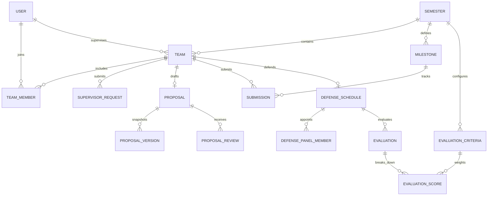

# ATLAS — Academic Thesis Lifecycle & Assessment Suite


> **ATLAS** is a centralized, end-to-end academic thesis, capstone, and dissertation lifecycle management suite developed for universities. Built with **FastAPI**, **SQLAlchemy 2.0**, **PostgreSQL / SQLite**, **Jinja2**, and **TailwindCSS**, it connects Students, Faculty Supervisors, and Program Coordinators through every phase of the academic research lifecycle.

---

## 📑 Table of Contents
1. [Executive Overview & Mental Model](#1-executive-overview--mental-model)
2. [Quick Start & 5-Minute Testing Guide](#2-quick-start--5-minute-testing-guide)
3. [The Three User Roles Explained](#3-the-three-user-roles-explained)
4. [Role-by-Role User Journeys (Step-by-Step Playbooks)](#4-role-by-role-user-journeys-step-by-step-playbooks)
   - [🏛️ The Coordinator Playbook](#-the-coordinator-playbook-academic-administrator)
   - [🎓 The Student Playbook](#-the-student-playbook-thesis-candidate)
   - [👨‍🏫 The Supervisor Playbook](#-the-supervisor-playbook-faculty-mentor--examiner)
5. [The 12-Stage Lifecycle Explained (Deep Dive)](#5-the-12-stage-lifecycle-explained-deep-dive)
6. [Core Technical Innovations & Engines](#6-core-technical-innovations--engines)
   - [Automated Defense Conflict Engine](#a-automated-defense-conflict-detection-engine)
   - [Immutable Proposal Versioning](#b-immutable-proposal-versioning-system)
   - [Server-Side Late Submission Detection](#c-authoritative-server-side-late-detection)
   - [Weighted Multi-Criteria Rubric Engine](#d-weighted-multi-criteria-rubric-math)
   - [Unified Authentication & Dynamic Role Routing](#e-unified-authentication--role-routing)
7. [Role-Based Access Control (RBAC) Matrix](#7-role-based-access-control-rbac-matrix)
8. [Automated Test Suite](#8-automated-test-suite)
9. [Project Structure & Architecture](#9-project-structure--architecture)
10. [Database Schema & Entity Relationships](#10-database-schema--entity-relationships)
11. [Docker Deployment](#11-docker-deployment)
12. [Frequently Asked Questions & Troubleshooting](#12-frequently-asked-questions--troubleshooting)

---

## 1. Executive Overview & Mental Model

In traditional academic departments, managing capstone projects and graduate theses is fraught with friction:
* Proposal drafts and supervisor revisions are scattered across unversioned email threads.
* Students miss deliverables due to inconsistent communication of deadlines.
* Coordinators spend days manually cross-referencing room bookings and professor calendars to schedule oral defense sessions without double-booking.
* Grading criteria are subjective, and computing weighted final scores across multiple defense panelists requires tedious spreadsheet calculations.

**ATLAS solves this by establishing a single source of truth** governed by authoritative server-side state machines, automated conflict detection, and mathematical rubric scoring.

```text
       ┌─────────────────────────────────────────────────────────────┐
       │                   ACADEMIC COORDINATOR                      │
       │    Configures Terms • Assigns Faculty • Schedules Defenses  │
       │             Monitors Rubrics • Publishes Final Grades       │
       └──────────────────────────────┬──────────────────────────────┘
                                      │ Orchestrates
                                      ▼
       ┌─────────────────────────────────────────────────────────────┐
       │                 THE 12-STAGE THESIS LIFECYCLE               │
       │ Team Formation ➔ Proposals ➔ Milestones ➔ Defense ➔ Grades │
       └──────────────▲───────────────────────────────▲──────────────┘
                      │ Submits & Iterates            │ Mentors & Evaluates
       ┌──────────────┴──────────────┐ ┌──────────────┴──────────────┐
       │           STUDENT           │ │         SUPERVISOR          │
       │ Form Teams • Submit Drafts  │ │ Accept Teams • Guide Work   │
       │ Code Repos • Defend Project │ │ Grade Work • Panel Scoring  │
       └─────────────────────────────┘ └─────────────────────────────┘
```

---

## 2. Quick Start & 5-Minute Testing Guide

### Prerequisites
* Python 3.10+ (or virtual environment preconfigured in `.venv`)
* SQLite (built-in default) or PostgreSQL 15+

### Start the Local Server
From the project root directory (`Atlas`):

```powershell
# Windows PowerShell / Command Prompt (Recommended direct execution):
.venv\Scripts\python -m uvicorn main:app --reload --port 8000

# Or activate the virtual environment first:
.venv\Scripts\activate
uvicorn main:app --reload --port 8000

# Linux / macOS:
source .venv/bin/activate
uvicorn main:app --reload --port 8000
```

Once started, open your web browser at:
👉 **[http://localhost:8000](http://localhost:8000)**

---

### Demo Accounts & 1-Click Login
When you visit the login page (`/auth?mode=login`), you will find **1-Click Test Credentials Buttons** at the top of the form that automatically fill in test accounts:

| Role | Email | Password | Pre-loaded State in Database |
|---|---|---|---|
| **🏛️ Coordinator** | `coordinator@atlas.edu` | `Password123` | Full administrative control; manages active semester, defenses, rubrics, and grade registry. |
| **👨‍🏫 Supervisor** | `supervisor1@atlas.edu` | `Password123` | Fatema Jannat Dihan; assigned supervisor of Team Apollo, pending reviews and submissions. |
| **🎓 Student (Leader)** | `student1@atlas.edu` | `Password123` | Tahmid Hasan; leader of Team Apollo (Proposal Approved, Final Grade: A+ published). |
| **🎓 Student (Milestones)** | `student4@atlas.edu` | `Password123` | Rafiul Karim; leader of Team Cipher (Active milestone submissions, SRS graded). |
| **🎓 Student (Unassigned)** | `student10@atlas.edu` | `Password123` | Arifur Rahman; unassigned student ready to create or join a new team. |

*(A full list of pre-seeded accounts is available in [credentials.txt](credentials.txt).)*

---

## 3. The Three User Roles Explained

ATLAS enforces strict Role-Based Access Control (RBAC) divided into three distinct academic personas:

| Role | Badge | Key Responsibilities | Access Boundaries |
|---|:---:|---|---|
| **COORDINATOR** | 🏛️ Admin | Department head or capstone director. Configures academic terms, sets team limits, manages milestones, schedules oral defenses, defines evaluation rubrics, publishes final grades, and audits system logs. | Full access to all administrative dashboards, reports, and audit trails. |
| **SUPERVISOR** | 👨‍🏫 Faculty | Research professor and academic mentor. Accepts or declines student supervision requests, reviews thesis proposals, provides qualitative feedback, grades milestone deliverables, and serves on oral defense examination panels. | Restricted to assigned teams, supervised student proposals, deliverables, and defense panels where they are assigned as panel members. |
| **STUDENT** | 🎓 Candidate | Undergraduate or postgraduate researcher. Creates or joins a capstone team, sends formal supervision requests, drafts and resubmits thesis proposals, uploads code repository links and milestone documents, tracks late penalties, and reviews panel defense feedback. | Strictly scoped to their own team, proposals, deliverables, and assigned defense session. Cannot view other teams' private grades or administrative settings. |

---

## 4. Role-by-Role User Journeys (Step-by-Step Playbooks)

Here is exactly how each user interacts with ATLAS during an academic term:

```
┌────────────────────────────────────────────────────────────────────────────────────────────────────────┐
│                                       ATLAS USER JOURNEY MAP                                           │
│                                                                                                        │
│  COORDINATOR        [1. Semester Setup] ───> [2. Set Milestones] ──────> [3. Defense & Panels] ──> [4. Publish Grades] │
│                           │                         │                          │                      │        │
│  STUDENT                  ├──> [Form Team] ───────> ├──> [Submit Proposal] ──> ├──> [Submit Work] ───> ├──> [View Grade]│
│                           │         │               │          │               │         │            │        │
│  SUPERVISOR               └─────────┴─> [Accept] ───┴──────────┴─> [Approve] ──┴─────────┴─> [Grade] ─┴────────┘       │
└────────────────────────────────────────────────────────────────────────────────────────────────────────┘
```

---

### 🏛️ The Coordinator Playbook (Academic Administrator)

1. **Step 1 — Create and Activate Semester**:
   * Navigate to **Semesters** (`/dashboard/semesters`).
   * Click **Create Semester**, specify the term code (e.g., `Fall 2026`), academic year (`2026-2027`), and team limits (`min_team_size: 1`, `max_team_size: 4`).
   * Click **Set as Active**. All subsequent teams and student submissions will belong to this semester.
2. **Step 2 — Establish Milestone Deliverables**:
   * Navigate to **Milestones** (`/dashboard/milestones`).
   * Click **Create Milestone** to define the term's required checkpoints:
     * *Software Requirements Specification (SRS)* (Deadline + Max Score: 100)
     * *Midterm Progress & Architecture* (Deadline + Max Score: 100)
     * *Final Implementation & Codebase* (Deadline + Max Score: 100)
3. **Step 3 — Configure Departmental Grading Rubrics**:
   * Navigate to **Evaluations / Rubrics** (`/dashboard/evaluations`).
   * Define institutional evaluation criteria with percentage weights:
     * *Problem Formulation & Literature Review* (20%)
     * *System Architecture & Code Quality* (30%)
     * *Documentation & Report* (20%)
     * *Oral Presentation & Viva Defense* (30%)
   * ATLAS automatically validates that the sum of criteria weights equals 100%.
4. **Step 4 — Schedule Oral Defenses (With Conflict Protection)**:
   * Navigate to **Oral Defenses** (`/dashboard/defense`).
   * Click **Schedule Defense**, select the Team, Date, Start Time, End Time, and Examination Room (e.g., `Room CS-301`).
   * Assign Faculty Panelists: **Defense Chair**, **Internal Examiner**, and **External Examiner**.
   * If a room or professor is already booked for another defense at an overlapping time, ATLAS rejects the schedule immediately and displays the exact conflicting session.
5. **Step 5 — Publish Final Grades**:
   * Navigate to **Grade Registry** (`/dashboard/grades`).
   * Review computed weighted scores across all defense panel evaluations.
   * Click **Publish Grade** to finalize the grade and release it to the student dashboard.
6. **Step 6 — Export Departmental Reports**:
   * Navigate to **Reports** (`/dashboard/reports`) to export one-click CSV reports for faculty records, accreditation, and university registries.

---

### 🎓 The Student Playbook (Thesis Candidate)

1. **Step 1 — Register or Sign In**:
   * Sign in using your student account (`/auth?mode=login`).
   * *New Student?* Click **Create Account**, enter your name, institutional email, and select the **Student** role. Your account is immediately activated.
2. **Step 2 — Form or Join a Team**:
   * Navigate to **My Team** (`/dashboard/teams`).
   * **Option A (Create Team)**: Click **Create Team**, enter your project title and proposed domain. You are designated as **Team Leader** and receive a unique 6-character invite code (e.g., `K9X2LP`).
   * **Option B (Join Team)**: Enter your team leader's invite code to join an existing team. ATLAS ensures the team cannot exceed the maximum member limit.
3. **Step 3 — Request a Faculty Supervisor**:
   * On your team detail page, browse the list of available faculty members and their research areas.
   * Click **Request Supervisor**, write a short summary of your topic, and send the request.
   * Wait for the faculty member to review and accept your request.
4. **Step 4 — Draft and Submit Proposal (v1)**:
   * Once your supervisor is assigned, navigate to **Proposals** (`/dashboard/proposals`).
   * Enter your formal Project Title, Abstract, Problem Statement, and Methodology.
   * Click **Submit Proposal**. ATLAS creates an immutable `Version 1` snapshot and notifies your supervisor.
5. **Step 5 — Handle Changes and Resubmit (v2, v3)**:
   * If your supervisor requests revisions, your proposal status changes to `CHANGES_REQUESTED`.
   * Review your supervisor's specific written feedback.
   * Edit your proposal, provide a **Summary of Changes**, and click **Submit Revision**.
   * ATLAS creates `Version 2`. Previous versions remain permanently archived in your revision history.
6. **Step 6 — Submit Milestones & Deliverables**:
   * Navigate to **Milestones** (`/dashboard/submissions`).
   * For each active milestone (e.g., *SRS*, *Midterm Progress*, *Final Code*):
     * Upload your PDF deliverable and/or paste your public GitHub repository URL.
     * Click **Submit Deliverable**.
     * ATLAS validates the server timestamp against the milestone deadline. Submissions made before the deadline are marked `SUBMITTED`; submissions after the deadline are automatically flagged `LATE`.
7. **Step 7 — Prepare for Defense & View Final Grade**:
   * View your scheduled defense date, time, examination room, and panel members on your dashboard.
   * After the defense, view your published letter grade (e.g., `A+`), numerical score, and detailed rubric score breakdown.

---

### 👨‍🏫 The Supervisor Playbook (Faculty Mentor & Examiner)

1. **Step 1 — Review Supervision Requests**:
   * Navigate to **Supervision Requests** (`/dashboard/requests`).
   * View pending student team requests, proposed topics, and student member lists.
   * Click **Accept** to become the official supervisor, or **Decline** with notes.
2. **Step 2 — Review & Approve Proposals**:
   * Navigate to **Proposals** (`/dashboard/proposals`).
   * Open the submitted proposal to review the abstract, methodology, and document.
   * Submit an evaluation decision:
     * **Approve**: Unlocks the project for milestone deliverables.
     * **Request Changes**: Enter bullet points detailing required revisions.
     * **Reject**: Closes the proposal.
3. **Step 3 — Grade Milestone Deliverables**:
   * Navigate to **Submissions** (`/dashboard/submissions`).
   * Review submitted student reports and click GitHub repository URLs to inspect the source code.
   * Enter a numerical score (e.g., `88 / 100`) and constructive qualitative feedback.
   * Click **Submit Review**. The student receives an instant grade notification.
4. **Step 4 — Conduct Oral Defense & Multi-Criteria Rubric Scoring**:
   * Navigate to **Oral Defenses** (`/dashboard/defense`) to check your upcoming panel examinations.
   * During the defense session, open **Evaluations** (`/dashboard/evaluations`).
   * Enter individual scores for each institutional rubric criterion (Problem Formulation, Architecture, Report, Viva Defense).
   * Submit the evaluation. ATLAS computes the weighted total and stores the panel feedback.

---

## 5. The 12-Stage Lifecycle Explained (Deep Dive)

The entire academic process follows an enforced 12-stage state machine:

```
  Stage 1: Semester Initialization (Coordinator)
     │
  Stage 2: Team Creation & Invite Code Generation (Student Leader)
     │
  Stage 3: Teammate Enrollment via Invite Code (Student Members)
     │
  Stage 4: Formal Supervision Request (Student Leader)
     │
  Stage 5: Supervisor Acceptance or Administrative Assignment (Supervisor / Coordinator)
     │
  Stage 6: Proposal Drafting & Initial Submission (v1) (Student Team)
     │
  Stage 7: Proposal Review & Changes Requested (Supervisor)
     │
  Stage 8: Revision Drafting & Resubmission (v2, v3) (Student Team)
     │
  Stage 9: Proposal Approval (Supervisor) ➔ Unlocks Milestone Phase
     │
  Stage 10: Milestone Deliverables & Server-Side Late Detection (Students)
     │
  Stage 11: Supervisor Milestone Grading & Code Review (Supervisor)
     │
  Stage 12: Oral Defense Scheduling with Automated Conflict Engine (Coordinator)
     │
  Stage 13: Multi-Criteria Rubric Scoring by Panel Members (Faculty Panelists)
     │
  Stage 14: Final Grade Calculation & Official Publication (Coordinator)
```

| Stage | Name | Description | Key Database State Change |
|:---:|---|---|---|
| **1** | **Semester Initialization** | Coordinator sets the active academic year and enforces team size constraints (`min_team_size`, `max_team_size`). | `Semester.is_active = True` |
| **2** | **Team Formation** | Student creates a team; server automatically designates the creator as `LEADER` and generates an invite code. | `Team.status = FORMING`, `TeamMember.role = LEADER` |
| **3** | **Teammate Enrollment** | Peers join the team using the invite code; server verifies team capacity before adding members. | `TeamMember.role = MEMBER` |
| **4** | **Supervision Request** | Team Leader selects a faculty member and submits research preliminary notes. | `SupervisorRequest.status = PENDING`, `Team.status = SUPERVISOR_REQUESTED` |
| **5** | **Supervisor Acceptance** | Faculty member accepts; team is assigned to the supervisor. | `SupervisorRequest.status = ACCEPTED`, `Team.supervisor_id = User.id`, `Team.status = SUPERVISOR_ASSIGNED` |
| **6** | **Proposal v1 Submission** | Team drafts title, abstract, methodology; submitting saves an immutable version snapshot. | `Proposal.status = SUBMITTED`, `ProposalVersion.version_number = 1` |
| **7** | **Proposal Review** | Supervisor reviews v1 and requests revisions with itemized feedback. | `ProposalReview.decision = CHANGES_REQUESTED`, `Proposal.status = CHANGES_REQUESTED` |
| **8** | **Proposal Resubmission** | Team submits revisions with a summary of changes; server increments the version number. | `ProposalVersion.version_number = 2`, `Proposal.status = SUBMITTED` |
| **9** | **Proposal Approval** | Supervisor marks proposal as approved, unlocking the milestone submission phase. | `Proposal.status = APPROVED`, `Team.status = IN_PROGRESS` |
| **10** | **Milestone Submissions** | Students upload documents and repository links. Server compares UTC time against deadline. | `Submission.status = SUBMITTED` (or `LATE` if `now > deadline`), `Submission.is_late = True/False` |
| **11** | **Supervisor Grading** | Supervisor inspects code repository and report, assigns a score, and provides written feedback. | `Submission.status = REVIEWED`, `Submission.score = X` |
| **12** | **Defense Scheduling** | Coordinator schedules examination session; conflict engine validates room and faculty availability. | `DefenseSchedule.status = SCHEDULED`, `DefensePanelMember.role = CHAIR/INTERNAL/EXTERNAL` |
| **13** | **Rubric Evaluation** | Panel members grade defense performance across weighted criteria. | `Evaluation.status = SUBMITTED`, `EvaluationScore.score = X` |
| **14** | **Grade Publication** | System computes weighted average score and maps to letter grade; Coordinator publishes official results. | `Team.status = COMPLETED`, `Team.final_grade = "A+"`, `Team.final_score = 94.5` |

---

## 6. Core Technical Innovations & Engines

### A. Automated Defense Conflict Detection Engine
Located in `api/v1/services/defense.py`, the defense scheduler prevents common scheduling mistakes:
1. **Room Overlap**: Ensures the selected examination room is not booked by another team during the requested time window (`start_time` to `end_time`).
2. **Panel Member Overlap**: Ensures that no assigned faculty member (Chair, Internal Examiner, or External Examiner) is scheduled to attend another defense during that window.
3. **Team Overlap**: Ensures that the defending team does not have another examination session booked simultaneously.

If any conflict is detected, ATLAS cancels the operation and returns an HTTP `409 Conflict` error explaining the exact room or professor conflict.

```python
# Real conflict detection logic (simplified snippet from DefenseService):
existing = db.query(DefenseSchedule).filter(
    DefenseSchedule.scheduled_date == scheduled_date,
    DefenseSchedule.room == room,
    DefenseSchedule.id != defense_id,
    DefenseSchedule.start_time < end_time,
    DefenseSchedule.end_time > start_time
).first()
if existing:
    raise ConflictException(f"Room {room} is already booked from {existing.start_time} to {existing.end_time}")
```

---

### B. Immutable Proposal Versioning System
Located in `api/v1/services/proposal.py`, every proposal submission and revision is recorded as a distinct, immutable `ProposalVersion` database record.
* Changes requested by a supervisor do not overwrite the original draft.
* Students submit revisions alongside a `change_summary`.
* Both faculty and students can view a complete chronological timeline comparing `v1`, `v2`, and `v3` drafts, including timestamps, abstract changes, and document revisions.

---

### C. Authoritative Server-Side Late Detection
Located in `api/v1/services/submission.py`, deadline enforcement is handled strictly on the backend:
* When a student submits a deliverable, the server queries the active `Milestone.deadline` and compares it with the server's current UTC time.
* If `submission_time > milestone.deadline`:
  * `submission.is_late` is set to `True`.
  * `submission.status` is set to `LATE`.
* Client-side clock tampering or browser timezone manipulation cannot bypass the late flag.

---

### D. Weighted Multi-Criteria Rubric Math
Located in `api/v1/services/evaluation.py`, grades are calculated using weighted institutional criteria:

$$\text{Final Score} = \sum_{i=1}^{n} \left( \frac{\text{Score}_i}{\text{MaxScore}_i} \times \text{Weight}_i \right)$$

The computed percentage is mapped to standard academic letter grades:
* $\ge 90\% \rightarrow \textbf{A+}$
* $\ge 85\% \rightarrow \textbf{A}$
* $\ge 80\% \rightarrow \textbf{A-}$
* $\ge 75\% \rightarrow \textbf{B+}$
* $\ge 70\% \rightarrow \textbf{B}$
* $\ge 65\% \rightarrow \textbf{B-}$
* $\ge 60\% \rightarrow \textbf{C+}$
* $\ge 50\% \rightarrow \textbf{C}$
* $< 50\% \rightarrow \textbf{F}$

---

### E. Unified Authentication & Role Routing
Located in `api/v1/routes/auth.py` and `frontend/app/pages/auth/role_auth.html`:
* **Role-Agnostic Login**: Users do not need to guess which portal to use. All users enter their email and password into the unified login form.
* **Backend Role Verification**: Upon verifying password hashes via `passlib/bcrypt`, the backend reads the user's role (`COORDINATOR`, `SUPERVISOR`, or `STUDENT`) directly from the database record and signs a secure JWT token containing the `role` claim.
* **Automatic Redirection**: The browser receives the token and role, immediately routing the user to their designated dashboard workspace:
  * `COORDINATOR` $\rightarrow$ `/dashboard/overview` (Administrative Overview, Semesters, Defenses)
  * `SUPERVISOR` $\rightarrow$ `/dashboard/overview` (Supervised Teams, Pending Proposals, Submissions)
  * `STUDENT` $\rightarrow$ `/dashboard/overview` (My Team, Proposal Status, Deliverables)

---

## 7. Role-Based Access Control (RBAC) Matrix

RBAC is enforced authoritatively at the route level via FastAPI dependencies (`_require_coordinator`, `_require_supervisor`, `_require_student`). Any attempt to bypass the UI receives an immediate `403 Forbidden`.

| Capability / Resource | 🎓 Student | 👨‍🏫 Supervisor | 🏛️ Coordinator | Enforcement Dependency / Service |
|---|:---:|:---:|:---:|---|
| **Semester Creation & Management** | ❌ | ❌ | ✅ | `_require_coordinator` |
| **Create Team & Generate Invite Code** | ✅ | ❌ | ❌ | `_require_student` |
| **Join Team via Invite Code** | ✅ | ❌ | ❌ | `_require_student` |
| **Send Supervision Request** | ✅ (Leader) | ❌ | ❌ | `TeamService.request_supervisor` |
| **Accept / Decline Supervision** | ❌ | ✅ | ❌ | `_require_supervisor` + Request Ownership |
| **Assign Supervisor Administratively** | ❌ | ❌ | ✅ | `_require_coordinator` |
| **Draft & Resubmit Thesis Proposals** | ✅ | ❌ | ❌ | `ProposalService.submit_proposal` |
| **Approve / Request Changes on Proposal** | ❌ | ✅ | ✅ (Override) | `ProposalService.review_proposal` |
| **Create Milestones & Set Deadlines** | ❌ | ❌ | ✅ | `_require_coordinator` |
| **Upload Deliverables & Code URLs** | ✅ | ❌ | ❌ | `SubmissionService.create_submission` |
| **Grade Milestones & Submit Feedback** | ❌ | ✅ | ✅ (Override) | `SubmissionService.grade_submission` |
| **Schedule Oral Defense Sessions** | ❌ | ❌ | ✅ | `DefenseService.schedule_defense` |
| **Submit Oral Defense Rubric Scores** | ❌ | ✅ (Panel) | ✅ | `EvaluationService.submit_evaluation` |
| **Configure Departmental Rubrics** | ❌ | ❌ | ✅ | `_require_coordinator` |
| **Publish Official Final Grades** | ❌ | ❌ | ✅ | `_require_coordinator` |
| **Export Academic CSV Reports** | ❌ | ❌ | ✅ | `_require_coordinator` |
| **Inspect System Security Audit Logs** | ❌ | ❌ | ✅ | `_require_coordinator` |

---

## 8. Automated Test Suite

ATLAS includes an automated test suite verifying all core security, scheduling, and lifecycle rules:

```powershell
.venv\Scripts\python -m pytest -v tests/
```

### Test Suite Results (17 Passed / 100% Pass Rate):
```text
tests/test_auth_rbac.py::test_login_successful PASSED                    [  5%]
tests/test_auth_rbac.py::test_login_invalid_credentials PASSED           [ 11%]
tests/test_auth_rbac.py::test_rbac_student_blocked_from_coordinator_endpoints PASSED [ 17%]
tests/test_auth_rbac.py::test_rbac_supervisor_blocked_from_semesters_management PASSED [ 23%]
tests/test_auth_rbac.py::test_student_registration_and_login PASSED      [ 29%]
tests/test_defense_conflict.py::test_defense_scheduling_and_room_conflict PASSED [ 35%]
tests/test_defense_conflict.py::test_defense_panel_member_conflict PASSED [ 41%]
tests/test_evaluations_rubrics.py::test_rubrics_evaluation_and_grade_calculation PASSED [ 47%]
tests/test_evaluations_rubrics.py::test_score_validation_exceeding_max PASSED [ 52%]
tests/test_milestones_submissions.py::test_milestone_and_submission_lifecycle PASSED [ 58%]
tests/test_milestones_submissions.py::test_late_submission_server_side_detection PASSED [ 64%]
tests/test_proposals.py::test_proposal_lifecycle_and_versioning PASSED   [ 70%]
tests/test_proposals.py::test_proposal_invalid_state_transition PASSED   [ 76%]
tests/test_teams.py::test_team_creation_and_leader PASSED                [ 82%]
tests/test_teams.py::test_single_active_team_rule PASSED                 [ 88%]
tests/test_teams.py::test_team_member_addition_and_limit PASSED          [ 94%]
tests/test_teams.py::test_supervisor_request_and_approval PASSED         [100%]
======================= 17 passed in 28.60s =======================
```

---

## 9. Project Structure & Architecture

```text
Atlas/
├── api/
│   └── v1/
│       ├── models/              # 25 SQLAlchemy 2.0 Declarative Models
│       │   ├── user.py          # User accounts, Roles, Hashes
│       │   ├── semester.py      # Academic terms, Team size rules
│       │   ├── team.py          # Teams, TeamMembers, Invite codes
│       │   ├── proposal.py      # Proposals, Versions, Reviews
│       │   ├── milestone.py     # Milestones, Deliverable deadlines
│       │   ├── submission.py    # Submissions, Late flags, Scores
│       │   ├── defense.py       # Defense schedules, Panel members
│       │   ├── evaluation.py    # Rubric criteria, Panel scores
│       │   └── audit.py         # System security audit logs
│       ├── routes/              # FastAPI Route Handlers
│       │   ├── auth.py          # Login, Register, JWT Cookies
│       │   └── dashboard/       # 103 Dashboard endpoints across all 12 stages
│       └── services/            # Business Logic & Validation Engines
│           ├── defense.py       # Room & Panel conflict detection
│           ├── proposal.py      # Version snapshot engine
│           ├── submission.py    # Server-side late validator
│           ├── evaluation.py    # Weighted rubric score engine
│           └── report.py        # One-click CSV export engine
├── frontend/
│   └── app/
│       ├── components/          # Reusable Jinja2 UI Components (Navbar, Sidebar)
│       └── pages/               # Server-Rendered Jinja2 Templates
│           ├── auth/            # Unified Login & Registration with Demo Autofill
│           └── dashboard/       # 12-Stage Dashboard Views (Teams, Proposals, Defenses...)
├── scripts/
│   └── seeders/
│       └── seed_atlas.py        # Comprehensive database seeding script
├── tests/                       # Pytest Automated Test Suite (17 Tests)
├── credentials.txt              # Testing credentials and startup cheat sheet
├── main.py                      # FastAPI Application Entrypoint
└── requirements.txt             # Python Package Dependencies
```

---

## 10. Database Schema & Entity Relationships



---

## 11. Docker Deployment

To deploy ATLAS with a production-grade PostgreSQL 15 database:

```bash
# 1. Build and start containers:
docker compose up --build -d

# 2. Run database migrations:
docker compose exec web alembic upgrade head

# 3. Seed initial database records:
docker compose exec web python scripts/seeders/seed_atlas.py
```

The application will be live at `http://localhost:8000`.

---

## 12. Frequently Asked Questions & Troubleshooting

### Q: Why do I get `'uvicorn' is not recognized` when running in PowerShell?
**A:** Uvicorn is installed inside the project's virtual environment. Run the Python executable directly from the `.venv` directory:
```powershell
.venv\Scripts\python -m uvicorn main:app --reload --port 8000
```

### Q: How do I know which role I am logging into?
**A:** Sign-in is unified. The backend reads your account role directly from the database and automatically redirects you to the proper dashboard. You can use the **1-Click Test Buttons** on `/auth?mode=login` to switch between Coordinator, Supervisor, and Student personas.

### Q: Can a student create multiple active teams?
**A:** No. ATLAS enforces a database and service-level constraint: a student can belong to only one active team per semester.

### Q: What prevents students from claiming they submitted before the deadline?
**A:** Submissions are validated against the server's authoritative UTC clock at the exact millisecond the request reaches the API. If the server timestamp exceeds the milestone deadline, `is_late` is set to `True` permanently.

### Q: How do I reset the database to a fresh state?
**A:** You can re-run the seed script at any time:
```powershell
.venv\Scripts\python scripts/seeders/seed_atlas.py
```

---

## 13. License & Academic Attribution
Developed as an enterprise-grade Academic Thesis Lifecycle & Assessment Suite (ATLAS).  
All rights reserved. Designed for university departments and academic institutions.