# ATLAS — Complete Architectural, Data Flow & Modeling Diagrams
**Academic Thesis Lifecycle & Assessment Suite**  
*Comprehensive Software Engineering Diagrammatic Reference Manual*

---

## Document Overview

This manual provides an exhaustive, formal diagrammatic record of **ATLAS (Academic Thesis Lifecycle & Assessment Suite)**. It brings together all architectural, behavioral, structural, and data models required for university software engineering evaluations, technical documentation, and oral defense presentations.

Every diagram is rendered using standardized **Mermaid syntax** for direct visualization in GitHub, IDEs, and Markdown renderers, accompanied by formal entity definitions, data dictionaries, and source code cross-references.

---

## Table of Contents

1. [System Context & Data Flow Diagrams (DFD)](#1-system-context--data-flow-diagrams-dfd)
   - 1.1 Level 0 DFD (Context Diagram)
   - 1.2 Level 1 DFD (Subsystem Decomposition)
   - 1.3 Level 2 DFD: Subsystem 3.0 (Proposal Lifecycle & Review)
   - 1.4 Level 2 DFD: Subsystem 5.0 (Oral Defense & Collision Engine)
   - 1.5 Level 2 DFD: Subsystem 6.0 (Rubric Assessment & Grade Publishing)
2. [Use Case Models & Actor Specifications](#2-use-case-models--actor-specifications)
   - 2.1 Master System Use Case Diagram
   - 2.2 Student Subsystem Use Cases
   - 2.3 Faculty Supervisor Subsystem Use Cases
   - 2.4 Department Coordinator Subsystem Use Cases
3. [Database & Entity-Relationship (ER) Models](#3-database--entity-relationship-er-models)
   - 3.1 Conceptual Entity-Relationship Diagram
   - 3.2 Complete Logical / Physical ER Diagram (Crow's Foot Notation)
4. [Architectural, Component & Deployment Diagrams](#4-architectural-component--deployment-diagrams)
   - 4.1 High-Level Multi-Tier System Architecture
   - 4.2 Mobile Client Component Diagram (Riverpod Architecture)
   - 4.3 Backend Service Component Diagram
   - 4.4 Physical Deployment & Infrastructure Topology
   - 4.5 End-to-End Request/Response Middleware Pipeline
5. [Dynamic Sequence Diagrams (Core Workflows)](#5-dynamic-sequence-diagrams-core-workflows)
   - 5.1 Dual-Token Authentication & Refresh Lifecycle
   - 5.2 Team Formation & Member Invite Acceptance
   - 5.3 Supervisor Pitch & Two-Sided Agreement
   - 5.4 Multi-Round Proposal Review & Version Increment
   - 5.5 Milestone Submission & Qualitative Feedback
   - 5.6 Oral Defense Scheduling with Automated Collision Detection
   - 5.7 Rubric-Based Defense Evaluation & Grade Publishing
   - 5.8 Elevated Sudo Coordinator Creation (Option A)
   - 5.9 Push Notification Dispatch via Firebase Cloud Messaging
6. [State Machine & Lifecycle Diagrams](#6-state-machine--lifecycle-diagrams)
   - 6.1 Proposal Lifecycle Statechart
   - 6.2 Master Team Lifecycle Statechart
   - 6.3 Milestone & Deliverable Lifecycle Statechart
   - 6.4 Oral Defense Hearing Statechart
7. [Activity Diagrams & Algorithmic Flowcharts](#7-activity-diagrams--algorithmic-flowcharts)
   - 7.1 Authentication & Authorization Verification Flowchart
   - 7.2 Proposal Review Decision Logic Flowchart
   - 7.3 Oral Defense Collision Prevention Algorithm
   - 7.4 Weighted Grade Aggregation & Transcript Calculation
   - 7.5 Elevated Sudo Coordinator Creation Flowchart (Option A)
8. [Class Diagrams & Object-Oriented Models](#8-class-diagrams--object-oriented-models)
   - 8.1 Core Domain SQLAlchemy Model Class Diagram
   - 8.2 Flutter Mobile Architecture Class Diagram
9. [Security & Access Control Architecture](#9-security--access-control-architecture)
   - 9.1 Dual-Token Security Architecture
   - 9.2 RBAC vs. Object-Level Authorization Matrix

---

## 1. System Context & Data Flow Diagrams (DFD)

Data Flow Diagrams illustrate how information enters, flows through, and exits the ATLAS ecosystem.

### 1.1 Level 0 DFD (Context Diagram)

The Level 0 context diagram defines the boundary of the ATLAS system, showing external entities and primary inbound/outbound data streams.

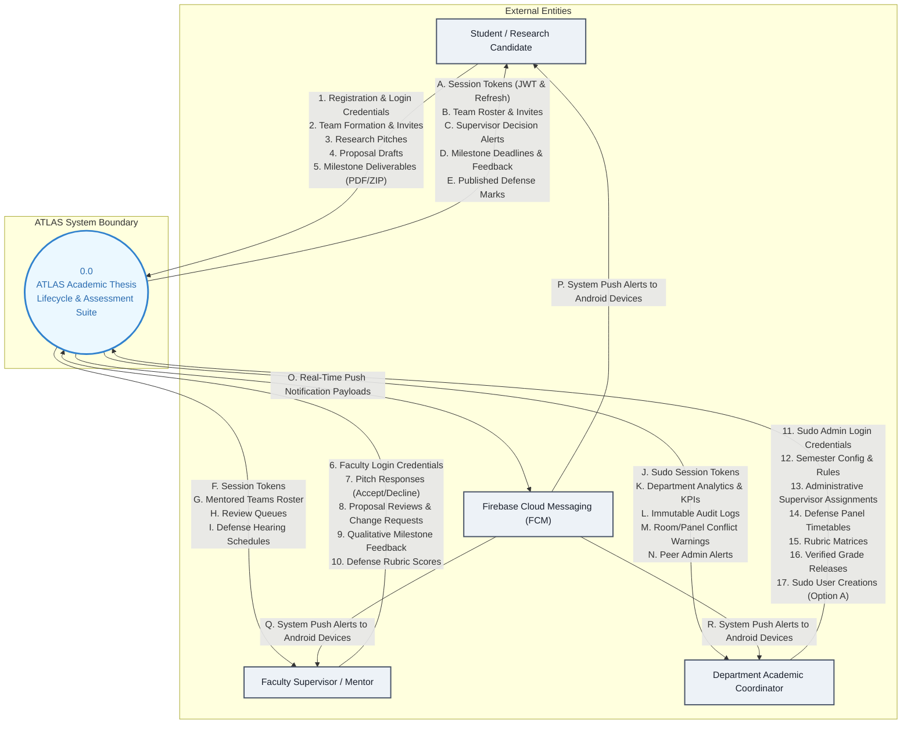

---

### 1.2 Level 1 DFD (Subsystem Decomposition)

The Level 1 DFD decomposes the ATLAS core into seven major processes and connects them with the nine authoritative data stores.

```mermaid
flowchart TD
    %% Entities
    Student["Student"]
    Supervisor["Supervisor"]
    Coordinator["Coordinator"]

    %% Data Stores
    D1[("D1: Users & Auth Tokens")]
    D2[("D2: Semesters & Teams")]
    D3[("D3: Proposals & Versions")]
    D4[("D4: Milestones")]
    D5[("D5: Submissions")]
    D6[("D6: Defense Schedules")]
    D7[("D7: Rubrics & Scores")]
    D8[("D8: Audit Logs")]
    D9[("D9: System Notifications")]

    %% Processes
    P1(("1.0<br/>Identity &<br/>Token Service"))
    P2(("2.0<br/>Team & Supervision<br/>Management"))
    P3(("3.0<br/>Proposal Drafting<br/>& Review Engine"))
    P4(("4.0<br/>Milestone &<br/>Submission Tracker"))
    P5(("5.0<br/>Oral Defense<br/>Collision Engine"))
    P6(("6.0<br/>Rubric Assessment<br/>& Grade Publisher"))
    P7(("7.0<br/>Department Admin<br/>& Audit Trail"))

    %% Auth Flow
    Student -->|"Credentials"| P1
    Supervisor -->|"Credentials"| P1
    Coordinator -->|"Sudo Credentials"| P1
    P1 <-->|"Verify / Issue Tokens"| D1
    P1 -->|"Log Access"| D8

    %% Team & Supervision
    Student -->|"Create Team / Join Code / Pitch"| P2
    Supervisor -->|"Accept / Decline Pitch"| P2
    Coordinator -->|"Administrative Assignment"| P2
    P2 <-->|"Rosters & Assignments"| D2
    P2 -->|"Trigger Alerts"| D9
    P2 -->|"Log Event"| D8

    %% Proposal
    Student -->|"Draft & Submit v1..vN"| P3
    Supervisor -->|"Review / Request Changes / Approve"| P3
    P3 <-->|"Store Versions & Comments"| D3
    P3 -->|"Update Status"| D2
    P3 -->|"Trigger Alerts"| D9
    P3 -->|"Log Event"| D8

    %% Milestone & Submissions
    Coordinator -->|"Create Milestones & Deadlines"| P4
    Student -->|"Upload Files & Remarks"| P4
    Supervisor -->|"Review & Grade Submissions"| P4
    P4 <-->|"Manage Milestones"| D4
    P4 <-->|"Store Files & Remarks"| D5
    P4 -->|"Trigger Alerts"| D9

    %% Oral Defense
    Coordinator -->|"Schedule Panel, Room, Date"| P5
    P5 <-->|"Check Room / Examiner Overlaps"| D6
    P5 -->|"Publish Timetable"| D9
    P5 -->|"Log Event"| D8

    %% Rubric & Grading
    Coordinator -->|"Define Criteria & Weights"| P6
    Supervisor -->|"Submit Defense Scores"| P6
    Coordinator -->|"Publish Final Grades"| P6
    P6 <-->|"Store Rubrics & Marks"| D7
    P6 -->|"Update Team Grade"| D2
    P6 -->|"Grade Published Notification"| D9
    P6 -->|"Log Event"| D8

    %% Admin & Audit
    Coordinator -->|"Elevated User Creation (Option A)"| P7
    P7 <-->|"Create Supervisor/Coordinator"| D1
    P7 -->|"Irrevocable Audit Record"| D8
    P7 -->|"Broadcast Peer Alerts"| D9

    classDef store fill:#FFF5F5,stroke:#E53E3E,stroke-width:1.5px,color:#9B2C2C;
    classDef process fill:#EBF8FF,stroke:#3182CE,stroke-width:2px,color:#2B6CB0;
    class D1,D2,D3,D4,D5,D6,D7,D8,D9 store;
    class P1,P2,P3,P4,P5,P6,P7 process;
```

---

### 1.3 Level 2 DFD: Subsystem 3.0 (Proposal Lifecycle & Review)

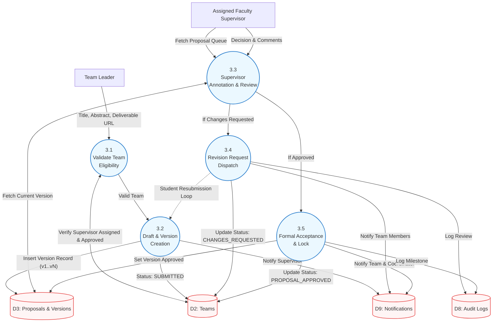

---

### 1.4 Level 2 DFD: Subsystem 5.0 (Oral Defense & Collision Engine)

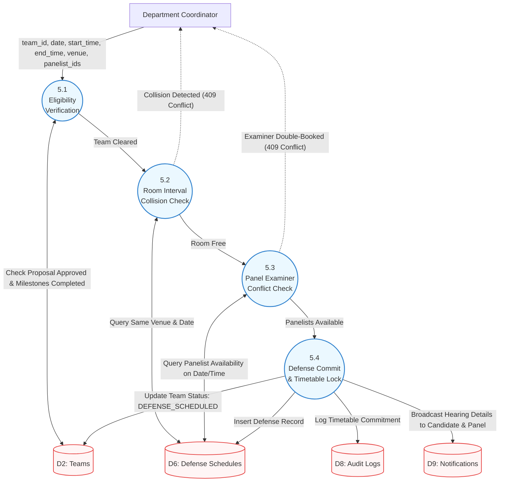

---

### 1.5 Level 2 DFD: Subsystem 6.0 (Rubric Assessment & Grade Publishing)

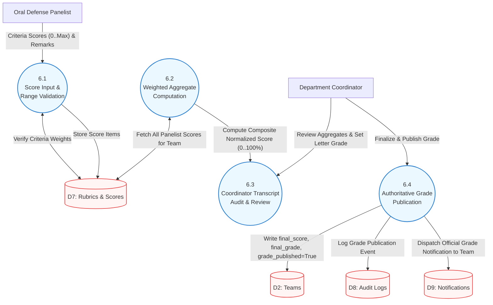

---

## 2. Use Case Models & Actor Specifications

### 2.1 Master System Use Case Diagram

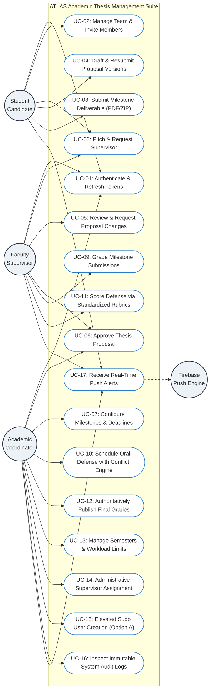

---

### 2.2 Student Subsystem Use Cases

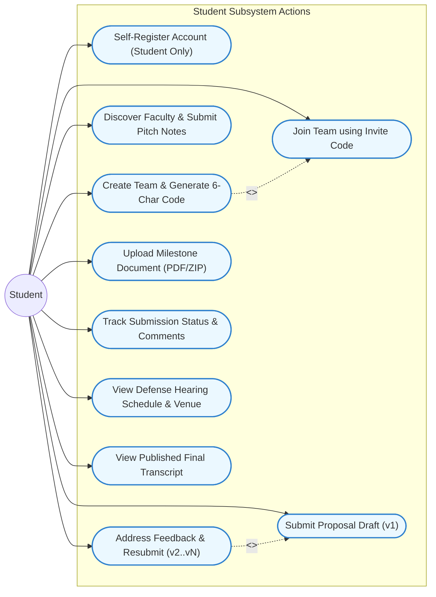

---

### 2.3 Faculty Supervisor Subsystem Use Cases

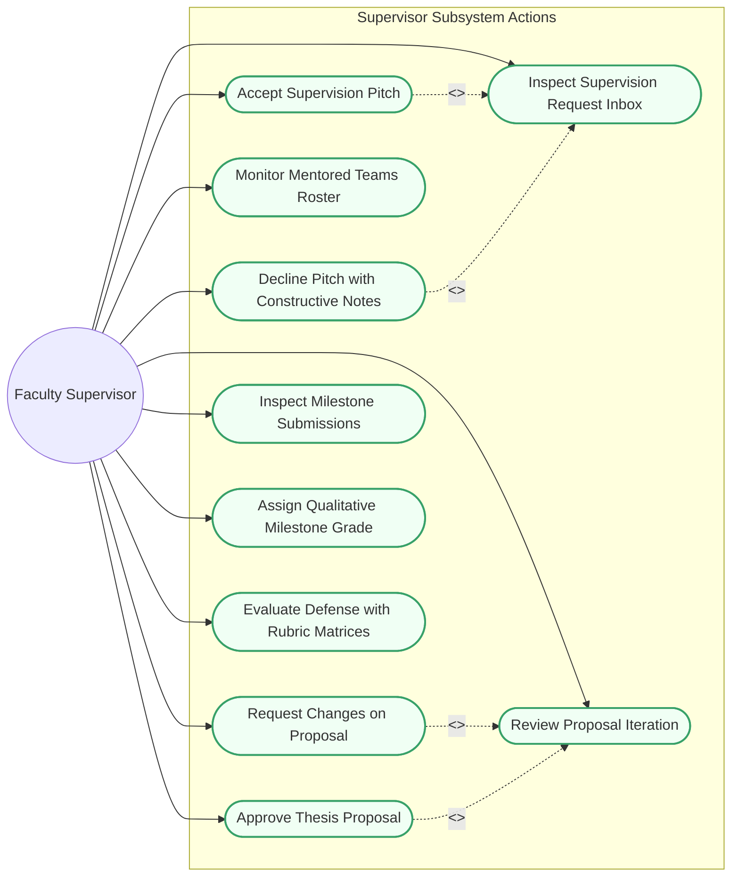

---

### 2.4 Department Coordinator Subsystem Use Cases

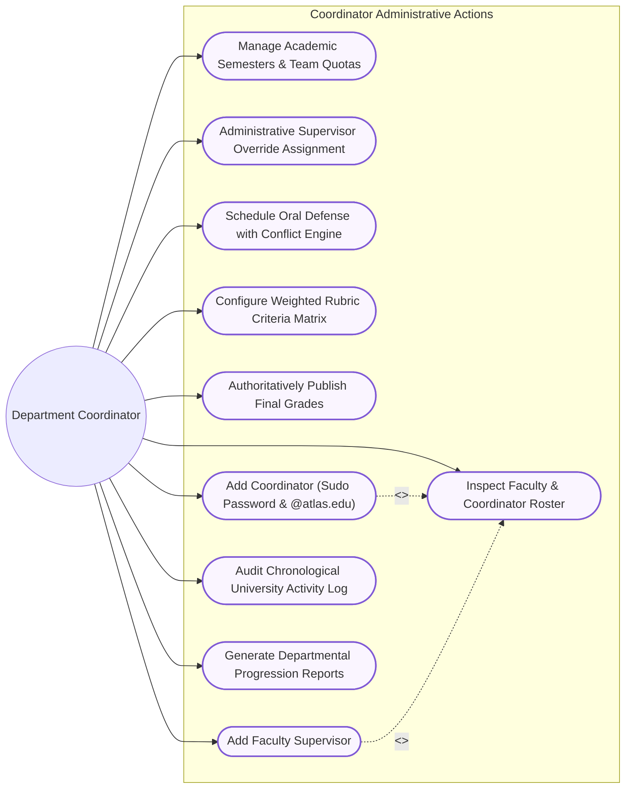

---

## 3. Database & Entity-Relationship (ER) Models

The ATLAS database is engineered around relational integrity, normalized relations, and foreign-key constraints.

### 3.1 Conceptual Entity-Relationship Diagram

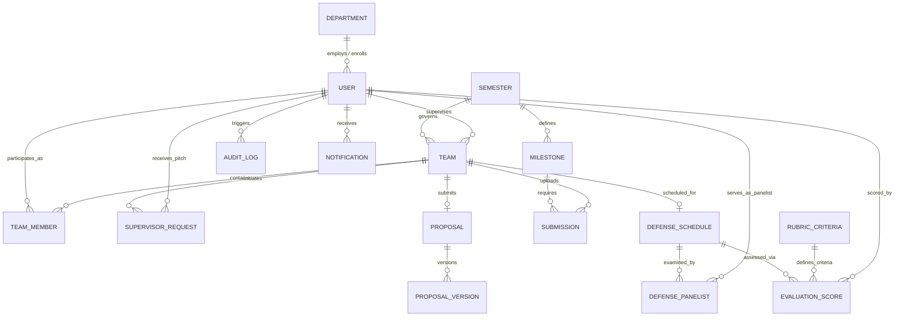

---

### 3.2 Complete Logical / Physical ER Diagram (Crow's Foot Notation)

```mermaid
erDiagram
    users {
        string id PK "UUID"
        string first_name "NOT NULL"
        string last_name "NOT NULL"
        string email UK "NOT NULL, Indexed"
        string password "BCrypt Hash"
        string role "student | supervisor | coordinator | admin"
        string department_id FK "Nullable"
        boolean is_active "Default TRUE"
        datetime last_login "Nullable"
        datetime created_at "UTC Timestamp"
        datetime updated_at "UTC Timestamp"
        boolean is_deleted "Soft Delete"
    }

    departments {
        string id PK "UUID"
        string name UK "NOT NULL"
        string code UK "NOT NULL"
        string head_id FK "Nullable"
        boolean is_deleted "Soft Delete"
    }

    semesters {
        string id PK "UUID"
        string name "e.g. Fall 2026"
        string academic_year "e.g. 2026-2027"
        date start_date "NOT NULL"
        date end_date "NOT NULL"
        integer min_team_size "Default 2"
        integer max_team_size "Default 4"
        boolean is_active "Default FALSE"
        boolean is_deleted "Soft Delete"
    }

    teams {
        string id PK "UUID"
        string name UK "NOT NULL"
        string project_title "NOT NULL"
        string description "Nullable"
        string leader_id FK "NOT NULL"
        string supervisor_id FK "Nullable"
        string semester_id FK "NOT NULL"
        string department_id FK "Nullable"
        string status "forming | supervisor_requested | supervisor_assigned | proposal_submitted | proposal_approved | in_progress | defense_scheduled | completed"
        string invite_code UK "6-char Alphanumeric"
        float final_score "0.0 .. 100.0"
        string final_grade "A+, A, B, etc."
        boolean grade_published "Default FALSE"
        boolean is_deleted "Soft Delete"
    }

    team_members {
        string id PK "UUID"
        string team_id FK "NOT NULL"
        string user_id FK "NOT NULL"
        string role "leader | member"
        datetime joined_at "UTC Timestamp"
        boolean is_deleted "Soft Delete"
    }

    supervisor_requests {
        string id PK "UUID"
        string team_id FK "NOT NULL"
        string supervisor_id FK "NOT NULL"
        string requested_by_id FK "NOT NULL"
        text notes "Research Pitch"
        string status "pending | accepted | rejected"
        text response_notes "Nullable"
        datetime responded_at "Nullable"
        boolean is_deleted "Soft Delete"
    }

    proposals {
        string id PK "UUID"
        string team_id FK UK "NOT NULL"
        string title "NOT NULL"
        text abstract "NOT NULL"
        string status "draft | submitted | changes_requested | approved | rejected"
        integer current_version "Default 1"
        string approved_by_id FK "Nullable"
        datetime approved_at "Nullable"
        boolean is_deleted "Soft Delete"
    }

    proposal_versions {
        string id PK "UUID"
        string proposal_id FK "NOT NULL"
        integer version_number "1, 2, 3..."
        string title "NOT NULL"
        text abstract "NOT NULL"
        string document_url "Storage Path"
        text change_summary "Nullable"
        string submitted_by_id FK "NOT NULL"
        datetime submitted_at "UTC Timestamp"
    }

    milestones {
        string id PK "UUID"
        string semester_id FK "NOT NULL"
        string title "NOT NULL"
        text description "Nullable"
        datetime due_date "NOT NULL"
        float weight_percentage "Weight in syllabus"
        boolean is_mandatory "Default TRUE"
        boolean is_deleted "Soft Delete"
    }

    submissions {
        string id PK "UUID"
        string milestone_id FK "NOT NULL"
        string team_id FK "NOT NULL"
        string submitted_by_id FK "NOT NULL"
        string document_url "Storage Path"
        text remarks "Candidate Comments"
        string status "submitted | graded | late"
        float score "Grade Awarded"
        text feedback "Supervisor Remarks"
        string graded_by_id FK "Nullable"
        datetime graded_at "Nullable"
        boolean is_deleted "Soft Delete"
    }

    defense_schedules {
        string id PK "UUID"
        string team_id FK UK "NOT NULL"
        date scheduled_date "NOT NULL"
        time start_time "NOT NULL"
        time end_time "NOT NULL"
        string venue "Room / Lab Name"
        string status "scheduled | in_progress | completed | cancelled"
        boolean is_deleted "Soft Delete"
    }

    defense_panelists {
        string id PK "UUID"
        string defense_id FK "NOT NULL"
        string user_id FK "NOT NULL"
        string role "chair | examiner | external"
    }

    rubric_criteria {
        string id PK "UUID"
        string title "NOT NULL"
        text description "Nullable"
        float max_score "e.g. 20.0"
        float weight_percentage "e.g. 25.0%"
        boolean is_active "Default TRUE"
        boolean is_deleted "Soft Delete"
    }

    evaluation_scores {
        string id PK "UUID"
        string defense_id FK "NOT NULL"
        string criteria_id FK "NOT NULL"
        string evaluator_id FK "NOT NULL"
        float score "Score Awarded"
        text remarks "Evaluator Comments"
    }

    audit_logs {
        string id PK "UUID"
        string user_id FK "Nullable"
        string action "SUPERVISOR_CREATED, etc."
        string entity_type "user | team | proposal"
        string entity_id "Target UUID"
        text details "Human-readable payload"
        string ip_address "IPv4/IPv6"
        datetime created_at "UTC Timestamp"
    }

    notifications {
        string id PK "UUID"
        string user_id FK "NOT NULL"
        string title "NOT NULL"
        text content "NOT NULL"
        string notification_type "system | deadline | grade"
        string link "Route URL"
        boolean is_read "Default FALSE"
        datetime created_at "UTC Timestamp"
    }

    %% Relationships
    departments ||--o{ users : "department_id"
    semesters ||--o{ teams : "semester_id"
    departments ||--o{ teams : "department_id"
    users ||--o{ teams : "supervisor_id"
    users ||--o{ teams : "leader_id"
    teams ||--o{ team_members : "team_id"
    users ||--o{ team_members : "user_id"
    teams ||--o{ supervisor_requests : "team_id"
    users ||--o{ supervisor_requests : "supervisor_id"
    teams ||--|| proposals : "team_id"
    proposals ||--o{ proposal_versions : "proposal_id"
    semesters ||--o{ milestones : "semester_id"
    milestones ||--o{ submissions : "milestone_id"
    teams ||--o{ submissions : "team_id"
    teams ||--|| defense_schedules : "team_id"
    defense_schedules ||--o{ defense_panelists : "defense_id"
    users ||--o{ defense_panelists : "user_id"
    defense_schedules ||--o{ evaluation_scores : "defense_id"
    rubric_criteria ||--o{ evaluation_scores : "criteria_id"
    users ||--o{ evaluation_scores : "evaluator_id"
    users ||--o{ audit_logs : "user_id"
    users ||--o{ notifications : "user_id"
```

---

## 4. Architectural, Component & Deployment Diagrams

### 4.1 High-Level Multi-Tier System Architecture

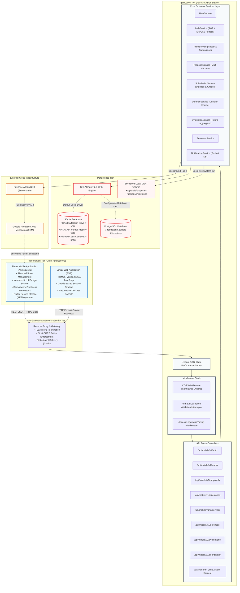

---

### 4.2 Mobile Client Component Diagram (Riverpod Architecture)

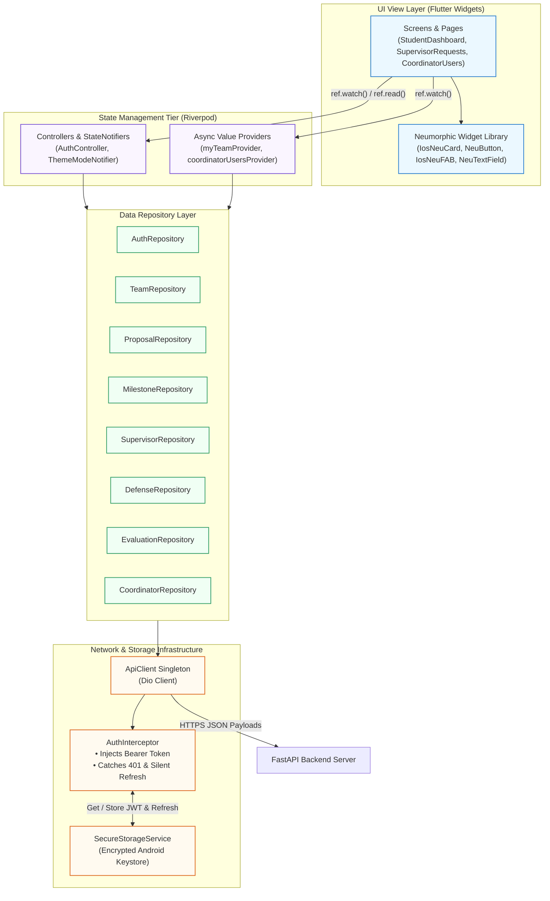

---

### 4.3 Backend Service Component Diagram

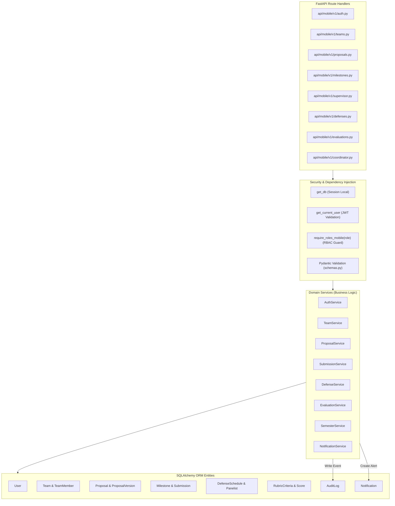

---

### 4.4 Physical Deployment & Infrastructure Topology

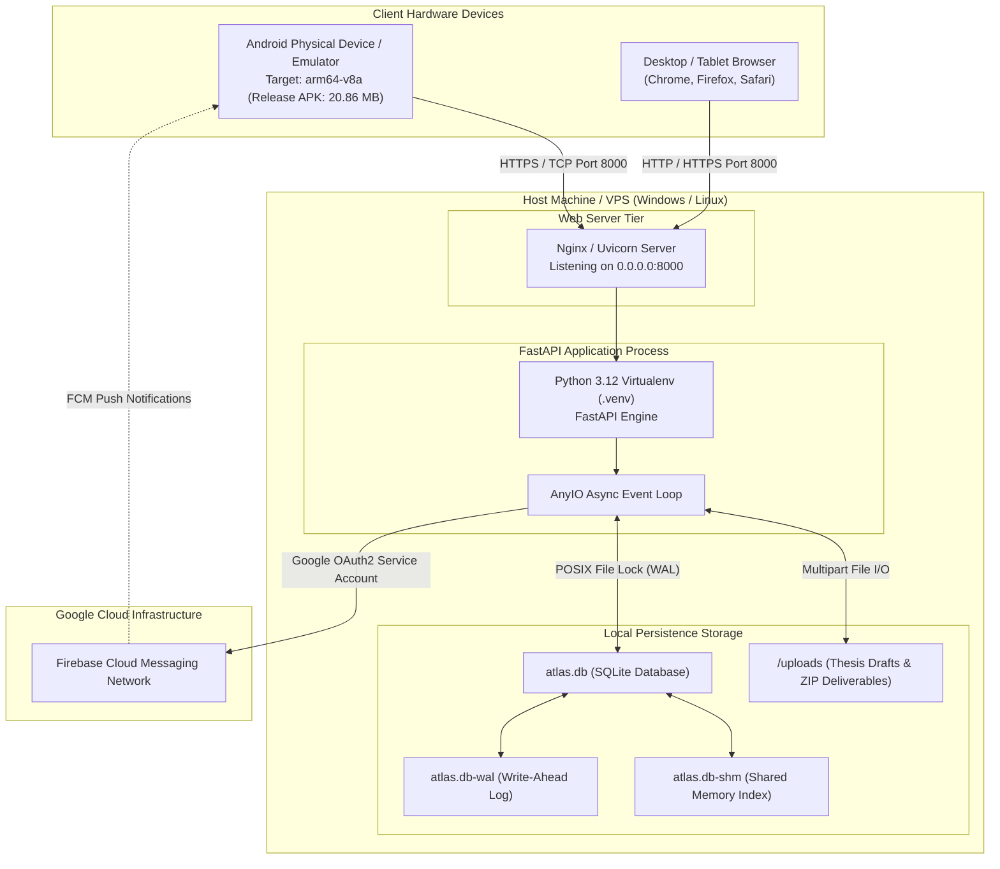

---

### 4.5 End-to-End Request/Response Middleware Pipeline

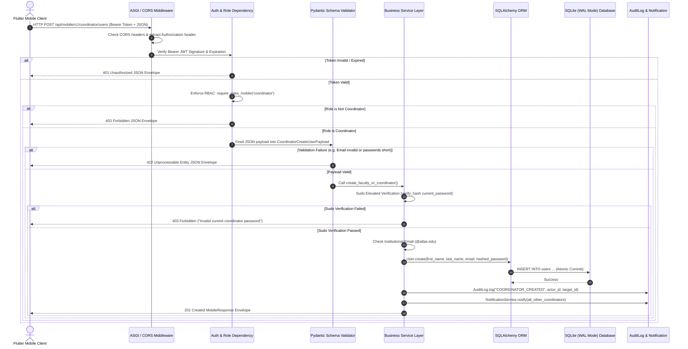

---

## 5. Dynamic Sequence Diagrams (Core Workflows)

### 5.1 Dual-Token Authentication & Refresh Lifecycle

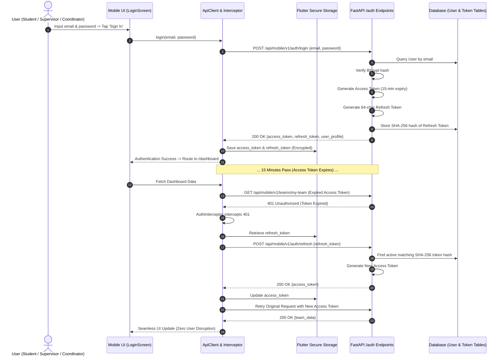

---

### 5.2 Team Formation & Member Invite Acceptance

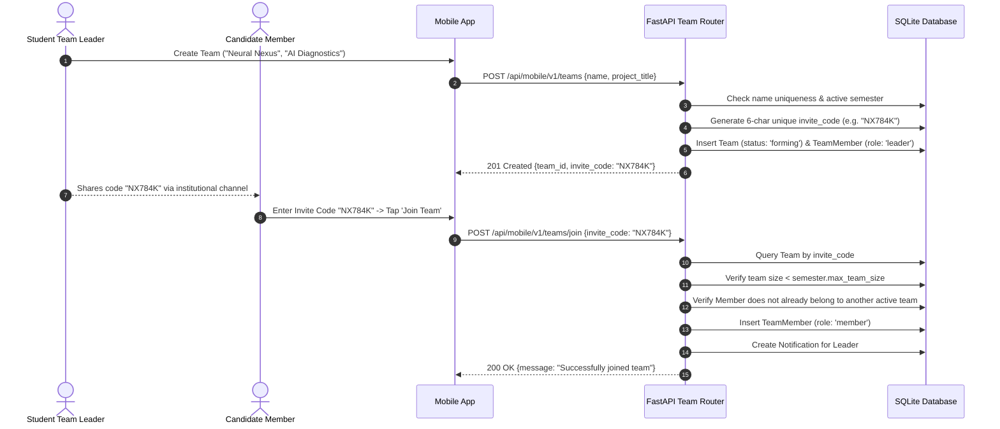

---

### 5.3 Supervisor Pitch & Two-Sided Agreement

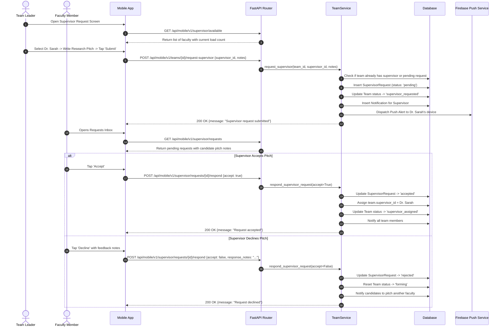

---

### 5.4 Multi-Round Proposal Review & Version Increment

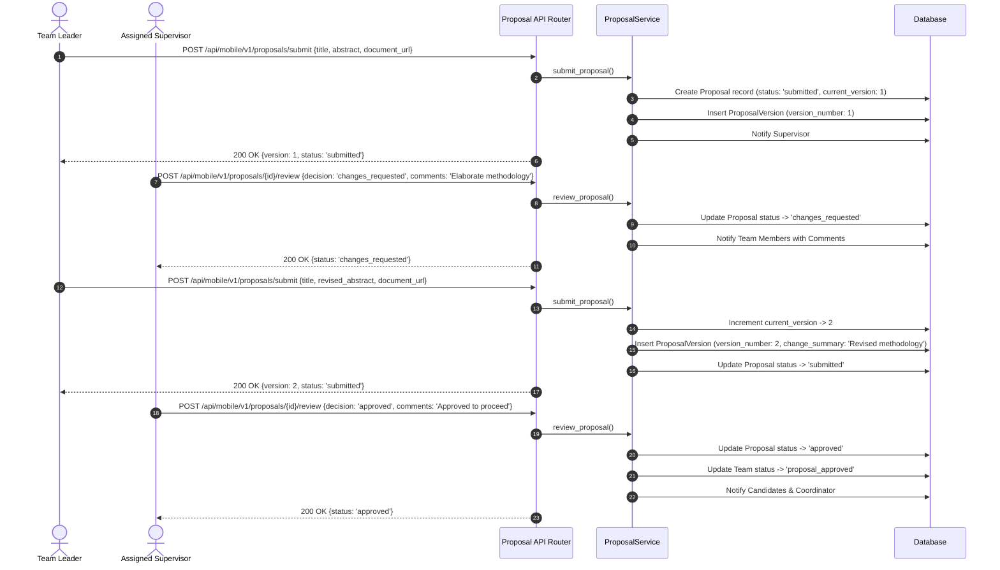

---

### 5.5 Milestone Submission & Qualitative Feedback

```mermaid
sequenceDiagram
    autonumber
    actor Student as Student Team
    actor Supervisor as Assigned Supervisor
    participant API as Milestones Router
    participant Service as SubmissionService
    participant Disk as Local File Storage
    participant DB as Database

    Student->>API: POST /api/mobile/v1/milestones/{id}/submit (Multipart File + Remarks)
    API->>Disk: Stream and store file -> /uploads/milestones/file_uuid.pdf
    API->>Service: create_submission(file_path, remarks)
    Service->>DB: Check due_date vs current_time
    Service->>DB: Set status: (current_time > due_date ? 'late' : 'submitted')
    Service->>DB: Insert Submission record
    Service->>DB: Notify Supervisor
    API-->>Student: 200 OK {submission_id, status: 'submitted'}

    Supervisor->>API: GET /api/mobile/v1/milestones/{id}/submissions
    API-->>Supervisor: Return candidate submissions with download URLs
    Supervisor->>API: POST /api/mobile/v1/milestones/submissions/{id}/grade {score: 92.0, feedback: "Excellent progress"}
    API->>Service: grade_submission()
    Service->>DB: Update Submission {score: 92.0, feedback: "...", status: 'graded', graded_at: now}
    Service->>DB: Notify Team of new grade & remarks
    API-->>Supervisor: 200 OK {status: 'graded'}
```

---

### 5.6 Oral Defense Scheduling with Automated Collision Detection

```mermaid
sequenceDiagram
    autonumber
    actor Coord as Department Coordinator
    participant API as Defense Router
    participant Service as DefenseService
    participant DB as Database

    Coord->>API: POST /api/mobile/v1/defenses/schedule {team_id, date, start_time, end_time, venue, panelist_ids}
    API->>Service: schedule_defense()
    
    note over Service,DB: Room Interval Conflict Check
    Service->>DB: SELECT * FROM defense_schedules WHERE venue = :venue AND scheduled_date = :date AND status != 'cancelled'
    loop For Each Existing Booking in Venue
        Service->>Service: Check interval overlap: [start, end) overlaps with [existing_start, existing_end)
    end
    alt Room is Double-Booked
        Service-->>API: Raise HTTP 409 Conflict ("Venue Room 302 is already booked during this time")
        API-->>Coord: 409 Conflict Error
    else Room is Free
        note over Service,DB: Panelist Schedule Conflict Check
        Service->>DB: SELECT * FROM defense_panelists JOIN defense_schedules WHERE user_id IN (:panelist_ids) AND date = :date
        loop For Each Assigned Examiner
            Service->>Service: Check interval overlap with other defense panels
        end
        alt Examiner is Double-Booked
            Service-->>API: Raise HTTP 409 Conflict ("Examiner Dr. Ahmed has a schedule collision")
            API-->>Coord: 409 Conflict Error
        else All Checks Cleared
            Service->>DB: INSERT INTO defense_schedules (team_id, date, start, end, venue, status='scheduled')
            Service->>DB: INSERT INTO defense_panelists (defense_id, user_id, role)
            Service->>DB: Update Team status -> 'defense_scheduled'
            Service->>DB: Record in AuditLog
            Service->>DB: Send Notification to Candidate Team & All Panelists
            API-->>Coord: 201 Created {defense_id, status: 'scheduled'}
        end
    end
```

---

### 5.7 Rubric-Based Defense Evaluation & Grade Publishing

```mermaid
sequenceDiagram
    autonumber
    actor Examiner as Oral Defense Panelist
    actor Coord as Department Coordinator
    actor Student as Student Candidate
    participant API as Evaluation API
    participant Service as EvaluationService
    participant DB as Database

    Examiner->>API: GET /api/mobile/v1/evaluations/rubrics
    API-->>Examiner: Return criteria: Technical (25%), Presentation (25%), Methodology (25%), Q&A (25%)
    Examiner->>API: POST /api/mobile/v1/evaluations/submit {defense_id, rubric_scores: [...], remarks: "..."}
    API->>Service: submit_defense_evaluation()
    Service->>DB: Validate criteria scores <= max_score
    Service->>DB: INSERT INTO evaluation_scores ...
    API-->>Examiner: 200 OK {message: "Evaluation recorded"}

    Coord->>API: GET /api/mobile/v1/evaluations/team/{team_id}/summary
    API->>Service: get_evaluation_summary()
    Service->>DB: Fetch all panelist scores
    Service->>Service: Compute weighted average normalized to 100%
    API-->>Coord: 200 OK {composite_score: 92.5%, panelist_count: 3}

    Coord->>API: POST /api/mobile/v1/evaluations/publish-grade {team_id, final_grade: "A+", final_score: 92.5}
    API->>Service: publish_grades()
    Service->>DB: UPDATE teams SET final_grade='A+', final_score=92.5, grade_published=TRUE, status='completed'
    Service->>DB: INSERT INTO audit_logs (action="GRADE_PUBLISHED")
    Service->>DB: INSERT INTO notifications for Team Members
    API-->>Coord: 200 OK {message: "Grades published to official transcripts"}

    Student->>API: GET /api/mobile/v1/evaluations/my-grade
    API-->>Student: 200 OK {final_grade: "A+", final_score: 92.5%, published: true}
```

---

### 5.8 Elevated Sudo Coordinator Creation (Option A)

```mermaid
sequenceDiagram
    autonumber
    actor ActingCoord as Acting Department Coordinator
    participant UI as Mobile App (CoordinatorUsersScreen)
    participant API as FastAPI Router (/coordinator/users)
    participant Auth as AuthService
    participant DB as Database
    actor PeerCoord as Peer Department Coordinator

    ActingCoord->>UI: Tap '+ Add Coordinator' -> Enter Name, Email, Password
    ActingCoord->>UI: Enter Current Coordinator Password (Sudo Mode)
    UI->>API: POST /api/mobile/v1/coordinator/users {first_name, last_name, email, password, role: 'coordinator', current_password}
    
    API->>API: Verify Acting User has Role 'coordinator'
    API->>Auth: verify_hash(payload.current_password, acting_user.password)
    alt Sudo Password Invalid
        Auth-->>API: Password Mismatch
        API-->>UI: 403 Forbidden ("Elevated authorization failed: Invalid current coordinator password.")
        UI-->>ActingCoord: Show Red Error Toast
    else Sudo Password Verified
        API->>API: Verify email.endswith('@atlas.edu')
        alt Non-Institutional Email (e.g. @gmail.com)
            API-->>UI: 400 Bad Request ("Coordinator accounts must use institutional @atlas.edu domain")
            UI-->>ActingCoord: Show Validation Error
        else Email Domain Verified
            API->>DB: Check email uniqueness
            API->>Auth: hash_secret(new_user_password)
            API->>DB: INSERT INTO users (role='coordinator', is_active=TRUE)
            API->>DB: INSERT INTO audit_logs (action="COORDINATOR_CREATED", actor_id=acting_user.id)
            API->>DB: INSERT INTO notifications for Peer Coordinators
            API-->>UI: 201 Created {user_id, email, role: 'coordinator'}
            UI-->>ActingCoord: Show Success Toast & Refresh Roster
            PeerCoord->>UI: Receives Alert: "New Coordinator account created by [ActingCoord]"
        end
    end
```

---

### 5.9 Push Notification Dispatch via Firebase Cloud Messaging

```mermaid
sequenceDiagram
    autonumber
    participant Event as System Business Event (e.g. Proposal Approved)
    participant Service as NotificationService
    participant DB as Database (Notifications Table)
    participant BG as FastAPI BackgroundTasks
    participant AdminSDK as Firebase Admin SDK
    participant FCM as Google Firebase Cloud Messaging Gateway
    actor Device as Candidate Android Device

    Event->>Service: notify(user_id, title, content, link)
    Service->>DB: INSERT INTO notifications (user_id, title, content, link, is_read=FALSE)
    Service->>BG: enqueue _dispatch_fcm_task(user_id, title, content)
    Service-->>Event: Return immediately (Non-blocking)

    note over BG,FCM: Background Thread Execution
    BG->>DB: SELECT fcm_token FROM device_tokens WHERE user_id = :user_id
    alt Device Token Found
        BG->>AdminSDK: messaging.Message(notification=..., token=fcm_token)
        AdminSDK->>FCM: POST https://fcm.googleapis.com/v1/projects/.../messages:send
        FCM->>Device: Encrypted Downstream Push Payload
        Device->>Device: Display System Heads-Up Notification Banner
    else Token Missing or Mock Fallback
        BG->>BG: Log fallback message to server console (Graceful Degradation)
    end
```

---

## 6. State Machine & Lifecycle Diagrams

### 6.1 Proposal Lifecycle Statechart

```mermaid
stateDiagram-v2
    [*] --> DRAFT : Candidate Creates Proposal
    DRAFT --> SUBMITTED : Team Leader Submits Version 1
    
    state SUBMITTED {
        [*] --> UnderSupervisorReview
        UnderSupervisorReview --> ChangesEvaluated
    }

    SUBMITTED --> CHANGES_REQUESTED : Supervisor Requests Revisions (Comments)
    CHANGES_REQUESTED --> SUBMITTED : Candidate Resubmits Revised Draft (v2..vN)
    
    SUBMITTED --> APPROVED : Supervisor Confirms Acceptance
    SUBMITTED --> REJECTED : Fundamental Rejection / Unviable

    APPROVED --> [*] : Locked (Milestones Activated)
    REJECTED --> DRAFT : Pivot Topic / Re-draft
```

---

### 6.2 Master Team Lifecycle Statechart

```mermaid
stateDiagram-v2
    [*] --> FORMING : Team Leader Registers Team
    FORMING --> FORMING : Members Join via Invite Code
    
    FORMING --> SUPERVISOR_REQUESTED : Leader Pitches to Faculty Member
    SUPERVISOR_REQUESTED --> FORMING : Faculty Declines Pitch
    SUPERVISOR_REQUESTED --> SUPERVISOR_ASSIGNED : Faculty Accepts Pitch
    FORMING --> SUPERVISOR_ASSIGNED : Coordinator Directly Assigns Faculty

    SUPERVISOR_ASSIGNED --> PROPOSAL_SUBMITTED : Team Submits Proposal Draft
    PROPOSAL_SUBMITTED --> PROPOSAL_SUBMITTED : Revisions Iterated
    PROPOSAL_SUBMITTED --> PROPOSAL_APPROVED : Proposal Approved by Supervisor

    PROPOSAL_APPROVED --> IN_PROGRESS : Milestones & Research Active
    IN_PROGRESS --> IN_PROGRESS : Periodic Submissions & Reviews
    
    IN_PROGRESS --> DEFENSE_SCHEDULED : Coordinator Schedules Oral Defense
    DEFENSE_SCHEDULED --> DEFENSE_SCHEDULED : Panel Examiner Scoring
    
    DEFENSE_SCHEDULED --> COMPLETED : Coordinator Publishes Final Grades
    COMPLETED --> [*] : Archival & Transcript Record
```

---

### 6.3 Milestone & Deliverable Lifecycle Statechart

```mermaid
stateDiagram-v2
    [*] --> UPCOMING : Coordinator Configures Milestone
    UPCOMING --> OPEN : Semester Reaches Open Window
    
    OPEN --> SUBMITTED : Candidate Uploads Deliverable (Before Due Date)
    OPEN --> LATE : Due Date Passes without Submission
    LATE --> SUBMITTED : Candidate Uploads Deliverable (Marked Late)

    SUBMITTED --> UNDER_REVIEW : Supervisor Accesses Document
    UNDER_REVIEW --> GRADED : Supervisor Enters Score & Remarks
    
    GRADED --> [*] : Added to Continuous Assessment
```

---

### 6.4 Oral Defense Hearing Statechart

```mermaid
stateDiagram-v2
    [*] --> PENDING_SCHEDULING : Proposal Approved & Milestones Met
    PENDING_SCHEDULING --> SCHEDULED : Coordinator Allocates Room & Panelists
    
    SCHEDULED --> IN_PROGRESS : Defense Hearing Commences on Schedule
    SCHEDULED --> CANCELLED : Scheduling Conflict / Postponement
    CANCELLED --> PENDING_SCHEDULING : Reschedule

    IN_PROGRESS --> EVALUATED : All Panelists Complete Rubrics
    EVALUATED --> GRADES_PUBLISHED : Coordinator Authoritatively Releases Grade
    
    GRADES_PUBLISHED --> [*] : Defense Concluded
```

---

## 7. Activity Diagrams & Algorithmic Flowcharts

### 7.1 Authentication & Authorization Verification Flowchart

```mermaid
flowchart TD
    Start(["Client Sends Request"]) --> HasAuthHeader{"Has 'Authorization: Bearer <token>'?"}
    
    HasAuthHeader -- No --> IsPublicRoute{"Is Route Public?<br/>(/login, /register)"}
    IsPublicRoute -- Yes --> ExecuteEndpoint["Process Route Handler"]
    IsPublicRoute -- No --> Return401["Return 401 Unauthorized"]

    HasAuthHeader -- Yes --> DecodeJWT{"Decode JWT Secret & Expiry"}
    DecodeJWT -- Expired / Invalid --> Return401
    DecodeJWT -- Valid --> FetchUser["Fetch User from DB"]
    
    FetchUser --> IsActive{"user.is_active == True?"}
    IsActive -- No --> Return403Inactive["Return 403 Forbidden: Inactive"]
    IsActive -- Yes --> CheckRole{"Endpoint Requires Role?"}

    CheckRole -- No --> ExecuteEndpoint
    CheckRole -- Yes --> RoleMatch{"User Role Matches Required Role?"}
    RoleMatch -- No --> Return403Role["Return 403 Forbidden: Insufficient Permissions"]
    RoleMatch -- Yes --> CheckObject{"Object-Level Check Required?<br/>(Own Team / Assigned Supervisor)"}
    
    CheckObject -- No --> ExecuteEndpoint
    CheckObject -- Yes --> ObjectAuthorized{"User Owns or Supervises Resource?"}
    ObjectAuthorized -- No --> Return403Obj["Return 403 Forbidden: Resource Access Denied"]
    ObjectAuthorized -- Yes --> ExecuteEndpoint

    ExecuteEndpoint --> Return200(["Return Response JSON"])

    classDef reject fill:#FFF5F5,stroke:#E53E3E,stroke-width:1.5px,color:#9B2C2C;
    classDef pass fill:#F0FFF4,stroke:#38A169,stroke-width:1.5px,color:#22543D;
    class Return401,Return403Inactive,Return403Role,Return403Obj reject;
    class ExecuteEndpoint,Return200 pass;
```

---

### 7.2 Proposal Review Decision Logic Flowchart

```mermaid
flowchart TD
    Start(["Supervisor Opens Proposal"]) --> ViewDraft["Inspect Title, Abstract & Document PDF"]
    ViewDraft --> FormulateDecision{"Supervisor Evaluation Decision"}

    FormulateDecision -- Changes Needed --> InputComments["Enter Required Revisions / Critique"]
    InputComments --> PostChanges["POST /proposals/{id}/review<br/>decision='changes_requested'"]
    PostChanges --> UpdateStatusCR["Set status = 'changes_requested'"]
    UpdateStatusCR --> NotifyCandidateCR["Send Notification & Remarks to Candidates"]
    NotifyCandidateCR --> WaitResubmit["Wait for Version Increment (v2..vN)"]
    WaitResubmit --> Start

    FormulateDecision -- Approved --> EnterPraise["Enter Formal Approval Remarks"]
    EnterPraise --> PostApprove["POST /proposals/{id}/review<br/>decision='approved'"]
    PostApprove --> UpdateStatusApp["Set status = 'approved' & team.status = 'proposal_approved'"]
    UpdateStatusApp --> NotifyCandidateApp["Dispatch Push Notification to Team & Coordinator"]
    NotifyCandidateApp --> EndApprove(["Proposal Locked & Approved"])

    FormulateDecision -- Reject --> EnterRejection["Enter Fundamental Rejection Reason"]
    EnterRejection --> PostReject["POST /proposals/{id}/review<br/>decision='rejected'"]
    PostReject --> UpdateStatusRej["Set status = 'rejected'"]
    UpdateStatusRej --> NotifyCandidateRej["Notify Candidates of Topic Rejection"]
    NotifyCandidateRej --> EndReject(["Candidates Must Pivot Topic"])

    classDef pass fill:#F0FFF4,stroke:#38A169,stroke-width:1.5px;
    classDef warn fill:#FFFAF0,stroke:#DD6B20,stroke-width:1.5px;
    classDef reject fill:#FFF5F5,stroke:#E53E3E,stroke-width:1.5px;
    class EndApprove pass;
    class WaitResubmit warn;
    class EndReject reject;
```

---

### 7.3 Oral Defense Collision Prevention Algorithm

```mermaid
flowchart TD
    Start(["Coordinator Submits Schedule Defense Request"]) --> ParseInput["Extract: team_id, date, start_time, end_time, venue, panelist_ids"]
    ParseInput --> CheckTimeOrder{"start_time < end_time?"}
    CheckTimeOrder -- No --> ErrTime["Return 400 Bad Request: Invalid Time Bounds"]

    CheckTimeOrder -- Yes --> QueryVenue["Query defense_schedules WHERE venue = :venue AND date = :date AND status != 'cancelled'"]
    QueryVenue --> VenueLoop{"For Each Existing Defense (B)"}

    VenueLoop -- Overlap Found --> VenueCollision["Detect Overlap:<br/>NOT (end_time <= B.start OR start_time >= B.end)"]
    VenueCollision -- True --> ErrVenue["Return 409 Conflict: Venue Room Already Booked"]
    VenueCollision -- False --> VenueLoop

    VenueLoop -- All Venue Bookings Checked (No Collision) --> QueryPanelists["Query defense_panelists & defense_schedules WHERE user_id IN (:panelist_ids) AND date = :date"]
    QueryPanelists --> PanelistLoop{"For Each Examiner Defense Booking (C)"}

    PanelistLoop -- Overlap Found --> PanelistCollision["Detect Overlap:<br/>NOT (end_time <= C.start OR start_time >= C.end)"]
    PanelistCollision -- True --> ErrPanelist["Return 409 Conflict: Examiner Schedule Collision Detected"]
    PanelistCollision -- False --> PanelistLoop

    PanelistLoop -- All Panelists Free --> CommitSchedule["DB Transaction Commit:<br/>1. Insert DefenseSchedule<br/>2. Insert DefensePanelists<br/>3. Update Team status='defense_scheduled'<br/>4. Log to AuditLog"]
    CommitSchedule --> SendAlerts["Send Push Notifications to Candidates & Panel"]
    SendAlerts --> Success(["Return 201 Created"])

    classDef err fill:#FFF5F5,stroke:#E53E3E,stroke-width:1.5px;
    classDef success fill:#F0FFF4,stroke:#38A169,stroke-width:1.5px;
    class ErrTime,ErrVenue,ErrPanelist err;
    class Success success;
```

---

### 7.4 Weighted Grade Aggregation & Transcript Calculation

```mermaid
flowchart TD
    Start(["Coordinator Triggers Grade Publishing"]) --> FetchCriteria["Fetch All rubric_criteria (Title, MaxScore, Weight%)"]
    FetchCriteria --> CheckWeights{"Sum of criteria.weight_percentage == 100%?"}
    CheckWeights -- No --> WarnWeights["Normalize weights to 1.0 (100%)"]
    CheckWeights -- Yes --> FetchScores["Fetch All evaluation_scores for Team"]

    FetchScores --> GroupPanelists["Group scores by panelist_id"]
    GroupPanelists --> CalcPanelistScore["For each panelist P:<br/>Score_P = Sum( (score_i / max_score_i) * weight_i )"]
    CalcPanelistScore --> CalcComposite["Composite Score = Average(Score_P1, Score_P2, ... Score_PN)"]
    
    CalcComposite --> ScaleGrade{"Map Composite Score (0..100) to Letter Grade"}
    ScaleGrade -- "Score >= 90" --> GradeA_Plus["Letter Grade: A+ (Excellent / Honors)"]
    ScaleGrade -- "80 <= Score < 90" --> GradeA["Letter Grade: A (Very Good)"]
    ScaleGrade -- "70 <= Score < 80" --> GradeB["Letter Grade: B (Good)"]
    ScaleGrade -- "60 <= Score < 70" --> GradeC["Letter Grade: C (Satisfactory)"]
    ScaleGrade -- "Score < 60" --> GradeF["Letter Grade: F (Fail)"]

    GradeA_Plus --> CommitGrade["DB Commit: team.final_score, team.final_grade, grade_published=True, status='completed'"]
    GradeA --> CommitGrade
    GradeB --> CommitGrade
    GradeC --> CommitGrade
    GradeF --> CommitGrade

    CommitGrade --> LogAudit["Write to AuditLog: 'GRADE_PUBLISHED'"]
    LogAudit --> AlertCandidates["Notify Candidates & Publish Official Transcript"]
    AlertCandidates --> End(["Grades Permanently Released"])

    classDef pass fill:#F0FFF4,stroke:#38A169,stroke-width:1.5px;
    class CommitGrade,LogAudit,AlertCandidates,End pass;
```

---

### 7.5 Elevated Sudo Coordinator Creation Flowchart (Option A)

```mermaid
flowchart TD
    Start(["Coordinator Submits 'Add User' Form"]) --> CheckRole{"Target Role Selected"}
    
    CheckRole -- "role == 'supervisor'" --> CreateSupervisor["Create Faculty Supervisor:<br/>1. Hash Password (BCrypt)<br/>2. Insert into users<br/>3. Log 'SUPERVISOR_CREATED' in AuditLog<br/>4. Notify New Faculty User"]
    CreateSupervisor --> Return201Sup(["Return 201 Created: Supervisor Ready"])

    CheckRole -- "role == 'coordinator'" --> CheckSudoPassword{"current_password provided?"}
    CheckSudoPassword -- No --> ErrNoSudo["Return 400 Bad Request: Sudo Password Required"]
    
    CheckSudoPassword -- Yes --> VerifySudoHash{"AuthService.verify_hash(current_password, acting_user.password)"}
    VerifySudoHash -- False --> ErrWrongSudo["Return 403 Forbidden: Sudo Elevated Authorization Failed"]
    
    VerifySudoHash -- True --> CheckEmailDomain{"email.endswith('@atlas.edu')?"}
    CheckEmailDomain -- No --> ErrDomain["Return 400 Bad Request: Institutional @atlas.edu Domain Required"]
    
    CheckEmailDomain -- Yes --> CheckDuplicate{"Email already exists in users table?"}
    CheckDuplicate -- Yes --> ErrDuplicate["Return 400 Bad Request: Account Email Already Registered"]
    
    CheckDuplicate -- No --> CreateCoordinator["DB Transaction Commit:<br/>1. Hash New Password (BCrypt)<br/>2. Insert new user (role='coordinator', is_active=True)<br/>3. Log 'COORDINATOR_CREATED' in AuditLog<br/>4. Broadcast Alert Notifications to All Peer Coordinators"]
    CreateCoordinator --> Return201Coord(["Return 201 Created: Coordinator Activated"])

    classDef err fill:#FFF5F5,stroke:#E53E3E,stroke-width:1.5px;
    classDef success fill:#F0FFF4,stroke:#38A169,stroke-width:1.5px;
    class ErrNoSudo,ErrWrongSudo,ErrDomain,ErrDuplicate err;
    class Return201Sup,Return201Coord success;
```

---

## 8. Class Diagrams & Object-Oriented Models

### 8.1 Core Domain SQLAlchemy Model Class Diagram

```mermaid
classDiagram
    class BaseTableModel {
        +String id
        +DateTime created_at
        +DateTime updated_at
        +Boolean is_deleted
        +to_dict(excludes)
        +fetch_by_id(db, id)
        +create(db, **kwargs)
        +update(db, id, **kwargs)
        +soft_delete(db, id)
    }

    class User {
        +String first_name
        +String last_name
        +String email
        +String password
        +String role
        +String department_id
        +Boolean is_active
        +DateTime last_login
        +full_name() String
        +is_coordinator() Boolean
        +is_supervisor() Boolean
        +is_student() Boolean
    }

    class Team {
        +String name
        +String project_title
        +String description
        +String leader_id
        +String supervisor_id
        +String semester_id
        +String department_id
        +String status
        +String invite_code
        +Float final_score
        +String final_grade
        +Boolean grade_published
    }

    class TeamMember {
        +String team_id
        +String user_id
        +String role
        +DateTime joined_at
    }

    class SupervisorRequest {
        +String team_id
        +String supervisor_id
        +String requested_by_id
        +String notes
        +String status
        +String response_notes
        +DateTime responded_at
    }

    class Proposal {
        +String team_id
        +String title
        +String abstract
        +String status
        +Integer current_version
        +String approved_by_id
        +DateTime approved_at
    }

    class ProposalVersion {
        +String proposal_id
        +Integer version_number
        +String title
        +String abstract
        +String document_url
        +String change_summary
        +String submitted_by_id
        +DateTime submitted_at
    }

    class Milestone {
        +String semester_id
        +String title
        +String description
        +DateTime due_date
        +Float weight_percentage
        +Boolean is_mandatory
    }

    class Submission {
        +String milestone_id
        +String team_id
        +String submitted_by_id
        +String document_url
        +String remarks
        +String status
        +Float score
        +String feedback
        +String graded_by_id
        +DateTime graded_at
    }

    class DefenseSchedule {
        +String team_id
        +Date scheduled_date
        +Time start_time
        +Time end_time
        +String venue
        +String status
    }

    class RubricCriteria {
        +String title
        +String description
        +Float max_score
        +Float weight_percentage
        +Boolean is_active
    }

    class EvaluationScore {
        +String defense_id
        +String criteria_id
        +String evaluator_id
        +Float score
        +String remarks
    }

    class AuditLog {
        +String user_id
        +String action
        +String entity_type
        +String entity_id
        +String details
        +String ip_address
    }

    BaseTableModel <|-- User
    BaseTableModel <|-- Team
    BaseTableModel <|-- TeamMember
    BaseTableModel <|-- SupervisorRequest
    BaseTableModel <|-- Proposal
    BaseTableModel <|-- ProposalVersion
    BaseTableModel <|-- Milestone
    BaseTableModel <|-- Submission
    BaseTableModel <|-- DefenseSchedule
    BaseTableModel <|-- RubricCriteria
    BaseTableModel <|-- EvaluationScore
    BaseTableModel <|-- AuditLog

    Team "1" *-- "many" TeamMember : members
    Team "1" o-- "0..1" User : supervisor
    Team "1" *-- "0..1" Proposal : proposal
    Proposal "1" *-- "many" ProposalVersion : versions
    Team "1" *-- "many" Submission : submissions
    Milestone "1" *-- "many" Submission : submissions
    Team "1" *-- "0..1" DefenseSchedule : defense
    DefenseSchedule "1" *-- "many" EvaluationScore : scores
    RubricCriteria "1" *-- "many" EvaluationScore : scores
```

---

### 8.2 Flutter Mobile Architecture Class Diagram

```mermaid
classDiagram
    class ApiClient {
        +Dio dio
        +SecureStorageService storage
        +handleDioError(e) Exception
    }

    class AuthInterceptor {
        +onRequest(options, handler)
        +onError(err, handler)
    }

    class AuthController {
        +AuthState state
        +login(email, password) Future~bool~
        +register(firstName, lastName, email, password) Future~bool~
        +logout() Future~void~
        +refreshSession() Future~bool~
    }

    class CoordinatorRepository {
        +ApiClient _client
        +getTeams() Future~List~TeamModel~~
        +getSemesters() Future~List~SemesterModel~~
        +getAuditLogs() Future~List~AuditLogItem~~
        +getReportSummary() Future~ReportSummaryModel~
        +getUsers(role) Future~List~CoordinatorUserItem~~
        +createUser(firstName, lastName, email, password, role, currentPassword) Future~CoordinatorUserItem~
    }

    class TeamRepository {
        +ApiClient _client
        +getMyTeam() Future~TeamModel~
        +createTeam(name, title) Future~TeamModel~
        +joinTeam(code) Future~TeamModel~
        +requestSupervisor(teamId, supervisorId, notes) Future~String~
    }

    class CoordinatorUsersScreen {
        +ConsumerState createState()
    }

    class StudentDashboardScreen {
        +Widget build(context, ref)
    }

    ApiClient o-- AuthInterceptor
    AuthController o-- ApiClient
    CoordinatorRepository o-- ApiClient
    TeamRepository o-- ApiClient
    CoordinatorUsersScreen ..> CoordinatorRepository : ref.watch(coordinatorUsersProvider)
    StudentDashboardScreen ..> TeamRepository : ref.watch(myTeamProvider)
```

---

## 9. Security & Access Control Architecture

### 9.1 Dual-Token Security Architecture

```mermaid
flowchart LR
    subgraph Client_Security["Client Storage (Android Keystore / iOS Keychain)"]
        AT["Access Token (JWT)<br/>• Lifespan: 15 Minutes<br/>• Payload: user_id, email, role<br/>• Signature: HS256 HMAC"]
        RT["Refresh Token (Opaque UUID)<br/>• Lifespan: 7 Days<br/>• High-Entropy 64-character token"]
    end

    subgraph Server_Validation["FastAPI Backend Validation Pipeline"]
        VerifyJWT["1. Verify JWT Signature with SECRET_KEY<br/>2. Check expiration (exp)"]
        HashRT["Hash received Refresh Token using SHA-256"]
    end

    subgraph DB_Security["Database Token Store (tokens table)"]
        TokenRecord["Hashed Token Record<br/>• user_id<br/>• token_hash (SHA-256)<br/>• expires_at<br/>• is_revoked (Boolean)"]
    end

    AT -->|"Included in every API Request (Authorization: Bearer)"| VerifyJWT
    RT -->|"Sent ONLY to /auth/refresh"| HashRT
    HashRT -->|"Constant-Time Equality Match"| TokenRecord
    TokenRecord -->|"If Valid & Active"| MintNewAT["Mint New 15-Minute Access Token"]
    MintNewAT -->|"Return to Client"| AT

    classDef token fill:#EBF8FF,stroke:#3182CE,stroke-width:2px;
    classDef server fill:#F7FAFC,stroke:#4A5568,stroke-width:2px;
    classDef db fill:#FFF5F5,stroke:#E53E3E,stroke-width:2px;
    class AT,RT token;
    class VerifyJWT,HashRT,MintNewAT server;
    class TokenRecord db;
```

---

### 9.2 RBAC vs. Object-Level Authorization Matrix

```mermaid
flowchart TD
    Request["Incoming API Request"] --> RBAC{"Check 1: Role-Based Access Control (RBAC)<br/>Does user.role match endpoint role requirements?"}
    
    RBAC -- Failed --> Deny403["403 Forbidden: Insufficient Role Permissions"]
    
    RBAC -- Passed --> ObjectLevel{"Check 2: Object-Level Authorization<br/>What is the targeted entity?"}

    ObjectLevel -- "Team Resource" --> TeamCheck{"User is Team Leader OR Assigned Supervisor OR Coordinator?"}
    TeamCheck -- No --> DenyObj["403 Forbidden: Access Denied to Other Team's Data"]
    TeamCheck -- Yes --> Allow["200 OK: Process Request"]

    ObjectLevel -- "Proposal Review" --> PropCheck{"User is Assigned Supervisor OR Coordinator?"}
    PropCheck -- No --> DenyObj
    PropCheck -- Yes --> Allow

    ObjectLevel -- "Milestone Grading" --> MileCheck{"User is Assigned Supervisor OR Coordinator?"}
    MileCheck -- No --> DenyObj
    MileCheck -- Yes --> Allow

    ObjectLevel -- "Sudo Coordinator Creation" --> SudoCheck{"Current Password matches acting Coordinator hash AND email ends with @atlas.edu?"}
    SudoCheck -- No --> DenyObj
    SudoCheck -- Yes --> Allow

    classDef pass fill:#F0FFF4,stroke:#38A169,stroke-width:1.5px;
    classDef reject fill:#FFF5F5,stroke:#E53E3E,stroke-width:1.5px;
    class Allow pass;
    class Deny403,DenyObj reject;
```

---

## 10. Summary Matrix of Diagrams

| Figure # | Category | Diagram Name | Primary Actors & Entities | Codebase Verification |
| :--- | :--- | :--- | :--- | :--- |
| **Fig 1.1** | DFD | Level 0 Context Diagram | Student, Supervisor, Coordinator, FCM | Full System Boundary |
| **Fig 1.2** | DFD | Level 1 Subsystem Decomposition | Processes 1.0 - 7.0, Data Stores D1 - D9 | Complete Architecture |
| **Fig 1.3** | DFD | Level 2 Proposal Lifecycle | Leader, Supervisor, Proposals, Versions | `api/v1/services/proposal.py` |
| **Fig 1.4** | DFD | Level 2 Defense Collision Engine | Coordinator, Venues, Panelists, Defenses | `api/v1/services/defense.py` |
| **Fig 1.5** | DFD | Level 2 Rubric Assessment | Panelists, Coordinator, Rubrics, Scores | `api/v1/services/evaluation.py` |
| **Fig 2.1** | Use Case | Master System Use Cases | All System Actors | 17 Core Use Cases |
| **Fig 2.2** | Use Case | Student Subsystem Use Cases | Student, Teams, Milestones, Pitches | Student Mobile Workflows |
| **Fig 2.3** | Use Case | Supervisor Subsystem Use Cases | Faculty, Requests, Proposals, Rubrics | Supervisor Mobile Workflows |
| **Fig 2.4** | Use Case | Coordinator Subsystem Use Cases | Coordinator, Semesters, Users, Audits | Coordinator Admin Panel |
| **Fig 3.1** | ERD | Conceptual ER Diagram | Core Domain Entities | High-Level Schema |
| **Fig 3.2** | ERD | Complete Physical ER Diagram | 16 Tables, PKs, FKs, Types, Cardinalities | `api/v1/models/*.py` |
| **Fig 4.1** | Architecture | Multi-Tier Architecture | Presentation, Gateway, App, DB, Cloud | `main.py`, `app_router.dart` |
| **Fig 4.2** | Architecture | Mobile Client Riverpod Architecture | Views, Notifiers, Repositories, Storage | `mobile/lib/` |
| **Fig 4.3** | Architecture | Backend Service Component Diagram | Routers, Guards, Services, Models | `api/mobile/v1/` |
| **Fig 4.4** | Deployment | Deployment Topology | Android OS, Uvicorn, SQLite WAL, FCM | Production Environment |
| **Fig 4.5** | Sequence | Request/Response Middleware Pipeline | ASGI, CORS, JWT, Pydantic, ORM, DB | `api/core/` |
| **Fig 5.1** | Sequence | Dual-Token Auth & Refresh Lifecycle | JWT Access (15m), Refresh Token (7d) | `api/v1/services/auth.py` |
| **Fig 5.2** | Sequence | Team Formation & Invite Acceptance | Leader, Member, 6-char Invite Code | `api/v1/services/team.py` |
| **Fig 5.3** | Sequence | Supervisor Pitch & Approval | Student Pitch, Requests Inbox, Decision | `api/v1/models/supervisor_request.py` |
| **Fig 5.4** | Sequence | Multi-Round Proposal Review | v1..vN Iteration, Change Requests | `api/v1/models/proposal.py` |
| **Fig 5.5** | Sequence | Milestone Submission & Feedback | File Uploads, Deadlines, Remarks | `api/v1/models/submission.py` |
| **Fig 5.6** | Sequence | Defense Scheduling & Collision Engine | Interval Checking, Room/Panelist Lock | `DefenseService.schedule_defense` |
| **Fig 5.7** | Sequence | Rubric Defense Evaluation & Publishing | Multi-Panel Scoring, Grade Publication | `EvaluationService.publish_grades` |
| **Fig 5.8** | Sequence | Sudo Coordinator Creation (Option A) | Password Re-verification, @atlas.edu | `api/mobile/v1/coordinator.py:273` |
| **Fig 5.9** | Sequence | Push Notification Dispatch via FCM | NotificationService, BackgroundTasks | `NotificationService.notify` |
| **Fig 6.1** | State Machine | Proposal Lifecycle Statechart | Draft, Submitted, Revisions, Approved | `ProposalStatus` |
| **Fig 6.2** | State Machine | Master Team Lifecycle Statechart | Forming, Pitched, Assigned, Defended | `TeamStatus` |
| **Fig 6.3** | State Machine | Milestone Submission Statechart | Open, Submitted, Late, Graded | `SubmissionStatus` |
| **Fig 6.4** | State Machine | Defense Hearing Statechart | Scheduled, In-Progress, Concluded | `DefenseStatus` |
| **Fig 7.1** | Activity | Auth & RBAC Verification Flowchart | Token Validation, Role & Object Checks | `require_roles_mobile` |
| **Fig 7.2** | Activity | Proposal Decision Logic Flowchart | Accept, Revise, Reject Decision Branch | `ProposalService.review_proposal` |
| **Fig 7.3** | Activity | Collision Prevention Algorithm | Mathematical Interval Overlap Formula | `DefenseService` |
| **Fig 7.4** | Activity | Weighted Grade Calculation Flowchart | Composite Averaging & Transcript Release | `EvaluationService` |
| **Fig 7.5** | Activity | Sudo Coordinator Creation Flowchart | Sudo Check, Domain Check, Broadcast | Option A Implementation |
| **Fig 8.1** | Class Diagram | Core SQLAlchemy Domain Class Diagram | 12 Model Classes with Methods & Fields | `api/v1/models/` |
| **Fig 8.2** | Class Diagram | Flutter Riverpod Mobile Architecture | Notifiers, Repositories, ApiClient | `mobile/lib/` |
| **Fig 9.1** | Security | Dual-Token Security Architecture | Token Hashing & Refresh Storage | Token Verification Pipeline |
| **Fig 9.2** | Security | RBAC vs. Object Authorization Matrix | 2-Tier Permission Evaluation Gates | System Security Framework |

---
*Generated and verified against the ATLAS source repository. All models, routes, and diagrams match the active implementation.*
