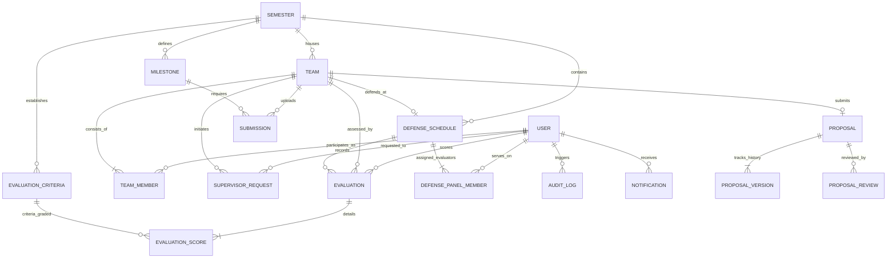

# ATLAS Database Schema & Entity Relationships

## Overview
ATLAS utilizes **PostgreSQL** in production (and SQLite for lightweight local testing). The database is managed using **SQLAlchemy 2.0 Declarative ORM** and version-controlled using **Alembic migrations**.

---

## Entity-Relationship Diagram (ERD)

---

## Model Specifications

### 1. `Semester`
Manages academic sessions and active term boundaries.
| Column | Type | Constraints | Description |
|---|---|---|---|
| `id` | String(UUID) | PK | Unique identifier |
| `name` | String(100) | Not Null | e.g. "Fall 2026", "Spring 2027" |
| `academic_year` | String(20) | Not Null | e.g. "2026-2027" |
| `start_date` | Date | Not Null | Term starting date |
| `end_date` | Date | Not Null | Term completion date |
| `is_active` | Boolean | Default False | Active semester flag |
| `max_team_size`| Integer | Default 4 | Configurable team size limit |
| `min_team_size`| Integer | Default 1 | Minimum team members |

### 2. `Team` & `TeamMember`
Represents student thesis cohorts and memberships.
- `Team`: `name`, `project_title`, `leader_id`, `supervisor_id`, `status` (`FORMING`, `SUPERVISOR_REQUESTED`, `SUPERVISOR_ASSIGNED`, `PROPOSAL_SUBMITTED`, `PROPOSAL_APPROVED`, `IN_PROGRESS`, `DEFENSE_SCHEDULED`, `COMPLETED`), `final_score`, `final_grade`, `grade_published`.
- `TeamMember`: `team_id`, `user_id`, `role` (`LEADER`, `MEMBER`). Enforces uniqueness on active student team membership.

### 3. `Proposal`, `ProposalVersion`, `ProposalReview`
Manages proposal review iterations and version audit trails.
- `Proposal`: `team_id`, `current_version`, `status` (`DRAFT`, `SUBMITTED`, `UNDER_REVIEW`, `CHANGES_REQUESTED`, `APPROVED`, `REJECTED`).
- `ProposalVersion`: `proposal_id`, `version_number`, `title`, `abstract`, `document_id`, `change_summary`, `submitted_at`.
- `ProposalReview`: `proposal_id`, `version_id`, `reviewer_id`, `decision`, `comments`, `reviewed_at`.

### 4. `Milestone` & `Submission`
Tracks deliverable deadlines, submissions, and grading.
- `Milestone`: `semester_id`, `title`, `description`, `due_date`, `max_score`, `weight_percentage`, `status`.
- `Submission`: `milestone_id`, `team_id`, `submitted_by`, `code_url`, `file_path`, `version`, `is_late`, `score`, `feedback`, `status` (`MISSING`, `SUBMITTED`, `LATE`, `UNDER_REVIEW`, `REVIEWED`).

### 5. `DefenseSchedule` & `DefensePanelMember`
Oral examination scheduling and panel assignment.
- `DefenseSchedule`: `team_id`, `semester_id`, `date`, `start_time`, `end_time`, `room`, `status` (`SCHEDULED`, `COMPLETED`, `CANCELLED`).
- `DefensePanelMember`: `defense_id`, `user_id`, `role` (`CHAIR`, `MEMBER`, `EXTERNAL`).

### 6. `EvaluationCriteria`, `Evaluation`, `EvaluationScore`
Configurable multi-criteria rubric grading.
- `EvaluationCriteria`: `semester_id`, `title`, `description`, `weight_percentage`, `max_score`, `order_index`.
- `Evaluation`: `team_id`, `evaluator_id`, `defense_id`, `calculated_score`, `overall_comments`, `is_submitted`.
- `EvaluationScore`: `evaluation_id`, `criteria_id`, `score`.

### 7. `AuditLog`
Records security and lifecycle events:
`user_id`, `action`, `entity_type`, `entity_id`, `details`, `ip_address`, `created_at`.
