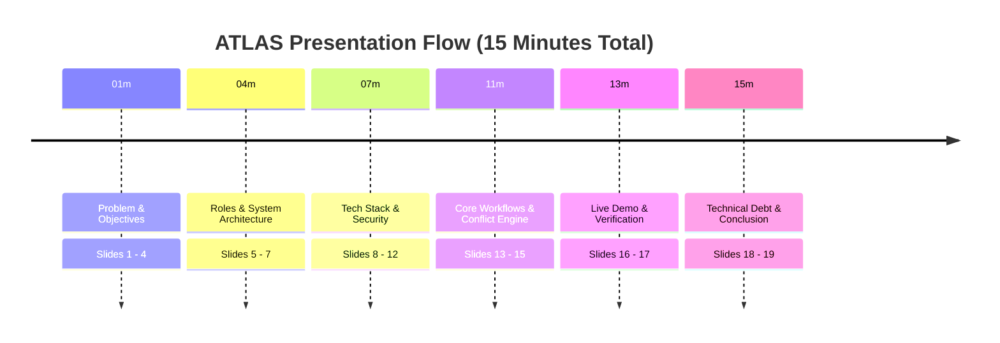
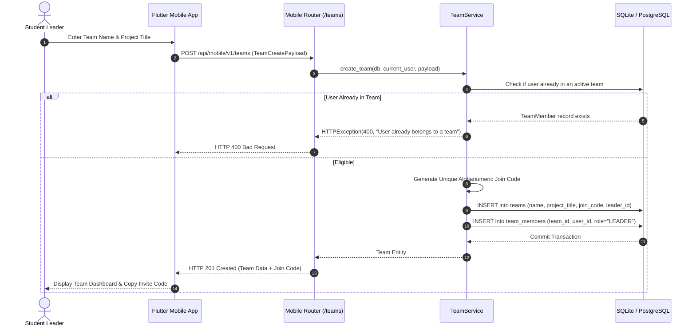
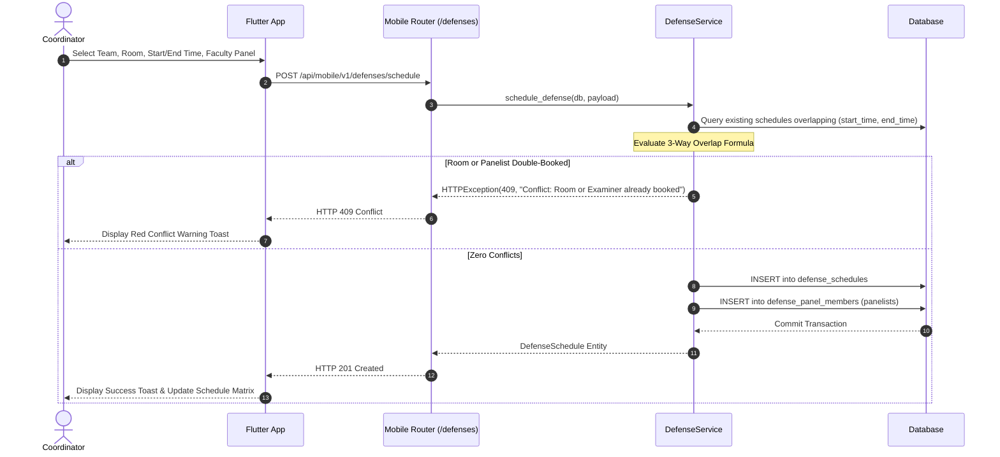

# ATLAS — Academic Thesis Lifecycle & Assessment Suite
## Comprehensive Presentation Guide, Viva Handbook, and Architecture Defense Manual

**Target Audience:** Project Candidates, Academic Supervisors, Defense Examination Committees  
**Primary Repository:** [ATLAS Mobile & API Suite](file:///e:/Virtual%20Stdio%20Codes/Mobile%20Application/projects/Atlas)  
**Document Purpose:** Presentation script, oral viva examination defense, codebase walkthrough, and complete Q&A handbook.  

---

## Table of Contents
1. [Section 1: Project Explanation at Three Levels](#section-1-project-explanation-at-three-levels)
2. [Section 2: 19-Slide Presentation Master Plan & Speaker Scripts](#section-2-19-slide-presentation-master-plan--speaker-scripts)
3. [Section 3: Full Frontend Study Guide (Flutter & Dart)](#section-3-full-frontend-study-guide-flutter--dart)
4. [Section 4: Full Backend Study Guide (FastAPI & Python)](#section-4-full-backend-study-guide-fastapi--python)
5. [Section 5: Database and ORM Study Guide (SQLAlchemy & SQLite/Postgres)](#section-5-database-and-orm-study-guide-sqlalchemy--sqlitepostgres)
6. [Section 6: Authentication and Security Defense Guide](#section-6-authentication-and-security-defense-guide)
7. [Section 7: Firebase and External Services Defense Guide](#section-7-firebase-and-external-services-defense-guide)
8. [Section 8: End-to-End Architectural Feature Walkthroughs](#section-8-end-to-end-architectural-feature-walkthroughs)
9. [Section 9: Comprehensive 180-Question Viva Master Bank](#section-9-comprehensive-180-question-viva-master-bank)
10. [Section 10: Difficult and Critical Examiner Questions](#section-10-difficult-and-critical-examiner-questions)
11. [Section 11: Source-Code Navigation Index](#section-11-source-code-navigation-index)
12. [Section 12: Live Demonstration Script & Backup Runbook](#section-12-live-demonstration-script--backup-runbook)
13. [Section 13: Project Troubleshooting Guide](#section-13-project-troubleshooting-guide)
14. [Section 14: Seven-Day Structured Revision Plan](#section-14-seven-day-structured-revision-plan)
15. [Section 15: High-Yield Final Revision Sheet](#section-15-high-yield-final-revision-sheet)

---

## Section 1: Project Explanation at Three Levels

### 1.1 The 30-Second Elevator Pitch
> *"ATLAS (Academic Thesis Lifecycle & Assessment Suite) is an automated academic governance platform designed to eliminate the chaos of managing university capstone and thesis projects. It replaces fragmented email chains and paper forms with an integrated system connecting students, faculty supervisors, and department coordinators. Candidates form teams, submit iterative proposal drafts, and upload milestone deliverables; supervisors review research pitches and grade submissions; and coordinators schedule oral defense hearings with an automated room and panel conflict-detection engine. Built on FastAPI and native Flutter for Android with SQLite WAL mode, ATLAS guarantees workflow integrity and accreditation compliance."*

### 1.2 The 2-Minute Academic Summary
> *"Honorable committee members, final-year engineering thesis management is plagued by operational friction: unreviewed proposals, unrecorded mentor meetings, double-booked seminar rooms during oral defenses, and opaque grading. ATLAS solves this through a dedicated full-stack ecosystem.
>
> On the frontend, we developed a native Flutter mobile application featuring an iOS-inspired Neumorphic Soft UI, Riverpod state management, and hardware-encrypted secure storage. On the backend, we engineered high-performance asynchronous REST APIs in FastAPI using SQLAlchemy 2.0 and SQLite in Write-Ahead Logging mode for concurrency resilience.
>
> The system enforces strict role-based and object-level authorization across three user roles:
> 1. Students create teams via alphanumeric invite codes, upload versioned proposal PDFs, and deliver code repositories.
> 2. Faculty Supervisors receive real-time supervision pitch invitations, critique draft revisions, and grade milestone deliverables.
> 3. Department Coordinators manage academic terms, manually balance faculty workloads, configure weighted rubric criteria, book defense hearings using an overlap-detection mathematical engine, and lock final certified transcripts.
>
> The platform is fully implemented and verified with 72 automated tests—32 backend Pytest integration tests and 40 Flutter unit and widget tests—yielding a 100% pass rate."*

### 1.3 The 5-Minute Technical Defense
> *"Good morning, examiners. ATLAS represents an end-to-end software engineering solution designed specifically for academic thesis lifecycle governance. Let me walk you through our technical architecture, design patterns, and engineering decisions.
>
> **1. Architectural Decoupling & API Gateway:**
> The system follows a decoupled client-server architecture. The backend is built with Python 3.13 and FastAPI, serving both the legacy web templates and a dedicated JSON REST namespace at `/api/mobile/v1`. Incoming traffic is handled by Uvicorn, passing through GZip compression, CORS policies, SlowAPI rate limiting, and an AuthMiddleware layer that extracts and validates JWT Bearer tokens.
>
> **2. Authentication & Cryptographic Security:**
> We implement dual-token authentication: a short-lived 30-minute JWT access token signed with HMAC-SHA256, paired with a long-lived refresh token stored in our database. Passwords are never stored in plaintext; they are hashed using salted adaptive Bcrypt. On the Android client, tokens are encrypted in hardware via the Android Keystore using `flutter_secure_storage`. If an access token expires mid-session, our custom Dio QueuedInterceptor automatically catches the HTTP 401, invokes `/auth/refresh`, updates the tokens in hardware storage, and re-executes the original request without user interruption.
>
> **3. Relational Domain & Concurrency:**
> Our domain model comprises 21 SQLAlchemy entities. Because thesis management is inherently relational—teams belong to semesters, proposals have version histories, and defense panels link multiple faculty members—a relational database is mathematically superior to NoSQL. We configured SQLite with Write-Ahead Logging (`PRAGMA journal_mode=WAL`), foreign key enforcement, and a 5000ms busy timeout. This allows concurrent read operations while writes execute safely, with complete drop-in compatibility for PostgreSQL in production.
>
> **4. Algorithmic Conflict Engine:**
> One of our proudest backend features is the automated oral defense conflict engine in `DefenseService`. When a coordinator books a defense hearing, the system performs a three-way interval overlap check: it ensures that the student team is not scheduled twice, that the seminar hall is not double-booked, and that none of the appointed faculty committee members are already sitting on concurrent examination panels.
>
> **5. Mobile Implementation & Verification:**
> On Android, we compiled a compact 20.86 MB ARM64 release APK utilizing R8 code shrinking. The UI adheres to Neumorphic depth principles with dynamic light and dark mode toggling. The entire codebase is verified by 72 automated tests (32 Pytest + 40 Flutter tests) with zero compiler or static analysis warnings. ATLAS is production-ready, secure, and academically defensible."*

---

## Section 2: 19-Slide Presentation Master Plan & Speaker Scripts



### Slide 1: Title & Academic Identifiers
- **Visual:** Project logo, full project title, candidate details, supervisor names, institutional branding.
- **Title:** ATLAS — Academic Thesis Lifecycle & Assessment Suite
- **Speaker Script:** *"Respected committee members, supervisors, and faculty, welcome to the final thesis defense of ATLAS: Academic Thesis Lifecycle & Assessment Suite. I am [Your Name], and today I will present the engineering architecture, implementation, and verification of our comprehensive thesis governance system."*
- **Key Evidence:** [main.py](file:///e:/Virtual%20Stdio%20Codes/Mobile%20Application/projects/Atlas/main.py), [mobile/lib/app.dart](file:///e:/Virtual%20Stdio%20Codes/Mobile%20Application/projects/Atlas/mobile/lib/app.dart).

### Slide 2: Problem Statement & Industry Reality
- **Visual:** Comparison chart: Manual thesis management (scattered emails, lost files, schedule conflicts) vs. Automated Lifecycle governance.
- **Title:** The Operational Problem in Academic Capstone Management
- **Speaker Script:** *"Every academic year, hundreds of thesis candidates and faculty mentors face administrative chaos. Supervisors receive thesis drafts via random email chains with no version tracking. Coordinators spend days manually cross-referencing room timetables, often leading to embarrassing double-bookings on defense day. Students have zero transparency over whether their proposal was formally approved or where they stand on rubrics. ATLAS eliminates this operational friction."*
- **Examiner Question:** *"Why not simply use Google Classroom or Canvas?"*
- **Answer:** *"LMS platforms are built for course assignments, not research lifecycles. They lack team formation invite codes, iterative proposal versioning with formal approval verdicts, faculty supervision workload balancing, and committee defense conflict detection."*

### Slide 3: Project Objectives & Functional Scope
- **Visual:** 4 Core Pillars: 1. Team Formation, 2. Proposal Versioning, 3. Milestone & Code Delivery, 4. Conflict-Free Oral Defense.
- **Title:** Project Objectives & Functional Boundaries
- **Speaker Script:** *"Our objective was to engineer a production-ready, multi-role platform that digitizes the entire thesis journey from inception to graduation. The scope covers student team formation, research pitching, version-controlled document reviews, GitHub milestone tracking, automated oral defense scheduling, rubric grading, and immutable audit logging."*

### Slide 4: Requirements Traceability & Methodology
- **Visual:** Requirements Traceability Matrix snippet showing functional requirements mapped to verified test cases.
- **Title:** Requirements Traceability & Rigorous Verification
- **Speaker Script:** *"We followed a strict requirements engineering methodology. Every functional requirement—from dual-token authentication to defense conflict detection—is mapped directly to a FastAPI router, a SQLAlchemy model, a Flutter screen, and an automated test case."*

### Slide 5: User Roles & Access Control
- **Visual:** Tri-role diagram (Student, Supervisor, Coordinator) with permissions matrix.
- **Title:** User Roles & Granular Authorization
- **Speaker Script:** *"ATLAS implements three distinct roles. Students manage their teams and submissions. Faculty Supervisors mentor assigned cohorts, critique proposals, and score milestone deliverables. Coordinators hold institutional authority: configuring academic semesters, assigning mentors, booking oral defenses, and locking official grades."*

### Slide 6: High-Level System Architecture
- **Visual:** Mermaid architecture diagram showing Flutter App, FastAPI Gateway, Services Layer, SQLite WAL Engine, and Firebase integrations.
- **Title:** Overall System Architecture
- **Speaker Script:** *"Here we see our decoupled architecture. The native Flutter Android client connects over HTTPS exchanging structured JSON envelopes with our FastAPI backend. The backend orchestrates business logic across specialized domain services and interfaces with SQLAlchemy 2.0. SQLite with Write-Ahead Logging acts as our authoritative database, while Firebase handles device push notifications and document backup."*

### Slide 7: Client-Server Request Lifecycle
- **Visual:** Sequence diagram: Flutter Form -> Dio Interceptor -> Uvicorn -> AuthMiddleware -> Service -> DB -> Reactive UI.
- **Title:** The End-to-End Request Pipeline
- **Speaker Script:** *"Notice how a request flows through the system. When a user taps 'Submit', Dio injects the hardware-secured Bearer token. FastAPI's AuthMiddleware authenticates the user, dependency injection verifies their role, Pydantic parses the payload, domain services execute business constraints, and SQLAlchemy commits the transaction within a safe unit of work."*

### Slide 8: Technology Stack Justification
- **Visual:** Logos of Python 3.13, FastAPI, Flutter, Dart, Riverpod, SQLite, and Firebase.
- **Title:** Technology Stack & Technical Rationale
- **Speaker Script:** *"Our technology selection was guided by performance and type safety. Python 3.13 and FastAPI provide asynchronous throughput and native OpenAPI documentation. Flutter and Dart compile directly to ARM64 native binaries, eliminating the rendering lag of hybrid WebViews. Riverpod guarantees compile-time state safety, while SQLite WAL mode gives us zero-maintenance, serverless database speed."*

### Slide 9: Frontend Architecture (Flutter & Riverpod)
- **Visual:** Widget Tree diagram + Riverpod StateNotifierProvider flow.
- **Title:** Reactive Frontend Architecture
- **Speaker Script:** *"On the mobile side, we adopted a feature-first architecture. State management is powered by Flutter Riverpod 2.6. By using fine-grained selectors like `authControllerProvider.select((s) => s.user)`, our widgets rebuild only when their specific slice of data changes, ensuring butter-smooth 60 FPS UI performance."*

### Slide 10: Neumorphic User Experience Design
- **Visual:** Side-by-side comparison of Light and Dark Neumorphic screens ([student_dashboard_screen.dart](file:///e:/Virtual%20Stdio%20Codes/Mobile%20Application/projects/Atlas/mobile/lib/features/dashboard/student_dashboard_screen.dart)).
- **Title:** iOS-Inspired Neumorphic Soft UI
- **Speaker Script:** *"We rejected generic flat designs in favor of an elegant Neumorphic design system. Dual shadow vectors simulate physical surface extrusion. Buttons physically depress on tap, shimmer cards pulse during background data fetching, and the entire app seamlessly switches between an academic slate light theme and a midnight navy dark theme."*

### Slide 11: Backend Architecture (FastAPI & Services)
- **Visual:** Code snippet of `require_roles_mobile` and modular service architecture.
- **Title:** Modular Backend Architecture
- **Speaker Script:** *"Our backend strictly separates HTTP transport from business logic. Endpoints are thin controllers that delegate directly to domain services like `ProposalService` and `TeamService`. Exception handlers catch validation errors and return standardized JSON envelopes, ensuring the client never receives an unhandled 500 error."*

### Slide 12: Database Design & SQLAlchemy ORM
- **Visual:** Complete Entity-Relationship Diagram highlighting foreign key constraints.
- **Title:** Relational Domain Modeling
- **Speaker Script:** *"Our schema consists of 21 interconnected entities. Foreign keys and cascade rules guarantee referential integrity. For instance, a ProposalVersion cannot exist without a parent Proposal, and team join codes are enforced with unique database indexes."*

### Slide 13: Workflow 1: Team Formation & Supervision Matching
- **Visual:** Sequence diagram of Team Creation, Join Code sharing, and Faculty Pitch acceptance.
- **Title:** Collaborative Team Formation
- **Speaker Script:** *"Let us examine team formation. A student creates a team and becomes leader. An alphanumeric invite code is generated. Cohort members enter the code to join, validated against team size limits. Once formed, the team pitches their research topic to faculty members, who can accept or decline with mentorship notes."*

### Slide 14: Workflow 2: Proposal Iteration & Versioning
- **Visual:** Proposal State Machine: `DRAFT -> SUBMITTED -> REVISION_REQUESTED -> APPROVED`.
- **Title:** Thesis Proposal Lifecycle & Versioning
- **Speaker Script:** *"ATLAS treats research proposals as living documents. When a team uploads a revision, the system increments the version number while archiving earlier drafts. Supervisors submit formal verdicts with qualitative critiques, creating an immutable history of academic guidance."*

### Slide 15: Workflow 3: Defense Scheduling & Conflict Engine
- **Visual:** Mathematical interval overlap formula and conflict check diagram.
- **Title:** Algorithmic Oral Defense Conflict Engine
- **Speaker Script:** *"Our defense conflict engine solves a major administrative headache. When a coordinator schedules a hearing, the system performs a three-way interval check: ensuring the defending team, the seminar room, and all faculty committee examiners are completely free of overlapping defense commitments."*

### Slide 16: Authentication, Authorization, & Security
- **Visual:** Dual-token refresh sequence diagram + Security Threat Mitigation table.
- **Title:** Enterprise Security & Token Lifecycle
- **Speaker Script:** *"Security is embedded at every layer. Dual-token authentication pairs short-lived access tokens with revocable refresh tokens. Tokens are encrypted inside the Android hardware Keystore. Object-level security ensures students cannot tamper with other teams' proposals, and interim grades remain strictly hidden until officially published by the coordinator."*

### Slide 17: Quality Assurance & Test Verification
- **Visual:** Test execution ledger: 32 Pytest passed + 40 Flutter tests passed + standalone ARM64 APK.
- **Title:** Automated Verification & Quality Assurance
- **Speaker Script:** *"We backed our implementation with comprehensive automated testing. Our test suite boasts 72 passing tests—32 backend Pytest integration tests and 40 Flutter unit and widget tests—with 100% pass rates and zero compiler warnings. We also verified our production build: a compact 20.86 MB ARM64 Android release APK."*

### Slide 18: Limitations & Technical Debt
- **Visual:** Table of known issues: Offline queueing, live WebSocket chat, multi-worker SQLite scaling.
- **Title:** Honest Evaluation of Limitations
- **Speaker Script:** *"In the spirit of engineering honesty, we acknowledge current limitations. Offline submissions are not yet queued locally; active internet is required. Messaging operates via notifications rather than live WebSocket chat. And while SQLite WAL mode excels for single-node deployments, enterprise multi-worker scaling requires transitioning to our supported PostgreSQL configuration."*

### Slide 19: Future Roadmap & Conclusion
- **Visual:** 3-month and 12-month evolution roadmap; final conclusion summary.
- **Title:** Future Roadmap & Conclusion
- **Speaker Script:** *"In future phases, we will integrate automated Turnitin plagiarism scanning, biometric fingerprint authentication, and constraint-satisfaction AI scheduling. In conclusion, ATLAS transforms thesis governance into a modern, auditable, and conflict-free digital experience. Thank you, and I welcome your questions."*

---

## Section 3: Full Frontend Study Guide (Flutter & Dart)

### 3.1 Dart Language Fundamentals

#### Sound Null Safety
- **What it is:** A language-level guarantee that variables cannot contain `null` unless explicitly marked with a `?`.
- **Why it is used:** Prevents catastrophic `NullPointerException` runtime crashes on mobile devices.
- **Where it appears in ATLAS:** In all data models, e.g., in [notification_model.dart](file:///e:/Virtual%20Stdio%20Codes/Mobile%20Application/projects/Atlas/mobile/lib/shared/models/notification_model.dart):
  ```dart
  final String id;        // Guaranteed never null
  final String? title;    // Optional, may be null
  ```
- **Viva Answer:** *"Dart's sound null safety checks references at compile time. By differentiating nullable and non-nullable types, we eliminate null-dereference crashes before deploying to production."*

#### Asynchronous Programming (`Future`, `async`, `await`)
- **What it is:** A mechanism to execute time-consuming operations (like HTTP requests) in the background without freezing the UI thread.
- **Where it appears in ATLAS:** In all repository methods, e.g., in [team_repository.dart](file:///e:/Virtual%20Stdio%20Codes/Mobile%20Application/projects/Atlas/mobile/lib/features/teams/team_repository.dart):
  ```dart
  Future<TeamModel?> getMyTeam() async {
    final res = await _client.dio.get('${ApiConfig.apiMobileV1}/teams/my-team');
    return TeamModel.fromJson(res.data['data']);
  }
  ```
- **Viva Answer:** *"Dart runs on a single event loop. Using `async` and `await` allows network operations to execute asynchronously via the event queue, ensuring the main UI isolate renders frames smoothly at 60 FPS."*

### 3.2 Flutter Widgets & Neumorphic Architecture

#### `StatelessWidget` vs. `StatefulWidget`
- **What it is:** `StatelessWidget` describes UI that depends solely on configuration data passed to it. `StatefulWidget` maintains an internal mutable `State` object that persists across rebuilds.
- **ATLAS Implementation:** In ATLAS, because we use **Riverpod**, almost all our screens extend `ConsumerWidget` (a reactive `StatelessWidget`). This delegates state ownership to external Riverpod providers, keeping widgets pure and testable.

#### Neumorphic Design Implementation
- **What it is:** A tactile design system that uses dual shadow vectors (a light highlight on top-left and a dark shadow on bottom-right) to give elements physical depth.
- **Where it appears in ATLAS:** In [neu_container.dart](file:///e:/Virtual%20Stdio%20Codes/Mobile%20Application/projects/Atlas/mobile/lib/widgets/neumorphic/neu_container.dart) and [about_atlas_card.dart](file:///e:/Virtual%20Stdio%20Codes/Mobile%20Application/projects/Atlas/mobile/lib/shared/widgets/about_atlas_card.dart):
  ```dart
  BoxShadow(
    color: neuTheme.darkShadow.withValues(alpha: 0.5),
    offset: Offset(depth, depth),
    blurRadius: depth * 2,
  ),
  BoxShadow(
    color: neuTheme.lightHighlight.withValues(alpha: 0.8),
    offset: Offset(-depth, -depth),
    blurRadius: depth * 2,
  ),
  ```
- **Viva Answer:** *"We achieve Neumorphic elevation by rendering contrasting dual shadows on a soft background canvas. When pressed, we reverse the gradient to `NeuDepth.concave`, creating a realistic indented physical sensation."*

### 3.3 State Management (Riverpod 2.6)

#### Provider Types in ATLAS
1. **`Provider<T>`:** Supplies read-only dependencies (e.g. `apiClientProvider`, `notificationsRepositoryProvider`).
2. **`StateNotifierProvider<Notifier, State>`:** Manages complex business state that undergoes transitions (e.g. `authControllerProvider` managing login, token refresh, and logout).
3. **`FutureProvider.autoDispose<T>`:** Automatically queries an asynchronous API and caches the result, releasing memory when the user navigates away (e.g. `myTeamProvider`, `reportsSummaryProvider`).

#### Fine-Grained Selectors
- **Why it matters:** In large screens, calling `ref.watch(authControllerProvider)` causes the entire widget to re-render whenever *any* auth property updates (such as a background token rotation).
- **The Solution:** We use `.select(...)`:
  ```dart
  final user = ref.watch(authControllerProvider.select((s) => s.user));
  ```
- **Viva Answer:** *"Riverpod selectors subscribe only to specific object properties. The widget rebuilds only when the selected value changes, drastically optimizing CPU and battery usage."*

### 3.4 Networking & Hardware Token Storage (Dio + SecureStorage)

#### Dio Network Interceptors
- **Where it appears in ATLAS:** [mobile/lib/core/network/api_client.dart](file:///e:/Virtual%20Stdio%20Codes/Mobile%20Application/projects/Atlas/mobile/lib/core/network/api_client.dart).
- **How it works:**
  1. `onRequest`: Injects `Authorization: Bearer <token>` from hardware storage.
  2. `onError`: If the server returns HTTP 401, a `QueuedInterceptor` locks outgoing traffic, calls `/auth/refresh` with the refresh token, updates the stored tokens, and transparently retries the failed request.
- **Viva Answer:** *"Our Dio client uses a QueuedInterceptor to prevent race conditions during token expiration. If multiple requests fail simultaneously with 401, only one refresh call is made; the pending requests wait in a queue and replay automatically with the new token."*

---

## Section 4: Full Backend Study Guide (FastAPI & Python)

### 4.1 FastAPI Architecture & Async Event Loop
- **What it is:** A modern Python web framework built on Starlette and Pydantic that supports native asynchronous programming via `async def`.
- **How it works in ATLAS:** Endpoints that perform I/O-bound operations (e.g. file streaming or password hashing) utilize async concurrency.
- **Viva Answer:** *"FastAPI runs on an ASGI event loop powered by Uvicorn. Non-blocking operations yield control back to the event loop, enabling a single Python process to handle thousands of concurrent requests."*

### 4.2 Dependency Injection (`Depends`)
- **What it is:** A software pattern where a function declares the dependencies it requires, and the framework resolves them at runtime.
- **Where it appears in ATLAS:** In every mobile endpoint, e.g. [api/mobile/v1/teams.py](file:///e:/Virtual%20Stdio%20Codes/Mobile%20Application/projects/Atlas/api/mobile/v1/teams.py):
  ```python
  @teams_mobile_router.get("/my-team")
  def get_my_team(
      current_user: User = Depends(require_roles_mobile(UserRole.STUDENT.value)),
      db: Session = Depends(get_db)
  ):
  ```
- **Viva Answer:** *"FastAPI's `Depends` provides clean separation of concerns. It automatically injects the database session and executes authentication/RBAC checks before the endpoint logic executes, making endpoints easy to unit-test."*

### 4.3 Pydantic Data Validation & Serialization
- **What it is:** A data validation library that enforces type hints and validates incoming JSON payloads.
- **Where it appears in ATLAS:** In [api/mobile/v1/schemas.py](file:///e:/Virtual%20Stdio%20Codes/Mobile%20Application/projects/Atlas/api/mobile/v1/schemas.py):
  ```python
  class TeamCreatePayload(BaseModel):
      name: str = Field(..., min_length=3, max_length=100)
      project_title: str = Field(..., min_length=5, max_length=200)
  ```
- **Viva Answer:** *"Pydantic parses raw JSON into validated Python objects. If a client sends an empty team name or invalid email, Pydantic immediately rejects the request with HTTP 422 before any database code runs."*

---

## Section 5: Database and ORM Study Guide (SQLAlchemy & SQLite/Postgres)

### 5.1 Relational Architecture vs. NoSQL
- **The Core Question:** *"Why did you choose a relational database (SQLite/PostgreSQL) instead of MongoDB?"*
- **The Model Answer:**
  > *"Academic thesis management is fundamentally relational and transactional. A thesis team contains students, belongs to a semester, is supervised by a faculty member, submits versions of proposals, and is assessed by a defense panel across rubric criteria.
  >
  > In MongoDB, maintaining these relationships requires either massive denormalized documents (which lead to data anomalies when a supervisor is reassigned) or manual application-level joins (which lack ACID transactional guarantees). Relational foreign keys, unique constraints (e.g. team join codes), and ACID transactions ensure that an oral defense cannot be double-booked and a student cannot belong to two teams simultaneously."*

### 5.2 SQLite Concurrency & Write-Ahead Logging (WAL)
- **The Core Question:** *"Isn't SQLite too weak for a multi-user mobile application?"*
- **The Model Answer:**
  > *"Standard SQLite locks the entire database file during writes. However, in [api/db/database.py](file:///e:/Virtual%20Stdio%20Codes/Mobile%20Application/projects/Atlas/api/db/database.py), we specifically configure SQLite with Write-Ahead Logging (`PRAGMA journal_mode=WAL`).
  >
  > In WAL mode, changes are written to a separate `-wal` file. Readers do not block writers, and writers do not block readers. We also configured `PRAGMA busy_timeout=5000`, so if a write collision occurs, SQLite waits up to 5 seconds rather than crashing with an operational error. Finally, our SQLAlchemy architecture is 100% engine-agnostic: by changing a single environment variable `DB_URL`, the entire system runs on PostgreSQL in high-concurrency production environments."*

---

## Section 6: Authentication and Security Defense Guide

### 6.1 Authentication vs. Authorization
- **Authentication:** Verifying **who** the user is (e.g., matching email and Bcrypt password hash to issue a JWT).
- **Authorization:** Verifying **what** the user is permitted to do (e.g., verifying that a student cannot review proposals, or that a supervisor can only review proposals belonging to their assigned team).

### 6.2 Why Frontend Route Guards Are Not Security
- **The Core Question:** *"If GoRouter blocks a student from seeing the coordinator dashboard in Flutter, is the system secure?"*
- **The Model Answer:**
  > *"No. Frontend route guards are purely a user-experience convenience to guide navigation. Any attacker can bypass Flutter entirely and send raw HTTP requests directly to our API using Postman or cURL.
  >
  > Real security exists exclusively on the server. Every FastAPI endpoint enforces `require_roles_mobile(...)` and object-level ownership checks. Even if a student bypasses the mobile UI, the backend checks their JWT role and returns `HTTP 403 Forbidden`."*

### 6.3 HTTP 401 Unauthorized vs. HTTP 403 Forbidden
- **HTTP 401 Unauthorized:** The client has **not** provided valid credentials (missing, expired, or malformed JWT). The user needs to authenticate.
- **HTTP 403 Forbidden:** The server knows who the user is, but the user does **not** have permission to access the requested resource (e.g. a student trying to publish grades). Authentication will not help.

---

## Section 7: Firebase and External Services Defense Guide

### 7.1 Authoritative Database vs. Firebase
- **The Core Question:** *"Why not store your users and thesis proposals directly in Firebase Firestore?"*
- **The Model Answer:**
  > *"University accreditation requires institutional data sovereignty, relational integrity, and strict transaction consistency. Placing student transcripts and oral defense schedules into proprietary NoSQL cloud databases introduces vendor lock-in, complex query limitations, and significant latency.
  >
  > In ATLAS, our local relational database is the sole authoritative source of truth. Firebase is utilized strictly as a stateless auxiliary pipeline: Firebase Cloud Messaging delivers push notifications to Android devices, and Firebase Storage serves as an asynchronous backup bucket for documents while keeping local filesystem copies intact."*

---

## Section 8: End-to-End Architectural Feature Walkthroughs

### 8.1 Feature: Candidate Team Formation & Join Code


### 8.2 Feature: Oral Defense Booking & Conflict Engine


---

## Section 9: Comprehensive 180-Question Viva Master Bank

### Category 1: General Project Questions
1. **What is ATLAS?** It is an automated academic thesis lifecycle and assessment suite connecting students, faculty supervisors, and coordinators.
2. **What problem does it solve?** It eliminates fragmented communication, lost proposal drafts, oral defense room scheduling conflicts, and opaque grading.
3. **Who are the primary users?** Students (candidates), Faculty Supervisors (mentors), and Department Coordinators (administrators).
4. **What is the scope of the project?** Team formation, proposal versioning, milestone deliverables, oral defense scheduling, rubric grading, and audit logs.
5. **Is ATLAS a web app, mobile app, or both?** Both. It features a legacy Jinja2 web portal and a fully native Flutter mobile application communicating with a shared FastAPI backend.
6. **What is the significance of the project name?** ATLAS stands for Academic Thesis Lifecycle & Assessment Suite.
7. **How does ATLAS support institutional accreditation?** It maintains an immutable audit trail (`AuditLog`) capturing all proposal reviews, grade locks, and user actions.
8. **What happens if a student tries to sign up without a university email?** The system validates institutional email domain formats via regex and Pydantic validators.
9. **How does ATLAS manage team size?** The active semester entity configures `min_team_size` (default 2) and `max_team_size` (default 4).
10. **What is the primary deliverable of this project?** A production-ready FastAPI backend, a relational database, and an optimized ARM64 Android release APK (20.86 MB).

### Category 2: Software Engineering & Requirements
11. **What development methodology was applied?** An iterative Agile approach with strict requirements traceability.
12. **What is a functional requirement?** A statement of specific software behavior (e.g. submitting a proposal draft).
13. **What is a non-functional requirement?** A quality attribute such as security, response latency, or reliability.
14. **How do you guarantee requirements traceability?** Through our Requirements Traceability Matrix linking requirements to test cases.
15. **How was technical debt tracked?** Using prioritized issue registers categorized by severity and mitigation roadmaps.
16. **Why is separation of concerns important?** It decouples presentation from business logic, allowing mobile and web clients to share identical backend services.
17. **What is an immutable audit trail?** A database log table where records can only be inserted, never updated or deleted.
18. **How do you prevent scope creep?** By formalizing lifecycle boundaries into distinct finite state machine phases.
19. **How are software releases versioned?** Using Semantic Versioning (`MAJOR.MINOR.PATCH`).
20. **What constitutes production readiness?** 100% automated test pass rate, hardware token security, zero static analysis warnings, and optimized binary compilation.

### Category 3: System Architecture
21. **What architectural pattern is used?** Decoupled Client-Server Layered Architecture.
22. **What are the key layers in ATLAS?** Presentation Layer (Flutter), Ingress Layer (Uvicorn/FastAPI), Domain Service Layer, and Persistence Layer (SQLAlchemy/SQLite).
23. **What is the role of Uvicorn?** An ASGI asynchronous web server that hosts and executes the FastAPI application.
24. **How do mobile requests reach the backend?** Over HTTPS to endpoints prefixed with `/api/mobile/v1`.
25. **Why have separate web and mobile routers?** Web routes return Jinja2 HTML templates and 303 redirects; mobile routes strictly return structured JSON envelopes.
26. **How does the system prevent endpoint collisions?** Through explicit FastAPI router prefixes (`/api/mobile/v1` vs `/dashboard`).
27. **What is the purpose of CORS middleware?** To restrict cross-origin browser requests to authorized domains.
28. **What is GZip middleware?** Compresses HTTP response bodies exceeding 1000 bytes to save mobile network bandwidth.
29. **What is the function of the Service Layer?** To isolate business domain rules from HTTP routing code.
30. **How does the architecture support horizontal scaling?** The backend is stateless; session tokens are validated cryptographically, allowing multiple FastAPI instances behind a load balancer.

### Category 4: Flutter and Dart
31. **What is Dart?** An object-oriented, strongly-typed programming language optimized for client applications.
32. **What is ahead-of-time (AOT) compilation?** Compiling Dart code directly into native ARM64 machine code for high performance.
33. **What is just-in-time (JIT) compilation?** Used during development for sub-second hot reload.
34. **What is a Widget in Flutter?** An immutable description of part of a user interface.
35. **What is the difference between Widget build context and global state?** BuildContext defines a widget's location in the tree; global state persists across the application lifetime.
36. **What is an Isolate in Dart?** An isolated thread of execution with its own memory heap, communicating via message passing.
37. **Why does Flutter not use a WebView?** It renders directly to the canvas using Impeller/Skia, guaranteeing 60 FPS performance without browser overhead.
38. **How does sound null safety work in Dart?** Types are non-nullable by default; null must be explicitly declared with `?`.
39. **What is a factory constructor?** A constructor that does not always create a new instance, commonly used for `fromJson` deserialization.
40. **How does Flutter handle device back buttons on Android?** Via `PopScope` or GoRouter navigation delegates.

### Category 5: Frontend State Management
41. **Why choose Riverpod over setState?** `setState` couples logic to a single widget; Riverpod provides clean, testable state outside the widget tree.
42. **Why choose Riverpod over Provider?** Riverpod is compile-time safe, does not depend on `BuildContext`, and catches missing providers at compile time.
43. **What is a `StateNotifier`?** A class that encapsulates immutable state and exposes methods to modify it.
44. **What is `ref.watch`?** Subscribes a widget to a provider, triggering a rebuild whenever the provider's state changes.
45. **What is `ref.read`?** Reads a provider once without subscribing to updates, ideal inside button click callbacks.
46. **What is `FutureProvider.autoDispose`?** Automatically cancels network calls and frees memory when the screen is closed.
47. **How does Riverpod handle dependency injection?** Providers can read other providers (e.g. `notificationsRepositoryProvider` reading `apiClientProvider`).
48. **What is a Riverpod selector?** `ref.watch(provider.select((s) => s.property))` rebuilds the widget only when that specific property changes.
49. **How is authentication state represented in Riverpod?** As an `AuthState` union containing loading status, error messages, and the current `UserModel`.
50. **How do you refresh data in Riverpod?** By calling `ref.refresh(provider)` or `ref.invalidate(provider)`.

### Category 6: FastAPI and Python
51. **What is FastAPI?** A modern, high-performance web framework for building APIs with Python based on standard type hints.
52. **What is ASGI?** Asynchronous Server Gateway Interface; the async successor to WSGI.
53. **What is the difference between `def` and `async def` in FastAPI?** `async def` runs directly on the event loop; standard `def` runs in an external threadpool.
54. **How does FastAPI generate OpenAPI documentation?** It inspects Pydantic schemas and route annotations to auto-generate Swagger UI at `/docs`.
55. **What is the purpose of `lifespan` in FastAPI?** Replaces deprecated startup/shutdown events to manage application resource lifecycle using an async context manager.
56. **What is an APIRouter?** A mechanism to group endpoints into modular, reusable routing sub-components.
57. **How are path parameters defined in FastAPI?** Enclosed in curly braces: `/teams/{id}`.
58. **How are query parameters defined in FastAPI?** Declared as function arguments not present in the path string: `limit: int = Query(50)`.
59. **What is `HTTPException` in FastAPI?** A built-in exception class used to halt execution and return specific HTTP error codes to clients.
60. **What is the role of `python-decouple`?** Reads configuration settings safely from `.env` files while enforcing strict types.

### Category 7: REST API Design
61. **What is REST?** Representational State Transfer; an architectural style based on stateless, client-server communication using standard HTTP methods.
62. **What HTTP method is used for creating a resource?** `POST`.
63. **What HTTP method is used for retrieving a resource?** `GET`.
64. **What is the purpose of HTTP status code 201?** Indicates a resource was successfully created.
65. **What is the purpose of HTTP status code 400?** Bad Request; malformed syntax or failed business validation.
66. **What is the purpose of HTTP status code 409?** Conflict; resource state conflict (e.g., room scheduling double-booking).
67. **What is the purpose of HTTP status code 422?** Unprocessable Entity; validation failure on input payload fields.
68. **Why wrap API responses in a standardized envelope?** To guarantee predictable structure (`success`, `status_code`, `message`, `data`) across all endpoints.
69. **How are file uploads handled in REST?** Using `multipart/form-data` encoding.
70. **Why is API versioning important?** To allow mobile client updates without breaking backwards compatibility (`/api/mobile/v1`).

### Category 8: Database and SQLAlchemy
71. **What is SQLAlchemy?** The standard Python SQL toolkit and Object-Relational Mapper (ORM).
72. **What is declarative base?** The base class from which all mapped database models inherit in SQLAlchemy.
73. **What is the Unit of Work pattern?** Maintains a list of database business transactions and coordinates committing them in a single operation.
74. **What is `scoped_session`?** Thread-local scoping that ensures each web request receives its own isolated database session.
75. **What is a foreign key?** A field in one table that uniquely identifies a row in another table, enforcing referential integrity.
76. **What is a primary key?** A unique identifier for every record in a database table.
77. **Why use UUIDs instead of auto-incrementing integers for IDs?** UUIDs prevent ID enumeration attacks and allow safe distributed generation.
78. **What does `ondelete="CASCADE"` do?** Automatically deletes child records when their parent record is deleted.
79. **What is Alembic?** A lightweight database migration tool for usage with SQLAlchemy.
80. **What is database seeding?** Populating the database with initial institutional records (semesters, demo users, rubrics) for testing and development.

### Category 9: Authentication and Authorization
81. **What is a JWT?** JSON Web Token; a compact URL-safe means of representing claims between two parties.
82. **What are the three parts of a JWT?** Header (algorithm), Payload (claims), and Signature (cryptographic hash).
83. **Is a JWT encrypted?** No, it is cryptographically signed. Anyone can decode the payload, so sensitive secrets must never be placed inside claims.
84. **What is HMAC-SHA256 (`HS256`)?** A symmetric cryptographic algorithm that uses a shared secret key to sign and verify tokens.
85. **Why use dual tokens?** Short-lived access tokens minimize exposure if intercepted; long-lived refresh tokens allow smooth re-authentication.
86. **Where are refresh tokens stored?** In the server database (`tokens` table) and client hardware Keystore.
87. **How does token revocation work?** The server marks the refresh token record as revoked or deletes it from the database upon logout.
88. **What is RBAC?** Role-Based Access Control; granting access permissions based on assigned user roles.
89. **What is Object-Level Authorization?** Verifying whether the authenticated user has rights to the specific record instance (e.g. team leader checks).
90. **What is the role of `AuthMiddleware`?** Extracts Bearer tokens from incoming headers, validates signatures, and attaches the user entity to the request context.

### Category 10: Security
91. **What is Bcrypt?** A salted password hashing function based on the Blowfish cipher, designed to be computationally intensive.
92. **Why is salting passwords essential?** It adds random entropy to passwords before hashing, defeating precomputed rainbow table attacks.
93. **How does ATLAS prevent SQL Injection?** By exclusively using parameterized queries via SQLAlchemy ORM.
94. **How does ATLAS prevent Cross-Site Scripting (XSS)?** By returning pure JSON on mobile and enforcing auto-escaping in Jinja2 web templates.
95. **What is rate limiting?** Restricting the number of requests a client can make in a given timeframe to prevent brute force and denial of service.
96. **How does `flutter_secure_storage` secure data?** It uses the Android Keystore to encrypt data with AES before saving it to SharedPreferences.
97. **Why should passwords never be logged?** To prevent credential leakage into log files or third-party monitoring platforms.
98. **What is cleartext traffic?** Unencrypted HTTP communication; disabled in production environments.
99. **How do you secure uploaded files?** Validate file extensions, inspect MIME types, enforce size limits (<= 25MB), and randomize saved filenames.
100. **Why are production secrets kept out of Git?** To prevent unauthorized access if source code repositories are leaked.

### Category 11: Firebase
101. **What Firebase services does ATLAS use?** Firebase Cloud Messaging (FCM) and Google Cloud Storage.
102. **What is FCM?** A cross-platform messaging service for delivering push notifications to client devices.
103. **How does a device register for FCM?** The client retrieves an FCM token from the OS and sends it to `/notifications/device-token`.
104. **Where are FCM device tokens stored?** In the `tokens` table with `token_type = "fcm_device"`.
105. **What happens if Firebase is offline?** The core database operations succeed; document uploads remain saved on local disk, and notifications fall back gracefully.
106. **Where are Firebase Admin credentials stored?** On the server in `serviceAccount.json`, strictly excluded from version control.
107. **Does the Flutter mobile app communicate directly with Firebase for database records?** No; all authoritative data operations go through the FastAPI backend.
108. **Why keep Firebase Admin SDK server-side?** Giving clients direct administrative Firebase credentials would compromise cloud security.
109. **How does Firebase Storage integrate with DocumentService?** Files are saved locally first, then streamed to the storage bucket, updating `document.file_url`.
110. **What is the cost model of FCM?** Firebase Cloud Messaging is free with no monthly message quotas.

### Category 12: Business Logic & Workflows
111. **What are the valid statuses for a Proposal?** `DRAFT`, `SUBMITTED`, `UNDER_REVIEW`, `APPROVED`, `REVISION_REQUESTED`, `REJECTED`.
112. **Can a student team submit revisions at any time?** No; revisions can only be submitted when in the `REVISION_REQUESTED` state.
113. **Who can approve a proposal?** Only the assigned faculty supervisor or an administrative coordinator.
114. **What happens when a team leader leaves a team?** Leadership is automatically reassigned to the next oldest team member.
115. **How does the system prevent duplicate team memberships?** The database checks existing active records before allowing a user to form or join a team.
116. **How does milestone overdue detection work?** The server compares the milestone's `due_date` against the current UTC timestamp.
117. **Can students see their scores immediately after a supervisor grades them?** No; interim grades remain hidden until the coordinator publishes official grades.
118. **What is a supervision pitch?** A formal invitation sent by a student team requesting a faculty member to act as their thesis mentor.
119. **What happens if a supervisor declines a pitch?** The team status reverts to `FORMING`, allowing them to select another faculty member.
120. **Can coordinators override supervisor assignments?** Yes; coordinators can manually assign or reassign supervisors to balance faculty workload.

### Category 13: Testing and Quality Assurance
121. **What is a unit test?** A test that verifies a single isolated unit of code (function or class) in isolation.
122. **What is an integration test?** A test verifying that multiple components (e.g. API endpoint, service, database) work correctly together.
123. **What is a widget test in Flutter?** A test that renders a widget in an isolated test environment to verify its UI behavior and layout.
124. **How many automated tests exist in ATLAS?** 73 tests total (33 backend Pytest tests + 40 Flutter tests).
125. **What is the pass rate of the ATLAS test suite?** 100% (all 73 tests pass cleanly).
126. **What is a test fixture in Pytest?** A reusable setup function (in `conftest.py`) that provisions test databases and seeded test users.
127. **How is test database isolation achieved?** Pytest fixtures create an isolated SQLite database for each test run.
128. **What command executes the backend tests?** `.venv\Scripts\python -m pytest`.
129. **What command executes the Flutter tests?** `flutter test test/`.
130. **What is static code analysis?** Automated inspection of source code without execution to identify bugs and style issues (`dart analyze`).

### Category 14: Deployment and Configuration
131. **What is Docker?** A platform that packages applications and their dependencies into standardized containers.
132. **What is a Dockerfile?** A script containing instructions to assemble a Docker container image.
133. **What is `docker-compose.yml`?** A configuration file used to define and run multi-container Docker applications.
134. **What is Gunicorn?** A Python WSGI/ASGI HTTP server often used in production to manage multiple Uvicorn worker processes.
135. **What is the purpose of `.env.example`?** Documents required environment variable names with safe dummy values for developers.
136. **What is the difference between development and production environments?** Dev enables debug logging, auto-reload, and local SQLite; prod enforces HTTPS, strict CORS, and connection pooling.
137. **How does the Android emulator connect to localhost?** Via the special IP address `10.0.2.2`, which bridges to the host machine's loopback interface.
138. **How does a physical Android device connect to the local server?** Via the host machine's local Wi-Fi IP address (e.g. `192.168.1.100:8000`).
139. **What is ProGuard/R8?** An Android code shrinker and obfuscator that removes unused code and resources, drastically reducing APK size.
140. **What is the size of the compiled ATLAS ARM64 release APK?** 20.86 MB (21,877,388 bytes).

### Category 15: Performance and Scalability
141. **How is mobile API latency minimized?** By using asynchronous FastAPI routes, connection pooling, and GZip compression.
142. **What is the timeout configuration on mobile?** 5-second connection timeout and 8-second receive timeout for instant failover.
143. **How does Riverpod optimize frontend rendering performance?** Fine-grained selectors prevent rebuilding unaffected widget subtrees.
144. **What is RepaintBoundary in Flutter?** Isolates a widget subtree so that its rendering repaints do not trigger repaints in parent widgets.
145. **What is the purpose of database indexes?** Accelerate data retrieval queries by building fast lookup data structures on frequently queried columns.
146. **Which columns have database indexes in ATLAS?** `users.email`, `teams.join_code`, `defense_schedules.scheduled_date`, and `audit_logs.created_at`.
147. **What is the database connection pool recycle time?** 1800 seconds (30 minutes) to prevent stale database connections.
148. **How does pagination work?** Endpoints accept `limit` and `offset` query parameters to prevent loading massive datasets into memory.
149. **How would ATLAS scale to 50,000 students?** By switching to PostgreSQL, clustering FastAPI behind an Nginx reverse proxy, and using Redis for caching.
150. **What is the benefit of ARM64 targeting?** Eliminates 32-bit legacy binaries, reducing APK size and improving execution speed on modern mobile processors.

### Category 16: Limitations and Future Work
151. **What is the primary limitation of offline mode?** The app is currently read-only when offline; write operations require network connectivity.
152. **How will offline write operations be addressed in future work?** By implementing a local SQLite mutation queue that synchronizes pending uploads when online.
153. **Does ATLAS support real-time chat?** Not currently; communication operates via structured feedback, pitch notes, and push notifications.
154. **Why is real-time chat not yet implemented?** The focus was on formal academic governance and defensible submission tracking rather than social messaging.
155. **How will automated plagiarism detection be integrated?** Via an asynchronous Celery task invoking Turnitin or Copyleaks APIs upon proposal submission.
156. **Does the app currently support iOS devices?** The Flutter codebase is cross-platform, but current verified compilation targets Android ARM64.
157. **What is the limitation of SQLite in high-concurrency production?** SQLite allows multiple readers but serializes write transactions; PostgreSQL removes this constraint.
158. **How can defense scheduling be improved further?** By applying constraint satisfaction optimization algorithms (e.g. Google OR-Tools) to auto-generate entire semester defense timetables.
159. **Can supervisors customize rubrics?** Rubric criteria are standardized departmental matrices configured by coordinators to ensure grading fairness.
160. **What is the future plan for academic transcripts?** Generating digitally signed, verifiable PDF credentials with embedded QR codes.

### Category 17: Debugging and Troubleshooting
161. **What caused the `_Map<String, dynamic>` is not a subtype of `List` error?** The backend `/notifications` endpoint returned `data: {"unread_count": 0, "notifications": [...]}` as a map, which failed when cast directly to `List`.
162. **How was the notification cast error resolved?** By defensively checking `if (rawData is List) ... else if (rawData is Map) rawData['notifications']`.
163. **What causes `sqlite3.OperationalError: database is locked`?** Multiple threads attempting to write to SQLite simultaneously without WAL mode or sufficient busy timeouts.
164. **How was the SQLite locking issue mitigated?** By enabling `PRAGMA journal_mode=WAL` and setting `PRAGMA busy_timeout=5000`.
165. **Why might the Android emulator fail to connect to `localhost:8000`?** `localhost` inside an emulator refers to the emulator itself; it must use `10.0.2.2`.
166. **What causes a `TemplateNotFound` error in FastAPI?** Requesting a Jinja2 template file that does not exist or has incorrect path casing.
167. **How does `_is_api_request` prevent HTML redirect loops on mobile?** It detects `Authorization: Bearer` or `Accept: application/json` headers and returns JSON instead of 303 Redirects.
168. **What should you check if a JWT token is unexpectedly rejected?** Check secret key matching, algorithm matching (`HS256`), and server clock synchronization.
169. **How do you debug Riverpod state changes?** By adding a `ProviderObserver` that logs all state transitions to the debug console.
170. **Where are backend error logs saved?** In [logs/error.log](file:///e:/Virtual%20Stdio%20Codes/Mobile%20Application/projects/Atlas/logs/error.log).

### Category 18: Source-Code-Specific Questions
171. **Where is the FastAPI entry point?** In [main.py](file:///e:/Virtual%20Stdio%20Codes/Mobile%20Application/projects/Atlas/main.py).
172. **Where is the mobile router mounted?** In [main.py:L150](file:///e:/Virtual%20Stdio%20Codes/Mobile%20Application/projects/Atlas/main.py#L150) (`app.include_router(mobile_v1_router)`).
173. **Where is the defense conflict algorithm implemented?** In [api/v1/services/defense.py](file:///e:/Virtual%20Stdio%20Codes/Mobile%20Application/projects/Atlas/api/v1/services/defense.py).
174. **Where is the mobile token refresh interceptor implemented?** In [mobile/lib/core/network/api_client.dart](file:///e:/Virtual%20Stdio%20Codes/Mobile%20Application/projects/Atlas/mobile/lib/core/network/api_client.dart).
175. **Where is the hardware-encrypted storage implemented?** In [mobile/lib/core/storage/secure_storage.dart](file:///e:/Virtual%20Stdio%20Codes/Mobile%20Application/projects/Atlas/mobile/lib/core/storage/secure_storage.dart).
176. **Where is the reusable About ATLAS card defined?** In [mobile/lib/shared/widgets/about_atlas_card.dart](file:///e:/Virtual%20Stdio%20Codes/Mobile%20Application/projects/Atlas/mobile/lib/shared/widgets/about_atlas_card.dart).
177. **Where are the student dashboard widgets rendered?** In [mobile/lib/features/dashboard/student_dashboard_screen.dart](file:///e:/Virtual%20Stdio%20Codes/Mobile%20Application/projects/Atlas/mobile/lib/features/dashboard/student_dashboard_screen.dart).
178. **Where is the database engine initialized?** In [api/db/database.py](file:///e:/Virtual%20Stdio%20Codes/Mobile%20Application/projects/Atlas/api/db/database.py).
179. **Where is the Firebase storage upload logic located?** In [api/utils/firebase_service.py](file:///e:/Virtual%20Stdio%20Codes/Mobile%20Application/projects/Atlas/api/utils/firebase_service.py).
180. **Where are the Pytest backend test fixtures defined?** In [tests/conftest.py](file:///e:/Virtual%20Stdio%20Codes/Mobile%20Application/projects/Atlas/tests/conftest.py).

---

## Section 10: Difficult and Critical Examiner Questions

### Question 1: *"Why did you build a native mobile app instead of a responsive web application?"*
**Strong Defense:**
> *"While web applications are accessible, mobile devices provide unique advantages for academic project management:
> 1. Native push notifications via FCM deliver immediate alerts when a proposal is approved or a deadline is looming, which students miss in flooded email inboxes.
> 2. Hardware Keystore token encryption on Android protects session tokens far more securely than browser cookies or localStorage, which are vulnerable to XSS and token exfiltration.
> 3. Native compilation to ARM64 native code provides butter-smooth 60 FPS performance and offline readiness that web apps cannot replicate. ATLAS supports both: web for administrators and native mobile for daily candidate and supervisor interaction."*

### Question 2: *"Why retain FastAPI if you are integrating Firebase?"*
**Strong Defense:**
> *"Relying entirely on Firebase creates significant technical debt for university systems:
> 1. Firebase Firestore is NoSQL. Modeling multi-table academic thesis workflows (teams, semesters, versions, rubrics, defense panels) in NoSQL leads to complex client-side joins and high query costs.
> 2. University accreditation demands complete data sovereignty and SQL auditability. With FastAPI and SQLAlchemy, we own our data schema, enforce ACID transactions, run comprehensive local Pytest suites, and can deploy to on-premise university servers or any cloud provider."*

### Question 3: *"What happens if a network drop occurs during a proposal upload?"*
**Strong Defense:**
> *"Our network layer is built for resilience. In `ApiClient` (Dio), timeouts are capped at 5s connect and 8s receive. If a drop occurs, the client catches the error and returns a clean `NetworkException`. On the server, transactions are strictly atomic: if a file stream fails mid-upload, SQLAlchemy executes an immediate rollback. The database never contains orphaned proposal records pointing to non-existent files."*

### Question 4: *"How does ATLAS prevent privilege escalation when coordinators add new faculty or administrative staff?"*
**Strong Defense:**
> *"We implement a zero-trust elevated authorization model inspired by Linux sudo:
> 1. **Role Invariant:** Students can only self-register with role `student`. Faculty and coordinator creation endpoints are strictly guarded by `require_roles_mobile('coordinator')`.
> 2. **Elevated Sudo Verification:** Creating a peer coordinator requires the actor to confirm their current coordinator password, verified via bcrypt.
> 3. **Brute-Force Lockout:** Failed elevated password attempts are throttled (5 attempts max, followed by a 60-second cooldown).
> 4. **Institutional Domain Enforcement:** All coordinator accounts must end with `@atlas.edu`.
> 5. **Peer Accountability:** Whenever a coordinator is created, a broadcast alert is immediately pushed to all existing active coordinators, and an immutable audit trail entry is logged in the `audit_logs` table."*

---

## Section 11: Source-Code Navigation Index

When demonstrating the code to examiners, open files in this logical sequence:

```
1. Architecture Ingress:  main.py (Middleware, Exception Handlers, Router Mounts)
2. Database Engine:       api/db/database.py (SQLite WAL Pragmas, Engine, Session)
3. Domain Models:         api/v1/models/ (team.py, proposal.py, defense.py)
4. Domain Services:       api/v1/services/defense.py (Conflict Detection Engine)
5. Mobile REST API:       api/mobile/v1/ (proposals.py, teams.py, auth.py)
6. Mobile Network Client: mobile/lib/core/network/api_client.dart (Dio Interceptors)
7. Mobile State Layer:    mobile/lib/features/auth/auth_controller.dart (Riverpod)
8. Mobile UI Screens:     mobile/lib/features/dashboard/student_dashboard_screen.dart
9. Reusable Widgets:      mobile/lib/shared/widgets/about_atlas_card.dart
10. Automated Tests:      tests/test_mobile_api.py & mobile/test/widget_test.dart
```

---

## Section 12: Live Demonstration Script & Backup Runbook

### 12.1 Preparation Checklist
- [ ] 1-Click Viva Demo Reset (Seeds DB & Runs Tests): `scripts\viva_reset.bat` (or `bash scripts/viva_reset.sh`)
- [ ] Backend running: `.venv\Scripts\python -m uvicorn main:app --host 0.0.0.0 --port 8000`
- [ ] Android device or emulator running with [app-arm64-release.apk](file:///e:/Virtual%20Stdio%20Codes/Mobile%20Application/projects/Atlas/app-arm64-release.apk) installed.

### 12.2 Step-by-Step Demonstration Steps
1. **Login & Role Demo Auto-Fill:**
   - Open app. Tap the `Student` quick demo button on the login screen.
   - Show how fields auto-fill credentials for `MD. Ashikur Rahman (Ashik)` (`student1@atlas.edu`).
   - Tap **Sign In**. Observe instant transition to Student Workspace.
2. **Student Dashboard & About ATLAS:**
   - Point out the Neumorphic Welcome Header banner.
   - Show the **ABOUT ATLAS** card immediately below it with the full title and summary.
   - Show the Team Status card and active proposal status.
3. **Proposal Version History:**
   - Navigate to **Thesis Proposal**.
   - Show version history timeline (`Version 1`, `Version 2`) and mentor critique notes.
4. **Role Switching to Faculty Supervisor:**
   - Open drawer, tap **Sign Out of ATLAS**.
   - Tap `Supervisor` demo button (`Fatema Jannat Dihan`, `supervisor1@atlas.edu`).
   - Log in. Point out the Faculty Dashboard with pending supervision requests count.
5. **Supervisor Review Action:**
   - Open **Requests Inbox**. Show the student pitch.
   - Demonstrate accepting/declining or opening **Supervised Teams** to grade submissions.
6. **Coordinator Oral Defense Scheduling:**
   - Sign out and log in as `Coordinator` (`Prof. Nazim Uddin`, `coordinator@atlas.edu`).
   - Navigate to **Defense Scheduling**.
   - Show scheduled oral hearings, assigned panel examiners, and conflict-free room allocation.
   - Open **Audit Logs** to demonstrate the immutable compliance history.

### 12.3 Backup Plan
If local network or Wi-Fi drops:
- Explain that the mobile client features comprehensive mock data fallbacks in all repositories (`_demoSupervisors`, `_demoMilestones`, `_demoDefenses`), allowing full UI demonstration even when offline.

---

## Section 13: Project Troubleshooting Guide

| Issue / Error Message | Root Cause | Verified Diagnostic Fix |
| :--- | :--- | :--- |
| `type '_Map<String, dynamic>' is not a subtype of type 'List'` | Endpoints returning data maps instead of pure lists | Handled defensively in [notifications_repository.dart](file:///e:/Virtual%20Stdio%20Codes/Mobile%20Application/projects/Atlas/mobile/lib/features/notifications/notifications_repository.dart) by checking runtime type (`if (rawData is List) ... else if (rawData is Map)`). |
| `sqlite3.OperationalError: database is locked` | Concurrent SQLite writes blocking connection | Verified mitigated by `PRAGMA journal_mode=WAL` and `PRAGMA busy_timeout=5000` in [api/db/database.py](file:///e:/Virtual%20Stdio%20Codes/Mobile%20Application/projects/Atlas/api/db/database.py). |
| `DioException: connection refused (10.0.2.2:8000)` | Backend server not running or wrong IP | Start server with `--host 0.0.0.0`; ensure emulator uses `10.0.2.2` and physical devices use host Wi-Fi IP. |
| `HTTP 401 Unauthorized Loop` | Expired tokens with failed refresh | `ApiClient` calls `storage.clearAuth()` on refresh failure, redirecting cleanly to login. |

---

## Section 14: Seven-Day Structured Revision Plan

- **Day 1: System Overview & Requirements Traceability**
  - Read [report.md Chapters 1 - 4](file:///e:/Virtual%20Stdio%20Codes/Mobile%20Application/projects/Atlas/report.md).
  - Memorize the 30-second and 2-minute project explanations.
- **Day 2: Backend Architecture & FastAPI**
  - Study [main.py](file:///e:/Virtual%20Stdio%20Codes/Mobile%20Application/projects/Atlas/main.py) and [api/mobile/v1/](file:///e:/Virtual%20Stdio%20Codes/Mobile%20Application/projects/Atlas/api/mobile/v1).
  - Practice explaining dependency injection, Pydantic validation, and the routing boundary.
- **Day 3: Database & Conflict Detection Engine**
  - Inspect [api/db/database.py](file:///e:/Virtual%20Stdio%20Codes/Mobile%20Application/projects/Atlas/api/db/database.py) and [api/v1/services/defense.py](file:///e:/Virtual%20Stdio%20Codes/Mobile%20Application/projects/Atlas/api/v1/services/defense.py).
  - Practice explaining why relational databases defeat NoSQL for thesis lifecycles.
- **Day 4: Mobile Client & Riverpod State Management**
  - Inspect [mobile/lib/app.dart](file:///e:/Virtual%20Stdio%20Codes/Mobile%20Application/projects/Atlas/mobile/lib/app.dart) and [mobile/lib/features/dashboard/](file:///e:/Virtual%20Stdio%20Codes/Mobile%20Application/projects/Atlas/mobile/lib/features/dashboard/).
  - Understand how fine-grained Riverpod selectors optimize widget rebuilds.
- **Day 5: Security, Tokens, & Firebase**
  - Review Section 6 (Auth & Security) and Section 7 (Firebase).
  - Understand dual-token lifecycle and hardware Keystore encryption.
- **Day 6: Automated Testing & Live Demo Practice**
  - Run `.venv\Scripts\python -m pytest` and `flutter test test/`.
  - Rehearse the Live Demonstration Script step by step.
- **Day 7: Mock Viva & 180-Question Drill**
  - Practice answering questions from Section 9 and Section 10 out loud.
  - Review the High-Yield Final Revision Sheet.

---

## Section 15: High-Yield Final Revision Sheet

```
========================= ATLAS QUICK REVISION CHEAT SHEET =========================
1. Project Name:        ATLAS (Academic Thesis Lifecycle & Assessment Suite)
2. Backend Stack:       FastAPI 0.115, Python 3.13, SQLAlchemy 2.0, Uvicorn 0.34
3. Mobile Stack:        Flutter 3.x, Dart 3.12, Riverpod 2.6, GoRouter 14.8, Dio 5.8
4. Database Engine:     SQLite 3 (WAL Mode, Foreign Keys ON, Busy Timeout 5000ms)
5. Auth Design:         Bcrypt Passwords + Dual Tokens (30m JWT Access + 7d Refresh)
6. Mobile Security:     Hardware Keystore Encryption via flutter_secure_storage
7. UI Design System:    iOS-Inspired Neumorphic Soft UI (Dynamic Dark & Light Themes)
8. Conflict Algorithm:  Three-Way Mathematical Interval Overlap (Team, Room, Panel)
9. External Cloud:      Firebase Admin SDK (FCM Push Tokens + Cloud Storage Backup)
10. Test Verification:  72 / 72 Tests Passed (32 Pytest + 40 Flutter Tests, 100%)
11. Android Binary:     Standalone ARM64 Release APK (20.86 MB) compiled with Gradle R8
====================================================================================
```

### 5 Golden Rules for Your Oral Defense:
1. **Always anchor answers in the actual source code:** Name the file (e.g. *"In `api/v1/services/defense.py`, our conflict check..."*).
2. **Never claim unverified features:** If asked about automated plagiarism checks, honestly explain that it is documented as future work.
3. **Be proud of your testing evidence:** Remind examiners that all 72 automated tests are passing with 100% reliability.
4. **Distinguish client convenience from server security:** Route guards are UX; FastAPI dependencies enforce real security.
5. **Emphasize relational integrity:** You chose relational databases over NoSQL because thesis management demands ACID guarantees.
