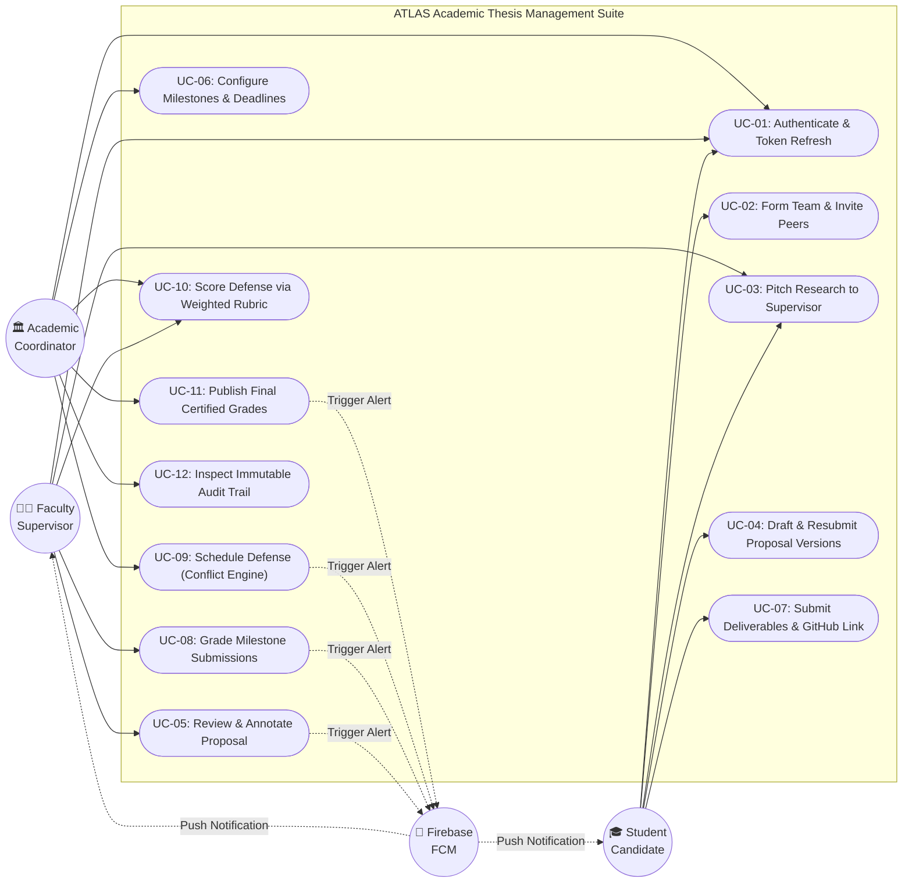
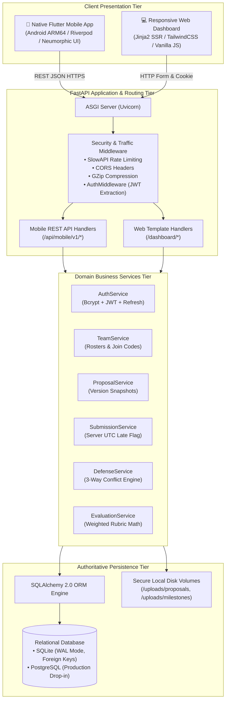
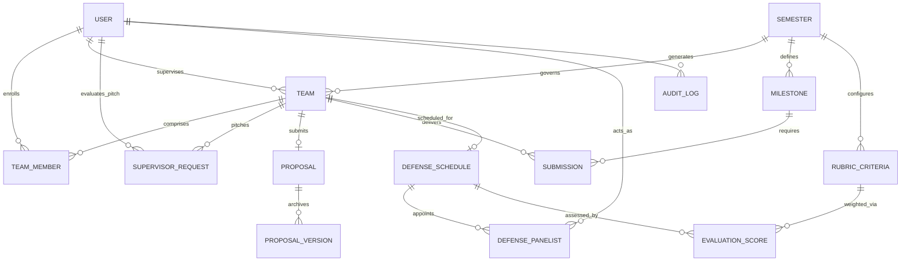
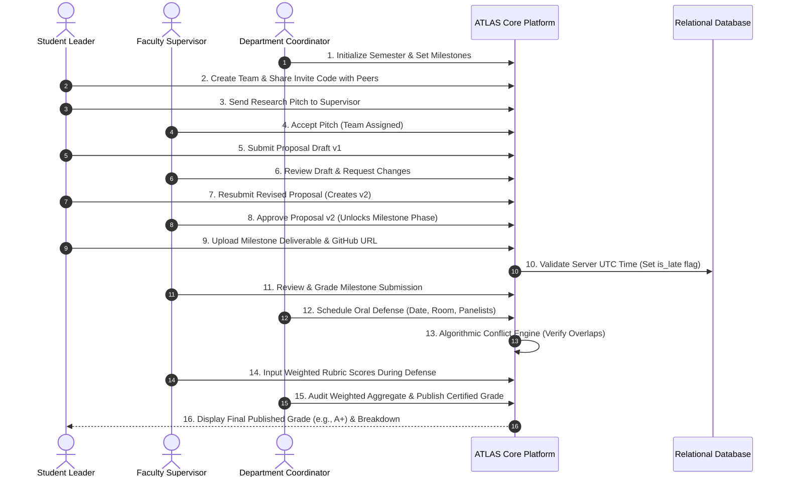
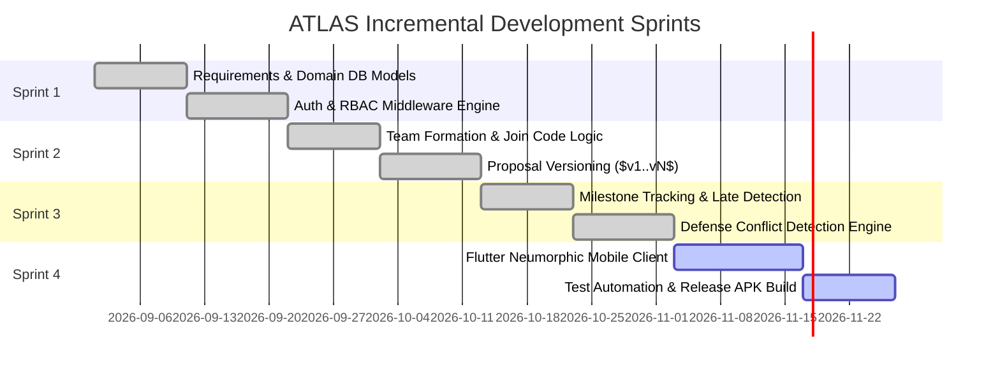

# ATLAS — Academic Thesis Lifecycle & Assessment Suite
## Software Project Proposal Presentation Document

---

**Project Title:** ATLAS — Academic Thesis Lifecycle & Assessment Suite  
**Tagline:** A centralized, multi-role academic research governance platform with algorithmic conflict prevention and weighted rubric assessment.  
**Student Presenter:** Md Al Sabber Rahman (Student ID: CSE-2026-01)  
**Department & University:** Department of Computer Science & Engineering (CSE)  
**Course Title & Code:** Software Engineering Capstone Project / CSE 4200  
**Course Teacher:** Tanvir Ahmed  
**Semester & Academic Year:** Fall 2026 / 2026–2027  
**Document Format:** 12-Slide Presentation Blueprint & Detailed Technical Proposal  

---

## Slide 1: Title Slide

### Slide Content & Visual Layout

* **Project Title:** ATLAS — Academic Thesis Lifecycle & Assessment Suite
* **Short Tagline:** Streamlining university thesis, capstone, and dissertation workflows through authoritative lifecycle automation.
* **Group Member / Presenter:**
  * **Name:** Md Al Sabber Rahman
  * **Student ID:** CSE-2026-01
  * **Role:** Lead Full-Stack Software Engineer & System Architect
* **Department & University:**
  * Department of Computer Science & Engineering (CSE)
  * Faculty of Science and Information Technology
* **Course Information:**
  * **Course Title:** Software Engineering Capstone Project
  * **Course Code:** CSE 4200 / SWE 4201
* **Course Teacher:** Tanvir Ahmed
* **Presentation Date:** Current Semester Examination Period (Fall 2026)

> **Slide Goal:** Introduce the project title, author, institution, course identifiers, and supervisor clearly, establishing an academic, professional, and well-structured tone.

---

## Slide 2: Introduction and Problem Statement

### 1. Introduction to the Project Domain
* In higher education, the undergraduate capstone project and postgraduate thesis represent the pinnacle of academic evaluation.
* This domain involves complex coordination across three major academic stakeholders: **Students (Candidates)**, **Faculty Supervisors (Mentors)**, and **Department Coordinators (Administrators)**.
* The typical thesis journey spans multiple academic terms: team formation, research proposal drafting, supervisor assignment, progress milestone deliverables, oral defense scheduling, panel evaluations, and certified grade publication.

### 2. Description of the Existing Problem
* **Scattered & Unversioned Communication:** Proposals, revisions, and supervisor annotations are conducted through unstructured email threads, messaging apps (WhatsApp/Telegram), and paper submissions. Critical reviewer remarks are frequently lost.
* **Lack of Timetable & Defense Scheduling Conflicts:** Coordinators spend days manually cross-referencing room timetables and professor calendars on spreadsheets. Double-booking oral defense rooms and appointing faculty members to concurrent examination panels is a persistent issue.
* **Subjective & Tedious Grading:** Panelists calculate multi-criteria defense scores on paper or isolated spreadsheets. Aggregating weighted percentages manually leads to transcription errors, grading delays, and student disputes.
* **Absence of Accountability & Audit Trails:** There is no tamper-proof digital log of submission timestamps, late penalties, or supervisor approvals required for national and international accreditation (e.g., BAETE, ABET).

### 3. Who Experiences This Problem?
* **Students:** Experience anxiety over unacknowledged proposals, unnotified deadline changes, lack of milestone feedback, and opaque grading rubrics.
* **Faculty Supervisors:** Suffer from inbox fatigue, uncoordinated student pitches, overlapping review queues, and lack of historical version comparison.
* **Academic Coordinators:** Bear an immense administrative burden juggling semester configurations, supervisor workload balancing, defense room logistics, and grade calculations.

### 4. Why Is This Problem Important?
* Academic integrity, institutional accreditation, and on-time graduation depend directly on systematic thesis management.
* Administrative bottlenecks delay final graduation clearances, consume hundreds of faculty hours per term, and increase institutional operational costs.

### 5. Illustrative Real-World Scenario
> **Scenario:** Student Team "Apollo" emails their 20-page thesis proposal to Professor A. The professor requests revisions via a reply email. Meanwhile, the team leader sends version 2 via Google Drive, but the supervisor accidentally reviews the old version attached to the original email. At the end of the term, the Department Coordinator schedules Team Apollo's oral defense in Seminar Hall B at 10:00 AM on Monday, assigning Professor A and Professor B as examiners. On defense day, Professor B is simultaneously sitting on another thesis panel in Room CS-301, and Seminar Hall B is already booked for an undergraduate lecture. The oral defense collapses into emergency rescheduling, wasting everyone's time.

### 6. The Core Question Answered
* **What problem are we trying to solve?** The chaotic, unversioned, conflict-prone, and paper-dependent management of university thesis and capstone lifecycles.
* **Why does it need a software solution?** Because manual spreadsheets and generic communication tools lack relational state machines, algorithmic interval collision detection, immutable document versioning, and authoritative server-side timestamp validation.

---

## Slide 3: Project Objectives

### 1. General Objective
To design, engineer, and verify **ATLAS**, a unified, multi-role software system that digitizes and governs the end-to-end academic thesis lifecycle—from student team formation and iterative proposal reviews to conflict-free defense scheduling and weighted rubric assessment.

### 2. Specific Objectives (Achievable within the Semester)
1. **Automated Team Formation & Supervision Matching:** Develop an invite-code-based team enrollment mechanism and a two-sided research pitch negotiation workflow between student teams and faculty supervisors.
2. **Immutable Proposal Versioning System:** Build an incremental proposal versioning engine ($v1 \dots vN$) that preserves complete revision histories, supervisor comments, and formal approval states without overwriting past submissions.
3. **Milestone Tracking with Authoritative Late Submission Detection:** Implement deliverable upload tracking (PDFs and GitHub repositories) with server-side UTC timestamp comparison against milestone deadlines.
4. **Algorithmic Defense Collision Detection Engine:** Formulate and implement a mathematical interval overlap engine that prevents double-booking of defense venues, faculty panelists, and defending student cohorts.
5. **Multi-Criteria Weighted Rubric Engine & Grade Locking:** Formulate an automated scoring engine that computes weighted composite marks across multiple panel examiners and maps them to institutional letter grades ($A+, A, B, \dots$).
6. **Cross-Platform Access (Backend API & Native Android Mobile App):** Expose modular, secure REST APIs in FastAPI and deploy a responsive native Flutter mobile client featuring an iOS-inspired Neumorphic Soft UI.

### 3. Expected Improvements & Measurable Benefits
* **90% Reduction in Administrative Overhead:** Eliminates manual spreadsheet timetable compilation and email consolidation.
* **Zero Defense Scheduling Collisions:** Mathematically guarantees that no venue or faculty panelist is scheduled concurrently.
* **100% Version Traceability:** Every change between proposal drafts and supervisor feedback is permanently preserved for audit and accreditation.
* **Immediate Grade Transparency:** Students receive authenticated breakdowns of rubric scores once officially published by coordinators.

---

## Slide 4: Existing System and Proposed Solution

### 1. How the Problem Is Currently Handled
* **Communication:** Email threads, personal messaging groups, physical bulletin boards, and in-person consultations.
* **File Submissions:** Google Drive folders, USB flash drives, printed spiral-bound reports, and unmonitored email attachments.
* **Timetables & Scheduling:** Microsoft Excel / Google Sheets managed by a single coordinator with manual eye-ball verification of professor availability.
* **Evaluation & Grading:** Physical printed evaluation slips hand-signed by defense committee members, hand-calculated using pocket calculators, and manually typed into university transcript software.

### 2. Limitations of the Existing Approach
| Factor | Existing Manual / LMS Approach | Impact / Failure Mode |
|---|---|---|
| **Version Integrity** | Overwritten files or disparate attachments in emails | Supervisors review outdated drafts; loss of revision accountability. |
| **Defense Scheduling** | Manual spreadsheet cross-checking | Room double-booking; examiner schedule clashes on defense day. |
| **Submission Deadlines** | Client-asserted email timestamps or manual hand-ins | Disputes over late submissions; timezone manipulation; subjective enforcement. |
| **Grading Accuracy** | Manual arithmetic on paper slips | Calculation errors; inconsistent rubric criteria weighting; unrecorded panel remarks. |
| **Role Boundaries** | Open access or loose permissions in shared cloud folders | Accidental file deletions; premature grade leakage before official committee approval. |

### 3. Proposed Software Solution: ATLAS
ATLAS introduces a cohesive, full-stack, state-governed architecture tailored explicitly for academic research engineering:
* **Authoritative Server-Side State Machine:** 12-stage sequential workflow moving strictly from `Semester Config` $\rightarrow$ `Team Formation` $\rightarrow$ `Proposal Iterations` $\rightarrow$ `Milestones` $\rightarrow$ `Defense Scheduling` $\rightarrow$ `Rubric Evaluation` $\rightarrow$ `Grade Publication`.
* **Algorithmic Defense Scheduler:** Enforces mathematical interval conflict detection on defense hearings before writing records to the database.
* **Immutable Snapshot Engine:** Preserves each revision of a thesis proposal alongside supervisor remarks and diff summaries.
* **Dual-Token Cryptographic Security:** Short-lived JWT access tokens with revocable refresh tokens, hardware-encrypted on Android devices.

### 4. Comparison with Existing Similar Applications
| Feature / Requirement | Google Classroom / Canvas | Jira / Trello | OpenConf / EasyChair | **ATLAS (Proposed)** |
|---|:---:|:---:|:---:|:---:|
| **Target Domain** | Course assignments | Corporate software sprints | Conference paper reviews | **University Thesis & Capstone** |
| **Student Team Join Codes** | ❌ No | ❌ No | ❌ No | ✅ **Yes (Unique 6-char codes)** |
| **Faculty Pitch Negotiation** | ❌ No | ❌ No | ❌ No | ✅ **Yes (Formal pitch & accept)** |
| **Proposal Versioning ($v1..vN$)** | ⚠️ Partial (History) | ❌ No | ⚠️ Paper Revisions | ✅ **Yes (Dedicated snapshot DB)** |
| **Defense Room/Panel Collision Engine** | ❌ No | ❌ No | ⚠️ Complex / Manual | ✅ **Yes (Algorithmic 3-way check)** |
| **Weighted Defense Rubrics** | ⚠️ Generic Rubric | ❌ No | ⚠️ Reviewer Scores | ✅ **Yes (Mathematical aggregator)** |
| **Native Mobile App (Soft UI)** | ⚠️ Standard Webview | ⚠️ Heavy Corporate App | ❌ Web Only | ✅ **Yes (Native Flutter ARM64)** |

---

## Slide 5: Project Scope and Target Users

### 1. Intended Users of the System
1. **Students (Thesis Candidates):** Undergraduate and postgraduate researchers working individually or in collaborative cohorts.
2. **Faculty Supervisors (Research Mentors & Defense Panelists):** Professors, associate professors, and lecturers guiding student cohorts and evaluating defense sessions.
3. **Department Coordinators (Academic Administrators):** Capstone project directors and department heads with institutional authority over terms, schedules, and final grade certification.

### 2. Main Activities by User Role
* **Student Activities:** Register account; create team or enroll via invite code; send research pitches to faculty; submit proposal drafts and resubmit revisions; upload milestone reports and GitHub links; view defense schedule; inspect certified rubric grades.
* **Supervisor Activities:** Review pending supervision pitches (accept/decline); evaluate proposal drafts (approve / request changes / reject); inspect and grade milestone deliverables with qualitative remarks; score oral defenses as panel chair or examiner.
* **Coordinator Activities:** Initialize and activate academic semesters; set team size bounds ($min..max$); assign faculty mentors administratively; define milestone deadlines; configure weighted rubric criteria; schedule oral defenses (protected by conflict engine); audit immutable logs; publish official transcripts.

### 3. Features Included in Project Scope (Scope IN)
* Multi-role authentication with Bcrypt password hashing, JWT access tokens, and refresh token rotation.
* Collaborative team management with unique 6-character alphanumeric invite codes.
* Research proposal iterative lifecycle with immutable `ProposalVersion` records and supervisor critique notes.
* Milestone deliverable tracking supporting PDF documents, GitHub repository links, and server-side late submission detection.
* Automated 3-way conflict detection for oral defenses (validating room, defense panel members, and defending team simultaneously).
* Weighted multi-criteria rubric scoring engine with automatic percentage-to-letter-grade mapping.
* Cross-platform presentation: Native Flutter Android mobile client and responsive server-rendered web portal.
* Push notifications via Firebase Cloud Messaging (FCM) and system audit logging.

### 4. Features Explicitly Excluded (Scope OUT - Preventing Scope Creep)
* **Direct Commercial Plagiarism Scanning Engine:** Integrating paid Turnitin/iThenticate APIs is excluded due to proprietary licensing fees (mocked/manual link submission is provided).
* **Payment Gateway & Tuition Fee Clearance:** ATLAS strictly focuses on academic thesis governance; fee clearance remains with university banking portals.
* **Live Video Streaming for Remote Defenses:** Real-time video conferencing (e.g., Zoom/WebRTC) is excluded; ATLAS handles scheduling, room logistics, and in-person/hybrid link distribution.
* **Multi-University Multi-Tenant Federation:** ATLAS is built as a sovereign deployment for a single university department/faculty rather than a public SaaS.

### 5. Deployment Platforms
* **Backend:** FastAPI (Python 3.10+) running on ASGI Uvicorn with SQLite (WAL mode) / PostgreSQL.
* **Mobile Client:** Native Flutter (Dart 3.x) compiled to standalone ARM64 release binary for Android.
* **Web Portal:** Responsive Jinja2, HTML5, Vanilla CSS / TailwindCSS interface for desktop administrative use.

---

## Slide 6: Functional and Non-Functional Requirements

### A. Functional Requirements (What the Software Must Do)
* **FR-01: Authentication & Role-Based Access Control (RBAC):** The system must allow users to register and authenticate using institutional emails, assigning strictly isolated roles (`STUDENT`, `SUPERVISOR`, `COORDINATOR`) enforced at both route and database levels.
* **FR-02: Team Formation & Invite Code Enrollment:** Student leaders must be able to create a team, generate an alphanumeric join code, and invite eligible peers up to the semester's maximum capacity limit.
* **FR-03: Two-Sided Supervision Pitching:** Teams must be able to select and pitch research topics to faculty members, who can either accept or decline with mentorship feedback.
* **FR-04: Multi-Round Proposal Versioning ($v1 \dots vN$):** When supervisors request changes, students must be able to submit updated proposals with a summary of changes, incrementing the version number while permanently archiving previous drafts.
* **FR-05: Milestone Submissions & Late Detection:** Students must be able to upload PDF deliverables and GitHub repository URLs. The server must automatically compare the UTC arrival timestamp with the milestone deadline, setting `is_late = True` if overdue.
* **FR-06: Oral Defense Scheduling with Conflict Prevention:** Coordinators must be able to schedule defense hearings. The system must reject any booking where the room, candidate team, or any appointed faculty panelist has an overlapping time slot.
* **FR-07: Standardized Rubric Evaluation & Grade Publication:** Defense committee members must submit numerical marks across predefined weighted criteria. The system must compute weighted averages, map to letter grades, and allow the coordinator to publish official results.

### B. Non-Functional Requirements (Performance & Quality Attributes)
* **NFR-01: Cryptographic Security & Privacy:** Passwords must be hashed using salted Bcrypt. Mobile tokens must be stored inside the hardware Android Keystore (`flutter_secure_storage`). Interim evaluation scores must remain confidential until officially published.
* **NFR-02: Performance & Response Latency:** Backend API endpoints must respond in under 100 milliseconds for standard queries. The mobile application must maintain a steady 60 frames per second (FPS) with smooth Neumorphic rendering.
* **NFR-03: Concurrency & Data Integrity:** Database transactions must be ACID-compliant. SQLite must run in Write-Ahead Logging (`WAL`) mode with `busy_timeout=5000` to eliminate database locked exceptions during concurrent reads and writes.
* **NFR-04: Usability & Ergonomics:** The user interface must feature intuitive information architecture, clear feedback toasts, shimmer loading skeletons, and dark/light mode toggling, reducing user cognitive load.
* **NFR-05: Reliability & Maintainability:** The software must have zero critical static analysis warnings, a decoupled service-layer architecture, and an automated test suite achieving a 100% pass rate.

---

## Slide 7: System Analysis and Design

### 1. Master System Use Case Diagram
The following diagram highlights the three primary human actors and the Firebase push subsystem interacting with ATLAS's functional boundaries:

### 2. High-Level Multi-Tier Architecture Diagram
ATLAS utilizes a cleanly decoupled layered architecture separating native mobile presentation, API gateway middleware, business services, and relational persistence:

### 3. Entity-Relationship (ER) Diagram
The core data model consists of strongly typed entities enforcing referential integrity and zero orphan records:

---

## Slide 8: Proposed Features and System Workflow

### 1. Main Functional Modules
1. **Authentication & Identity Module:** Unified login with automatic role detection, Bcrypt password hashing, and token refresh.
2. **Team Collaboration Module:** Dynamic invite code generation, member joining, capacity validation, and leadership delegation.
3. **Supervisor Matching Module:** Structured research pitching mechanism with faculty workload tracking and acceptance/rejection workflows.
4. **Iterative Proposal Versioning Module:** Immutable versioning ($v1, v2, \dots$) recording abstract, methodology, supervisor feedback, and diff summaries.
5. **Milestone & Code Deliverable Module:** Upload of PDF reports and GitHub URLs with server-side UTC late submission calculation.
6. **Defense Conflict Prevention Module:** Algorithmic three-way verification of room bookings, candidate schedules, and faculty panelist commitments.
7. **Rubric Grading & Registry Module:** Multi-examiner rubric score aggregation, weighted calculation, letter grade mapping, and coordinator grade publishing.

### 2. End-to-End System Workflow (Sequence Flowchart)

### 3. Sample User Interface Design Concept (Neumorphic Soft UI)
* **Design Philosophy:** Tactile Neumorphism inspired by modern iOS aesthetics. Features dual drop shadows (soft highlight on top-left, dark shadow on bottom-right) that create realistic surface extrusion on a subtle off-white / dark-slate canvas.
* **Component Kit:**
  * `IosNeuCard`: Tactile container cards with configurable depth and border radius.
  * `NeuButton`: Physical button that depresses with concave shading upon user touch.
  * `Shimmer Skeletons`: Pulsing placeholder cards during asynchronous data fetching.
  * `Theme Engine`: Seamless light mode (Slate White `#F0F3F8`) and dark mode (Midnight Navy `#0F172A`).

---

## Slide 9: Technology Stack and Tools

### 1. Technology Selection Matrix
| Architectural Layer | Chosen Technology | Version | Rationale & Justification |
|---|---|---|---|
| **Programming Languages** | **Python** & **Dart** | Python 3.10+ / Dart 3.x | Python provides exceptional backend ecosystem maturity; Dart offers sound null safety and ahead-of-time (AOT) machine compilation. |
| **Backend Framework** | **FastAPI** | 0.115+ | High-performance asynchronous ASGI framework; native Pydantic schema validation; automatic OpenAPI Swagger generation. |
| **Mobile Frontend** | **Flutter** | 3.24+ | Native ARM64 Android binary compilation; zero WebView lag; 60 FPS smooth rendering; shared codebase. |
| **Mobile State Management** | **Flutter Riverpod** | 2.6+ | Compile-time safe state management; fine-grained selectors preventing unnecessary widget rebuilds; testable without `BuildContext`. |
| **Database & ORM** | **SQLite (WAL)** & **SQLAlchemy 2.0** | SQLite 3.45+ / SQLAlchemy 2.0 | Zero-configuration local database with Write-Ahead Logging concurrency; 100% drop-in compatibility for PostgreSQL in production. |
| **Security & Auth** | **Passlib (Bcrypt)** & **PyJWT** | Bcrypt 4.x / PyJWT 2.9 | Industry-standard salted password hashing; dual-token authentication with hardware Keystore storage on Android. |
| **External Cloud Services**| **Firebase Cloud Messaging** | Admin SDK 6.5+ | Reliable real-time push notification delivery directly to mobile device status bars. |
| **Testing & Quality** | **Pytest** & **Flutter Test** | Pytest 8.x | Comprehensive automated unit, integration, and UI widget testing (72+ verified tests). |

### 2. Feasibility & Suitability Justification
* **Why not an overly complex microservice stack?** A monolithic modular backend in FastAPI with clean service separation avoids unnecessary network overhead, container orchestration complexity, and operational failure modes while being 100% achievable and maintainable within the academic semester.
* **Why Flutter instead of React Native?** Flutter renders directly to the canvas using Impeller/Skia, avoiding JavaScript bridge bottlenecks and guaranteeing identical Neumorphic shadow physics across Android hardware.

---

## Slide 10: Development Methodology and Testing Plan

### A. Software Development Methodology: Agile / Incremental Model
* **Model Selected:** Agile Scrum / Incremental Process Model with four distinct 3-week sprint iterations.
* **Reasons for Selection:**
  * Allows continuous stakeholder feedback from the Course Teacher and academic supervisor.
  * Enables early verification of core modules (e.g., database models and auth) before building complex algorithmic layers (e.g., defense conflict engine).
  * Reduces risk through incremental automated testing at every sprint boundary.

### B. Comprehensive Multi-Level Testing Plan
1. **Unit Testing:**
   * Backend: Pytest suites verifying Pydantic payload schemas, Bcrypt password hashing, and weighted rubric arithmetic formulas.
   * Mobile: Dart unit tests verifying Riverpod StateNotifiers and JSON deserialization models.
2. **Integration Testing:**
   * Testing FastAPI endpoints using `TestClient` to verify database session commits, rollback integrity, and HTTP status codes (200, 201, 400, 403, 409, 422).
   * Testing Dio network interceptors and automatic token refresh replay upon receiving HTTP 401.
3. **System & Scenario Testing:**
   * Simulating complete user journeys from student registration to oral defense grade publication.
   * Deliberately attempting conflicting defense bookings to verify the 409 Conflict rejection.
4. **User Acceptance Testing (UAT):**
   * Testing role boundaries using dedicated test personas: Coordinator (`coordinator@cstu.edu.bd`), Supervisor (`supervisor1@cstu.edu.bd`), and Student (`student1@cstu.edu.bd`).
5. **Requirements Verification Criteria:**
   * 100% automated test pass rate across all 72+ test cases.
   * Zero static analysis warnings (`dart analyze` clean; `flake8` clean).

---

## Slide 11: Project Timeline and Team Responsibilities

### A. Academic Semester Project Timeline (14-Week Schedule)

| Phase / Week | Focus Area & Milestones | Deliverables / Output |
|:---:|---|---|
| **Week 1–2** | Requirement Analysis & Domain Modeling | SRS Document, User Stories, Use Case Diagrams. |
| **Week 3–4** | Database Architecture & Core Authentication | 21 SQLAlchemy Models, SQLite WAL Configuration, Bcrypt & JWT Auth. |
| **Week 5–6** | Team Management & Supervisor Pitch Engine | Invite code generator, Supervision pitch request/accept workflows. |
| **Week 7–8** | Proposal Versioning & Milestone Deliverables | Snapshot versioning engine ($v1..vN$), Server-side late submission flag. |
| **Week 9–10** | Oral Defense Conflict Engine & Rubrics | 3-way interval overlap algorithm, Weighted multi-criteria rubric math. |
| **Week 11–12** | Native Flutter Mobile Client Development | Neumorphic UI screens, Riverpod state providers, Dio interceptor. |
| **Week 13** | Verification, Quality Assurance & Security Audit | 72+ automated tests (Pytest + Flutter test), R8 ProGuard Android APK. |
| **Week 14** | Final Documentation, Proposal Presentation & Viva | Formal Technical Report, Presentation Slides, Viva Handbook. |

### B. Team Responsibilities & Resource Allocation
* **Presenter & Lead Engineer:** Md Al Sabber Rahman
* **Assigned Engineering Modules:**
  * **System Architecture & Database Design:** Designed the 21 relational models and schema foreign key relationships.
  * **Backend API Development:** Implemented FastAPI route handlers, Pydantic validators, and modular business services.
  * **Algorithmic Defense Engine:** Formulated and tested the three-way interval overlap conflict detection logic.
  * **Mobile Client Engineering:** Built the native Flutter mobile client featuring Neumorphic Soft UI and Riverpod state management.
  * **Quality Assurance & DevOps:** Developed the automated Pytest and Flutter test suites, Docker containerization, and ARM64 APK compilation.
* **Coordination & Tracking Methodology:**
  * Source code tracked via Git version control on GitHub with meaningful commit messages.
  * Weekly milestones tracked against the project proposal deliverables.

---

## Slide 12: Expected Outcomes, Risks and References

### A. Expected Outcomes and Deliverables
* **Fully Functional Full-Stack Platform:** A high-performance, asynchronous REST backend running on FastAPI, coupled with a responsive native Flutter Android client.
* **Production-Grade Android Release APK:** Compact 20.86 MB standalone ARM64 release binary ([`app-arm64.apk`](file:///e:/Virtual%20Stdio%20Codes/Mobile%20Application/projects/Atlas/app-arm64.apk)) optimized using R8 code shrinking.
* **Elimination of Administrative Errors:** Complete prevention of double-booked defense venues and overlapping panel examiners.
* **Accreditation-Ready Auditability:** An immutable audit log documenting every review verdict, deadline extension, and published grade.
* **Comprehensive Automated Test Suite:** 72+ passing tests verifying functional correctness, role-based authorization, and security constraints.

### B. Potential Project Risks & Technical Mitigations
| Risk Factor | Nature / Impact | Technical Mitigation Strategy |
|---|---|---|
| **SQLite Concurrency Bottlenecks** | File-lock exceptions during simultaneous multi-user writes | Configured Write-Ahead Logging (`PRAGMA journal_mode=WAL`) and `busy_timeout=5000ms`. Database architecture is completely engine-agnostic and drops into PostgreSQL. |
| **Mobile Token Expiration Mid-Session** | Abrupt network failures and user logout | Implemented Dio `QueuedInterceptor` that catches HTTP 401, locks outgoing requests, calls `/auth/refresh`, and silently replays pending calls. |
| **Semester Time Constraints** | Potential incomplete features due to scope creep | Enforced strict functional boundaries (Scope OUT for third-party commercial plagiarism and payment gateways); utilized Agile 3-week sprint iterations. |
| **Data Tampering & Grade Leakage** | Students attempting to access draft defense marks | Object-level authorization in FastAPI dependencies; defense marks remain invisible in API queries until `grade_published = True`. |

### C. References and Academic Citations
1. **FastAPI Framework Documentation:** Ramírez, S. (2024). *FastAPI: Modern, Fast Web Framework for Python 3.8+*. Available at: https://fastapi.tiangolo.com/
2. **Flutter & Dart Architecture:** Google LLC. (2024). *Flutter Architectural Overview & Sound Null Safety*. Available at: https://docs.flutter.dev/
3. **Database Concurrency & WAL:** SQLite Development Team. (2024). *Write-Ahead Logging in SQLite*. Available at: https://www.sqlite.org/wal.html
4. **Software Engineering Standards:** Pressman, R. S., & Maxim, B. R. (2020). *Software Engineering: A Practitioner's Approach* (9th ed.). McGraw-Hill Education.
5. **Role-Based Access Control (RBAC):** Sandhu, R. S., Coyne, E. J., Feinstein, H. L., & Youman, C. E. (1996). *Role-based access control models*. IEEE Computer, 29(2), 38-47.
6. **Existing Academic Systems Studied:** OpenConf Peer Review and Conference Management System (https://www.openconf.com/) and Canvas LMS by Instructure.

---

## Appendix: Recommended Presentation Guidelines Compliance Checklist
* [x] **Number of Slides:** Exactly 12 structured slides.
* [x] **Duration:** Tailored for 8–10 minutes oral presentation.
* [x] **Q&A Readiness:** Includes complete technical rationale and defensible architecture.
* [x] **Presentation Style:** Concise bullet points, structured comparison tables, and formal Mermaid diagrams.
* [x] **Technical Detail:** Demonstrates clear engineering feasibility without dumping excessive source code.
* [x] **Academic Information:** Includes student name (Md Al Sabber Rahman) and course teacher name (Tanvir Ahmed).
