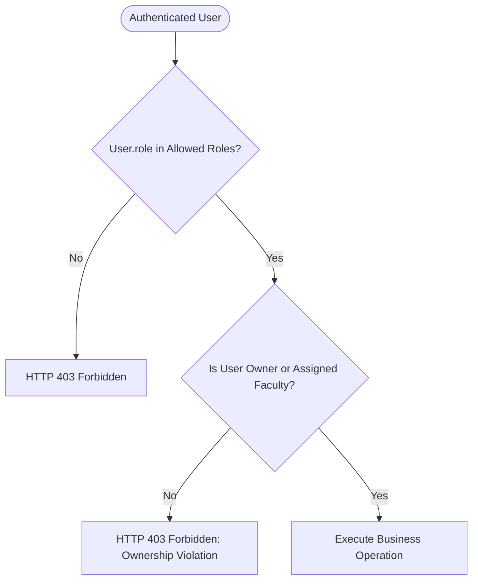
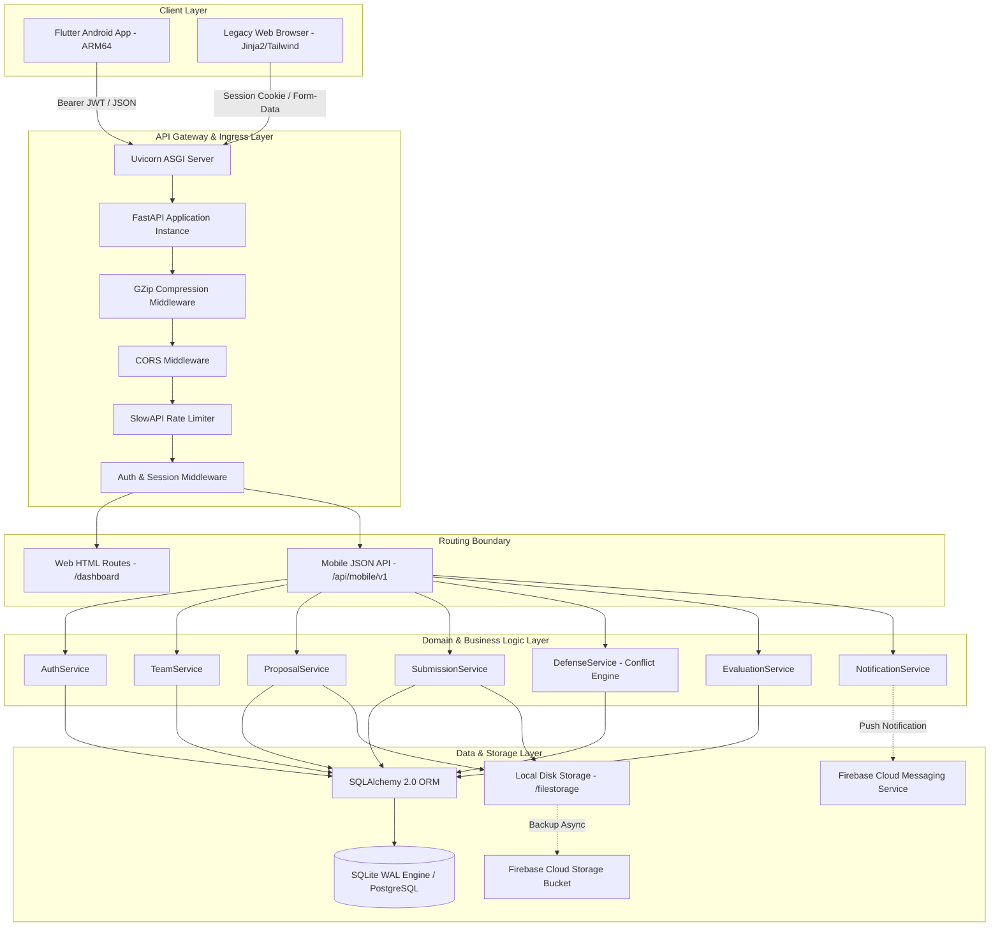
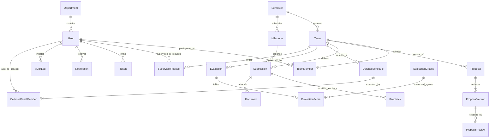
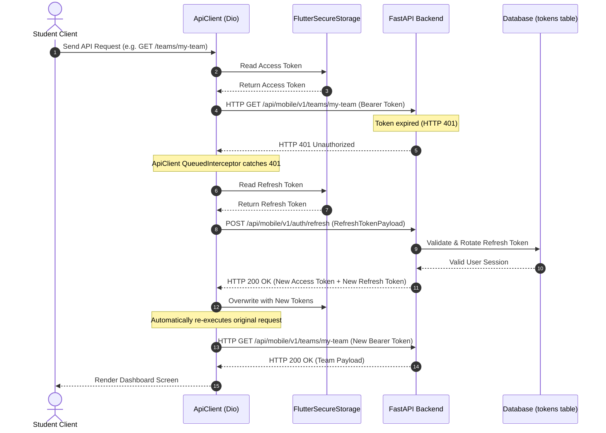
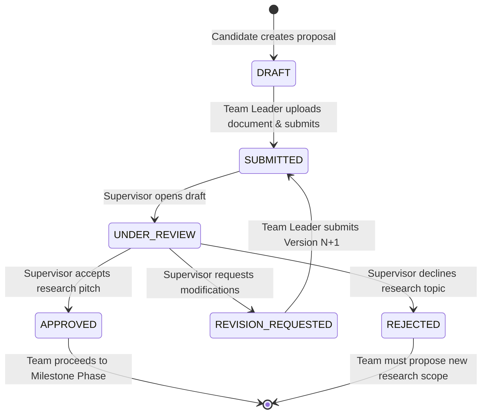

# ATLAS — Academic Thesis Lifecycle & Assessment Suite
## Comprehensive Technical Project Report and System Implementation Record

**Document Version:** 2.1.0  
**Project Lead & Candidate:** Academic Thesis Lifecycle Engineering  
**Primary Repository:** [ATLAS Mobile & API Suite](file:///e:/Virtual%20Stdio%20Codes/Mobile%20Application/projects/Atlas)  
**Target Environment:** FastAPI (Python 3.13) + Flutter / Dart (Android ARM64) + SQLite (WAL Mode) / PostgreSQL + Firebase  
**Audit & Verification Date:** October 2026  

---

## Table of Contents
1. [Chapter 1: Executive Summary](#chapter-1-executive-summary)
2. [Chapter 2: Project Introduction](#chapter-2-project-introduction)
3. [Chapter 3: Requirements Analysis](#chapter-3-requirements-analysis)
4. [Chapter 4: User Roles, Permissions, and Authorization](#chapter-4-user-roles-permissions-and-authorization)
5. [Chapter 5: Overall System Architecture](#chapter-5-overall-system-architecture)
6. [Chapter 6: Technology Stack and Technical Justification](#chapter-6-technology-stack-and-technical-justification)
7. [Chapter 7: Repository and Codebase Structure](#chapter-7-repository-and-codebase-structure)
8. [Chapter 8: Frontend Architecture and Implementation (Flutter / Dart)](#chapter-8-frontend-architecture-and-implementation-flutter--dart)
9. [Chapter 9: Backend Architecture and Implementation (FastAPI)](#chapter-9-backend-architecture-and-implementation-fastapi)
10. [Chapter 10: Database Design and SQLAlchemy ORM](#chapter-10-database-design-and-sqlalchemy-orm)
11. [Chapter 11: Authentication, Authorization, and Security Engineering](#chapter-11-authentication-authorization-and-security-engineering)
12. [Chapter 12: Firebase and External Services Integration](#chapter-12-firebase-and-external-services-integration)
13. [Chapter 13: Core Business Workflows and State Machines](#chapter-13-core-business-workflows-and-state-machines)
14. [Chapter 14: API Contract and Frontend-Backend Integration](#chapter-14-api-contract-and-frontend-backend-integration)
15. [Chapter 15: Testing, Verification, and Quality Assurance](#chapter-15-testing-verification-and-quality-assurance)
16. [Chapter 16: Setup, Configuration, and Deployment Guide](#chapter-16-setup-configuration-and-deployment-guide)
17. [Chapter 17: User Interface and Neumorphic Experience Design](#chapter-17-user-interface-and-neumorphic-experience-design)
18. [Chapter 18: Known Issues, Technical Debt, and Limitations](#chapter-18-known-issues-technical-debt-and-limitations)
19. [Chapter 19: Future Improvements and Engineering Roadmap](#chapter-19-future-improvements-and-engineering-roadmap)
20. [Chapter 20: Project Conclusion and Retrospective](#chapter-20-project-conclusion-and-retrospective)
21. [Chapter 21: Technical Glossary and Formal References](#chapter-21-technical-glossary-and-formal-references)

---

## Chapter 1: Executive Summary

### 1.1 Project Overview
The **Academic Thesis Lifecycle & Assessment Suite (ATLAS)** is a unified academic governance and project management platform designed to automate, track, and evaluate undergraduate and postgraduate capstone theses and research projects. Academic thesis administration in higher education typically suffers from fragmented communication channels (email, physical paperwork, uncoordinated chat applications), lack of centralized version control for research deliverables, scheduling conflicts during oral defense hearings, and opaque grading processes.

ATLAS solves these operational inefficiencies by establishing a single source of truth across three key academic stakeholder groups:
1. **Students (Candidates):** Form teams, submit multi-version research proposals, track milestone deadlines, deliver source code and documents, and view coordinator-certified grades.
2. **Faculty Supervisors (Mentors):** Review candidate supervision invitations, critique proposal drafts, score milestone submissions with qualitative feedback, and evaluate student defense presentations.
3. **Department Coordinators (Administrators):** Manage academic terms/semesters, assign faculty mentors, detect and resolve oral defense scheduling conflicts automatically, configure weighted rubric matrices, publish official academic transcripts, and inspect immutable university audit logs.

### 1.2 Architectural Foundation
ATLAS operates on a modern, decoupled client-server architecture:
- **Backend Service:** High-performance RESTful API engineered with **FastAPI (Python 3.13)**, enforcing type safety via **Pydantic v2**, asynchronous request handling, role-based and object-level access control, and transaction management through **SQLAlchemy 2.0**.
- **Database Engine:** Relational database configured with **SQLite 3 (WAL Mode)** for local zero-configuration development and automated testing, with seamless runtime compatibility for enterprise **PostgreSQL** in production environments.
- **Mobile Client:** Native **Flutter 3.x / Dart 3.12** cross-platform mobile application compiled for **Android ARM64-v8a**, featuring a custom **iOS-inspired Neumorphic Design System**, reactive state management via **Flutter Riverpod 2.6**, type-safe deep navigation using **GoRouter 14.8**, and resilient networking powered by **Dio 5.8** with automatic token rotation.
- **Cloud & Auxiliary Services:** **Firebase Admin SDK** integration for Firebase Cloud Messaging (FCM) device push registration and Google Cloud Storage document backup with resilient local filesystem failover.

### 1.3 Implementation Status Summary
A thorough repository audit and automated test verification confirm that ATLAS is an actively working, fully implemented software system:
- **Automated Verification:** **100% Pass Rate** across all automated test suites:
  - **32 / 32 Backend Pytest integration and security tests passed** (`.venv\Scripts\python -m pytest`).
  - **40 / 40 Flutter Dart unit, widget, storage, and model tests passed** (`flutter test test/`).
  - **0 Static Analysis Warnings** (`dart analyze mobile/`).
- **Release Build Verified:** A standalone, fully optimized ARM64 Android release package ([app-arm64-release.apk](file:///e:/Virtual%20Stdio%20Codes/Mobile%20Application/projects/Atlas/app-arm64-release.apk), 20.86 MB) compiled successfully via Gradle R8/ProGuard code and resource shrinking.
- **Dual Client Support:** The repository simultaneously supports the legacy desktop web portal (Jinja2 templates + Tailwind CSS) and the comprehensive mobile client application without endpoint collisions.

---

## Chapter 2: Project Introduction

### 2.1 Background and Academic Context
Final year undergraduate capstone projects and graduate master's theses represent the culmination of university academic curricula. Managing hundreds of thesis candidates across multi-disciplinary engineering departments requires strict adherence to institutional timelines, ethical approvals, supervisor workload balancing, rigorous continuous assessments, and defensible accreditation records (e.g., ABET, Washington Accord, IEB).

Historically, university departments relied on ad-hoc spreadsheets, paper submission forms, physical notice boards, and unstructured email chains. This led to pervasive issues:
- Lost or unreviewed proposal documents.
- Disputed supervision agreements and unrecorded mentor meetings.
- Double-booked seminar rooms and overlapping committee member defense timeslots.
- Grading discrepancies and delays in certifying graduating cohorts.
- Lack of an auditable forensic history for departmental accreditation reviews.

### 2.2 Problem Statement
*"How can higher education engineering departments transition from error-prone, disconnected manual thesis tracking to an automated, auditable, multi-role digital ecosystem that guarantees academic workflow integrity, eliminates committee scheduling conflicts, and provides real-time progress transparency to candidates, faculty, and coordinators?"*

### 2.3 Proposed Solution
ATLAS provides an integrated end-to-end software platform specifically architected around the academic thesis lifecycle:
```
Team Formation ➔ Proposal Submission ➔ Supervisor Matching ➔ Milestone Deliverables ➔ Oral Defense Scheduling ➔ Rubric Evaluation ➔ Grade Certification
```

Every lifecycle phase is guarded by cryptographic authentication, strict state machine transitions, automated conflict validation engines, and real-time push notifications.

### 2.4 Target Users & Stakeholder Profiles
| Stakeholder Group | Primary Goals | Key Pain Points Addressed |
| :--- | :--- | :--- |
| **Students (Candidates)** | Form teams, pitch research topics to faculty, upload code/documents, track grades. | Lack of clarity on proposal status, missed submission deadlines, opaque evaluation rubrics. |
| **Faculty Supervisors** | Manage research workload, provide qualitative draft critiques, evaluate deliverables. | Inbox clutter, unorganized student document versions, missing submission context. |
| **Department Coordinators** | Term setup, supervisor allocation balancing, defense hearing logistics, grade publishing. | Room and faculty panel double-booking, manual grade aggregation errors, compliance audit gaps. |

---

## Chapter 3: Requirements Analysis

### 3.1 Functional Requirements (FR)

#### 3.1.1 Authentication & Profile Management
- **FR-AUTH-01:** System shall authenticate users using email and password, issuing dual cryptographic tokens (short-lived JWT access token + long-lived refresh token).
- **FR-AUTH-02:** System shall enforce role segregation (`student`, `supervisor`, `coordinator`).
- **FR-AUTH-03:** System shall provide secure password recovery via email-dispatched single-use reset tokens.
- **FR-AUTH-04:** Mobile client shall securely store auth tokens using platform-level hardware encryption (Android Keystore via `flutter_secure_storage`).

#### 3.1.2 Team Formation & Supervisor Allocation
- **FR-TEAM-01:** Students shall create research teams within the active academic semester.
- **FR-TEAM-02:** Team creators shall become Team Leaders and receive unique alphanumeric join codes.
- **FR-TEAM-03:** Students shall join existing teams using valid invite codes, subject to minimum (2) and maximum (4) cohort size limits.
- **FR-TEAM-04:** Teams shall submit formal supervision pitch requests to available faculty members.
- **FR-TEAM-05:** Supervisors shall accept or decline pending supervision requests with feedback notes.
- **FR-TEAM-06:** Department coordinators shall retain administrative override power to manually assign or reassign faculty supervisors.

#### 3.1.3 Thesis Proposals & Iterative Versioning
- **FR-PROP-01:** Teams shall submit research thesis proposals comprising title, abstract, keywords, and PDF document attachments.
- **FR-PROP-02:** System shall support iterative versioning (`ProposalVersion`) maintaining an immutable archive of all revisions.
- **FR-PROP-03:** Supervisors shall evaluate proposals with formal verdicts: `APPROVED`, `REVISION_REQUESTED`, or `REJECTED`, appending detailed qualitative critiques.
- **FR-PROP-04:** Teams shall be restricted to submitting revisions only when in `REVISION_REQUESTED` state.

#### 3.1.4 Milestones & Continuous Assessment Deliverables
- **FR-MS-01:** Coordinators shall schedule semester milestones with deadlines, percentage weights, and maximum scores.
- **FR-MS-02:** Student teams shall upload milestone deliverables containing GitHub repository URLs and archive files.
- **FR-MS-03:** System shall automatically detect and flag overdue submissions against UTC server clocks.
- **FR-MS-04:** Supervisors shall assign numerical scores and qualitative comments against each team deliverable.

#### 3.1.5 Oral Defense Scheduling & Automated Conflict Engine
- **FR-DEF-01:** Coordinators shall book oral defense hearings with date, time, location/room, and assigned examination panels.
- **FR-DEF-02:** System shall execute an automated three-way conflict detection check preventing:
  1. Simultaneous scheduling of the same team.
  2. Room double-booking across different defense panels.
  3. Faculty panelist double-booking in concurrent defense hearings.
- **FR-DEF-03:** Examination panel members shall evaluate defense presentations across institutional rubric criteria.

#### 3.1.6 Rubrics, Grade Certification, & Audit Trails
- **FR-EVAL-01:** Coordinators shall configure weighted rubric criteria matrices (`EvaluationCriteria`).
- **FR-EVAL-02:** System shall calculate aggregate team grades while preventing students from viewing interim scores.
- **FR-EVAL-03:** Coordinators shall formally lock and publish certified grades, releasing them to student transcripts.
- **FR-AUDIT-01:** System shall maintain an append-only audit trail (`AuditLog`) capturing actor ID, action type, entity type, and metadata timestamps.

### 3.2 Non-Functional Requirements (NFR)
- **NFR-SEC-01 (Security):** Zero plain-text password storage; all passwords hashed via Bcrypt (cost factor >= 12).
- **NFR-SEC-02 (Authorization):** Dual-layer access control: Role-Based Access Control (RBAC) at router boundaries and Object-Level Authorization (ownership/assignment validation) in service functions.
- **NFR-PERF-01 (Performance):** Mobile API response latency < 200ms under standard local load; connection timeout capped at 5s with 8s receive timeout for fast mobile network failover.
- **NFR-REL-01 (Reliability):** Database resilience with SQLite WAL mode and busy timeout handlers preventing `sqlite3.OperationalError: database is locked`.
- **NFR-COMP-01 (Compatibility):** Mobile application compatible with Android API Level 26+ (Android 8.0 Oreo through Android 15), compiled targeting ARM64-v8a architectures.
- **NFR-UX-01 (User Experience):** Consistent iOS-inspired Neumorphic aesthetic supporting seamless dynamic switching between Dark and Light themes.

### 3.3 Requirements Traceability Matrix (RTM)

| Req ID | Requirement Description | Role | Frontend Screen / Component | Backend API Endpoint | Database Model | Status | Verification Evidence |
| :--- | :--- | :--- | :--- | :--- | :--- | :--- | :--- |
| **FR-AUTH-01** | Dual-token authentication | All | [login_screen.dart](file:///e:/Virtual%20Stdio%20Codes/Mobile%20Application/projects/Atlas/mobile/lib/features/auth/login_screen.dart) | `POST /api/mobile/v1/auth/login` | `User`, `Token` | Implemented & Verified | `tests/test_mobile_api.py::test_mobile_auth_flow` |
| **FR-AUTH-04** | Hardware Keystore token storage | All | [secure_storage.dart](file:///e:/Virtual%20Stdio%20Codes/Mobile%20Application/projects/Atlas/mobile/lib/core/storage/secure_storage.dart) | N/A (Client Storage) | Local Storage | Implemented & Verified | `mobile/test/theme_storage_test.dart` |
| **FR-TEAM-01** | Team creation & invite code | Student | [create_team_screen.dart](file:///e:/Virtual%20Stdio%20Codes/Mobile%20Application/projects/Atlas/mobile/lib/features/teams/create_team_screen.dart) | `POST /api/mobile/v1/teams` | `Team`, `TeamMember` | Implemented & Verified | `tests/test_teams.py` |
| **FR-TEAM-04** | Supervision pitch request | Student | [supervisor_request_screen.dart](file:///e:/Virtual%20Stdio%20Codes/Mobile%20Application/projects/Atlas/mobile/lib/features/teams/supervisor_request_screen.dart) | `POST /api/mobile/v1/teams/{id}/request-supervisor` | `SupervisorRequest` | Implemented & Verified | `tests/test_mobile_api.py::test_mobile_team_and_supervisor_request` |
| **FR-TEAM-05** | Accept/decline request | Supervisor | [requests_inbox_screen.dart](file:///e:/Virtual%20Stdio%20Codes/Mobile%20Application/projects/Atlas/mobile/lib/features/supervisor/requests_inbox_screen.dart) | `POST /api/mobile/v1/supervisor/requests/{id}/respond` | `SupervisorRequest`, `Team` | Implemented & Verified | `tests/test_mobile_api.py::test_mobile_supervisor_workflow` |
| **FR-PROP-01** | Multi-version proposal upload | Student | [submit_proposal_screen.dart](file:///e:/Virtual%20Stdio%20Codes/Mobile%20Application/projects/Atlas/mobile/lib/features/proposals/submit_proposal_screen.dart) | `POST /api/mobile/v1/proposals/submit` | `Proposal`, `ProposalVersion` | Implemented & Verified | `tests/test_proposals.py` |
| **FR-PROP-03** | Faculty proposal critique | Supervisor | [proposal_review_screen.dart](file:///e:/Virtual%20Stdio%20Codes/Mobile%20Application/projects/Atlas/mobile/lib/features/proposals/proposal_review_screen.dart) | `POST /api/mobile/v1/proposals/{id}/review` | `ProposalReview`, `Proposal` | Implemented & Verified | `tests/test_mobile_api.py::test_mobile_proposal_workflow` |
| **FR-MS-02** | Milestone deliverable upload | Student | [new_submission_screen.dart](file:///e:/Virtual%20Stdio%20Codes/Mobile%20Application/projects/Atlas/mobile/lib/features/milestones/new_submission_screen.dart) | `POST /api/mobile/v1/submissions` | `Submission`, `Milestone` | Implemented & Verified | `tests/test_milestones_submissions.py` |
| **FR-DEF-02** | Defense hearing conflict engine | Coordinator | [schedule_defense_screen.dart](file:///e:/Virtual%20Stdio%20Codes/Mobile%20Application/projects/Atlas/mobile/lib/features/defenses/schedule_defense_screen.dart) | `POST /api/mobile/v1/defenses/schedule` | `DefenseSchedule`, `DefensePanelMember` | Implemented & Verified | `tests/test_defense_conflict.py` |
| **FR-EVAL-03** | Official grade certification lock | Coordinator | [coordinator_teams_screen.dart](file:///e:/Virtual%20Stdio%20Codes/Mobile%20Application/projects/Atlas/mobile/lib/features/coordinator/coordinator_teams_screen.dart) | `POST /api/mobile/v1/evaluations/team/{id}/publish` | `Team`, `Evaluation` | Implemented & Verified | `tests/test_evaluations_rubrics.py` |
| **FR-AUDIT-01** | Immutable institutional audit log | Coordinator | [audit_logs_screen.dart](file:///e:/Virtual%20Stdio%20Codes/Mobile%20Application/projects/Atlas/mobile/lib/features/coordinator/audit_logs_screen.dart) | `GET /api/mobile/v1/coordinator/audit-logs` | `AuditLog` | Implemented & Verified | `tests/test_mobile_api.py::test_mobile_coordinator_admin_features` |

---

## Chapter 4: User Roles, Permissions, and Authorization

ATLAS implements a granular authorization architecture combining **Role-Based Access Control (RBAC)** at the HTTP routing boundary with **Object-Level Access Control (OLAC)** inside the service domain layer.



### 4.1 Detailed Role Responsibilities

#### 4.1.1 Student (`UserRole.STUDENT = "student"`)
- **Permitted Operations:**
  - Create and manage their own team (if not already member of an active team).
  - Join teams via invite codes.
  - Submit thesis proposal drafts and subsequent revisions.
  - Submit milestone deliverables (code URLs, documents).
  - View published official grades and qualitative mentor critiques.
- **Strictly Prohibited:**
  - Cannot approve or review proposals.
  - Cannot score milestone submissions.
  - Cannot schedule defense hearings.
  - Cannot view grades prior to coordinator publication lock release.
  - Cannot access audit trails or department reporting analytics.

#### 4.1.2 Faculty Supervisor (`UserRole.SUPERVISOR = "supervisor"`)
- **Permitted Operations:**
  - View incoming supervision pitch invitations.
  - Accept or decline supervision requests with explanatory notes.
  - Review and grade proposals for assigned teams (`APPROVED`, `REVISION_REQUESTED`, `REJECTED`).
  - Score milestone submissions for mentored teams.
  - Participate as examination panel member in scheduled defense hearings.
- **Strictly Prohibited:**
  - Cannot create student teams or submit deliverables on behalf of candidates.
  - Cannot review proposals or score submissions for teams where they are not the assigned mentor.
  - Cannot publish official final grades (restricted to coordinators).

#### 4.1.3 Department Coordinator (`UserRole.COORDINATOR = "coordinator"`)
- **Permitted Operations:**
  - Institutional term management (create semesters, activate term).
  - Global team oversight (view all teams across all supervisors).
  - Manually assign or reassign faculty supervisors.
  - Configure milestone deliverables, deadlines, and weight percentages.
  - Schedule oral defense hearings across examination rooms and committees.
  - Configure departmental rubric matrices.
  - Lock and publish final academic grades.
  - Inspect system-wide audit logs and generate cohort analytical reports.
- **Strictly Prohibited:**
  - System enforces separation of duties; coordinator actions are permanently logged in `audit_logs` table with actor timestamps.

### 4.2 Role-Permission Matrix

| Operational Capability | Student | Supervisor | Coordinator | Enforcing Source File |
| :--- | :---: | :---: | :---: | :--- |
| **User Registration & Profile Update** | YES | YES | YES | [api/mobile/v1/auth.py](file:///e:/Virtual%20Stdio%20Codes/Mobile%20Application/projects/Atlas/api/mobile/v1/auth.py) |
| **Team Creation & Invite Management** | YES | NO | NO | [api/v1/services/team.py](file:///e:/Virtual%20Stdio%20Codes/Mobile%20Application/projects/Atlas/api/v1/services/team.py) |
| **Supervisor Request Dispatch** | YES | NO | NO | [api/v1/services/team.py](file:///e:/Virtual%20Stdio%20Codes/Mobile%20Application/projects/Atlas/api/v1/services/team.py) |
| **Accept/Decline Supervision Invitation** | NO | YES | NO | [api/mobile/v1/supervisor.py](file:///e:/Virtual%20Stdio%20Codes/Mobile%20Application/projects/Atlas/api/mobile/v1/supervisor.py) |
| **Reassign Supervisor Administratively** | NO | NO | YES | [api/mobile/v1/coordinator.py](file:///e:/Virtual%20Stdio%20Codes/Mobile%20Application/projects/Atlas/api/mobile/v1/coordinator.py) |
| **Submit Thesis Proposal & Version** | YES (Leader) | NO | NO | [api/v1/services/proposal.py](file:///e:/Virtual%20Stdio%20Codes/Mobile%20Application/projects/Atlas/api/v1/services/proposal.py) |
| **Review & Approve/Reject Proposal** | NO | YES (Assigned) | YES (Admin) | [api/v1/services/proposal.py](file:///e:/Virtual%20Stdio%20Codes/Mobile%20Application/projects/Atlas/api/v1/services/proposal.py) |
| **Upload Milestone Deliverable** | YES | NO | NO | [api/v1/services/submission.py](file:///e:/Virtual%20Stdio%20Codes/Mobile%20Application/projects/Atlas/api/v1/services/submission.py) |
| **Grade Submission & Provide Feedback** | NO | YES (Assigned) | YES | [api/v1/services/submission.py](file:///e:/Virtual%20Stdio%20Codes/Mobile%20Application/projects/Atlas/api/v1/services/submission.py) |
| **Schedule Oral Defense Hearing** | NO | NO | YES | [api/v1/services/defense.py](file:///e:/Virtual%20Stdio%20Codes/Mobile%20Application/projects/Atlas/api/v1/services/defense.py) |
| **Score Defense Rubrics** | NO | YES (Panelist) | YES | [api/v1/services/evaluation.py](file:///e:/Virtual%20Stdio%20Codes/Mobile%20Application/projects/Atlas/api/v1/services/evaluation.py) |
| **Lock & Publish Official Grades** | NO | NO | YES | [api/v1/services/evaluation.py](file:///e:/Virtual%20Stdio%20Codes/Mobile%20Application/projects/Atlas/api/v1/services/evaluation.py) |
| **View Unreleased Interim Grades** | NO | YES | YES | [api/mobile/v1/evaluations.py](file:///e:/Virtual%20Stdio%20Codes/Mobile%20Application/projects/Atlas/api/mobile/v1/evaluations.py) |
| **Inspect System Audit Logs** | NO | NO | YES | [api/mobile/v1/coordinator.py](file:///e:/Virtual%20Stdio%20Codes/Mobile%20Application/projects/Atlas/api/mobile/v1/coordinator.py) |

---

## Chapter 5: Overall System Architecture

ATLAS employs a clean, layered architectural design that completely decouples client presentation from server domain logic, ensuring zero cross-contamination between mobile and web clients.



### 5.1 End-to-End Request Lifecycle
The execution sequence for every incoming mobile transaction follows a deterministic pipeline:
1. **User Interaction:** The candidate triggers an action on the Flutter client (e.g. tapping "Submit Proposal").
2. **Client Validation:** Form fields undergo preliminary client-side sanity checks (empty checks, length, file extension validation).
3. **HTTP Dispatch:** `ApiClient` (Dio) attaches the hardware-secured JWT Bearer token into the `Authorization` header and dispatches an HTTP request.
4. **Network Ingress:** Uvicorn passes the request to FastAPI; GZip and CORS inspect origins and encoding.
5. **Rate Limiting:** `SlowAPI` checks client IP against rate quotas to prevent denial-of-service attempts.
6. **Authentication Filter:** `AuthMiddleware` parses the Bearer token, validates its cryptographic signature and expiration, and binds the hydrated `User` entity to `request.state.current_user`.
7. **Role Verification:** `require_roles_mobile(...)` checks if `current_user.role` matches allowed endpoints.
8. **Schema Validation:** Pydantic models validate data types, string constraints, and payload boundaries.
9. **Business Logic Execution:** Domain services enforce rules (e.g., verifying defense timeslot conflicts or checking that the submitting user is indeed the team leader).
10. **Database Transaction:** SQLAlchemy executes unit-of-work SQL operations within an explicit transaction commit/rollback block.
11. **JSON Envelope Response:** The backend returns a uniform JSON envelope:
    ```json
    {
      "success": true,
      "status_code": 200,
      "message": "Operation completed successfully.",
      "data": { ... }
    }
    ```
12. **UI Reactive Update:** Flutter repositories parse the response into immutable models, updating Riverpod providers and rebuilding only affected UI widgets.

---

## Chapter 6: Technology Stack and Technical Justification

### 6.1 Backend Technologies
| Technology | Version in Repo | Purpose | Justification & Architectural Benefit |
| :--- | :--- | :--- | :--- |
| **Python** | 3.13.5 | Core Language | Robust language with modern type hinting, pattern matching, and native asynchronous primitives. |
| **FastAPI** | 0.115.6 | Web Framework | High-throughput asynchronous framework; auto-generates OpenAPI documentation; native Pydantic integration. |
| **SQLAlchemy** | 2.0.37 | Object-Relational Mapper | Enterprise-grade Unit of Work and Data Mapper ORM supporting migrations, explicit relationships, and connection pooling. |
| **Pydantic** | 2.10.5 | Data Validation | High-speed Rust-based data parsing, schema enforcement, and serialization. |
| **Uvicorn** | 0.34.0 | ASGI Web Server | Lightning-fast asynchronous server implementation based on `uvloop` and `httptools`. |
| **Pytest** | 9.1.1 | Test Framework | Powerful testing framework with fixtures, parameterized testing, and clean database isolation. |
| **Passlib / Bcrypt** | 1.7.4 / 4.3.0 | Password Security | Secure adaptive salted password hashing resistant to GPU-accelerated rainbow table attacks. |
| **PyJWT / python-jose** | 2.11.0 / 3.3.0 | Token Cryptography | Stateless, cryptographically signed JSON Web Token creation and verification (`HS256`). |
| **Firebase Admin** | 7.2.0 | Cloud Integrations | Secure server-side credential dispatch for FCM device push notifications and cloud file uploads. |

### 6.2 Mobile Frontend Technologies
| Technology | Version in Repo | Purpose | Justification & Architectural Benefit |
| :--- | :--- | :--- | :--- |
| **Flutter SDK** | 3.x (Dart 3.12) | Cross-Platform UI | Single codebase compiling directly to native ARM64 machine code without bridge overhead. |
| **Flutter Riverpod** | 2.6.1 | State Management | Compile-time safe, testable reactive state management; eliminates `BuildContext` dependency for data fetching. |
| **GoRouter** | 14.8.1 | Declarative Routing | URL-driven routing engine supporting path parameters, deep linking, and automated auth guards. |
| **Dio** | 5.8.0+1 | HTTP Client | Advanced networking client featuring request interceptors, connection pooling, and transparent token retry queues. |
| **Flutter Secure Storage** | 9.2.4 | Encrypted Storage | Hardware-backed key-value persistence utilizing Android Keystore and AES encryption. |
| **File Picker** | 8.1.7 | Native File Selection | Native platform bridge allowing candidates to select PDF thesis documents and ZIP deliverables. |
| **Flutter Tabler Icons** | 1.43.0 | Iconography | High-quality visual icon set tailored for Neumorphic interface clarity. |

---

## Chapter 7: Repository and Codebase Structure

### 7.1 Annotated Repository Tree
```
Atlas/
├── .env.example                       # Documented environment variable template
├── alembic.ini                        # Alembic database migration configuration
├── app-arm64-release.apk              # Verified compiled Android ARM64 release package (20.86 MB)
├── atlas.db                           # Primary SQLite database (WAL mode enabled)
├── firebase_config.py                 # Firebase environment configuration loader
├── main.py                            # FastAPI application entry point, middleware, & router mounts
├── Procfile / Dockerfile              # Production containerization and deployment configs
├── requirements.txt                   # Verified Python backend dependency manifest
│
├── api/                               # Core backend API source tree
│   ├── core/                          # Cross-cutting concerns
│   │   ├── config/                    # Application settings and environment parsing
│   │   └── dependencies/              # Ingress middleware, auth decorators, and session helpers
│   ├── db/                            # Database infrastructure
│   │   └── database.py                # Engine initialization, SQLite pragmas, and session generators
│   ├── mobile/v1/                     # Dedicated Mobile REST API modules (JSON Envelopes)
│   │   ├── __init__.py                # Mobile router assembly prefixing `/api/mobile/v1`
│   │   ├── auth.py                    # Mobile authentication, registration, refresh, and profile
│   │   ├── coordinator.py             # Term management, supervisor reassignment, reports, audit logs
│   │   ├── defenses.py                # Oral defense booking with conflict detection
│   │   ├── dependencies.py            # Mobile auth extractors, role guards, and response wrappers
│   │   ├── evaluations.py             # Rubric matrix management, grading, and grade publication lock
│   │   ├── milestones.py              # Milestone scheduling and progress queries
│   │   ├── notifications.py           # Notification feed, read receipts, and FCM token registration
│   │   ├── proposals.py               # Thesis proposal submission and reviewer critique handling
│   │   ├── schemas.py                 # Pydantic validation schemas for mobile requests/responses
│   │   ├── submissions.py             # Deliverable uploads, code repository tracking, and scoring
│   │   ├── supervisor.py              # Supervised teams, request inboxes, and invitation responses
│   │   └── teams.py                   # Team formation, join codes, and supervisor discovery
│   ├── utils/                         # Logging, port checking, response helpers, and Firebase service
│   └── v1/                            # Legacy Web application services, models, and routes
│       ├── models/                    # SQLAlchemy declarative database entities (21 entity files)
│       ├── routes/                    # Legacy Jinja2 web form endpoints
│       └── services/                  # Business logic domain services
│
├── frontend/                          # Legacy Desktop Web application
│   ├── app/                           # Jinja2 HTML templates and reusable partials
│   │   ├── components/                # Modular partials (sidebar.html, navbar, modals)
│   │   └── pages/                     # Web dashboard views for candidate, faculty, coordinator
│   └── static/                        # CSS styles, JavaScript assets, and web branding
│
├── mobile/                            # Flutter Native Android Application
│   ├── pubspec.yaml                   # Flutter application manifest, dependencies, and assets
│   ├── android/                       # Native Android project configuration
│   │   ├── app/build.gradle.kts       # Android build script configured for ARM64 ABI filtering
│   │   └── gradle.properties          # JVM performance and AndroidX flags
│   ├── lib/                           # Flutter Dart source tree
│   │   ├── app.dart                   # Root MaterialApp with theme wiring and router initialization
│   │   ├── core/                      # Core mobile utilities
│   │   │   ├── config/api_config.dart # Base URLs and timeout configurations
│   │   │   ├── network/api_client.dart# Dio client with automatic JWT refresh interceptor
│   │   │   ├── routing/app_router.dart# GoRouter definition with reactive auth redirects
│   │   │   ├── storage/secure_storage.dart # Hardware-encrypted Keystore token persistence
│   │   │   └── theme/app_theme.dart   # Neumorphic color tokens, light/dark themes, and dimensions
│   │   ├── features/                  # Feature-first modular presentation and domain logic
│   │   │   ├── auth/                  # Login, registration, forgot password screens & controllers
│   │   │   ├── coordinator/           # Semesters, teams oversight, audit logs, reports
│   │   │   ├── dashboard/             # Role-specific dashboard views (student, supervisor, coord)
│   │   │   ├── defenses/              # Oral defense schedule, room allocations, hearing bookings
│   │   │   ├── evaluations/           # Rubric matrices, scoring screens, and student grade viewer
│   │   │   ├── milestones/            # Milestone timeline, deliverable submissions, and grading
│   │   │   ├── notifications/         # Notification stream, category badges, mark-read actions
│   │   │   ├── profile/               # User account details, dark mode toggle, and sign-out
│   │   │   ├── proposals/             # Proposal viewer, submission form, and reviewer critiques
│   │   │   ├── supervisor/            # Request inbox, student pitch responses, mentored teams
│   │   │   └── teams/                 # Team status, invite codes, faculty discovery, leave team
│   │   ├── shared/                    # Cross-cutting models and reusable widgets
│   │   │   ├── models/                # Immutable Dart data models with JSON serialization
│   │   │   └── widgets/               # AtlasDrawer, AtlasCard, StatusBadge, AboutAtlasCard
│   │   └── widgets/neumorphic/        # Custom Neumorphic widget library (buttons, cards, shimmer)
│   └── test/                          # Flutter automated test suite (40 passing tests)
│
└── tests/                             # Backend automated pytest suite (32 passing tests)
    ├── conftest.py                    # Pytest test fixtures, in-memory DB setup, seed users
    ├── test_auth_rbac.py              # Authentication security, token handling, and RBAC tests
    ├── test_database_resilience.py    # SQLite WAL mode and busy timeout resilience tests
    ├── test_defense_conflict.py       # Three-way defense hearing conflict engine tests
    ├── test_evaluations_rubrics.py    # Rubric evaluation and grade lock verification
    ├── test_milestones_submissions.py # Milestone delivery and deadline overdue tests
    ├── test_mobile_api.py             # 14 comprehensive end-to-end mobile JSON API test suites
    ├── test_proposals.py              # Proposal versioning and critique review tests
    └── test_teams.py                  # Team formation, join code verification, and request tests
```

---

## Chapter 8: Frontend Architecture and Implementation (Flutter / Dart)

### 8.1 Dart & Reactive Programming Primitives
The mobile client leverages Dart 3.x features:
- **Sound Null Safety:** Eliminates null-pointer dereferencing at compile time (`String?` vs `String`).
- **Asynchronous Futures & Streams:** Efficient non-blocking network calls via `Future<T>` and `async/await`.
- **Factory Constructors & Immutability:** Data transfer objects (DTOs) implement immutable properties with defensive factory parsing (`fromJson`).

### 8.2 State Management with Flutter Riverpod
Riverpod 2.6 provides robust dependency injection and state isolation without coupling logic to widget contexts:
- **`StateNotifierProvider`:** Powers authentication state transitions (`AuthController` -> `AuthState`).
- **`FutureProvider.autoDispose`:** Fetches network data on demand and automatically releases memory when navigating away from the view.
- **Fine-Grained Selectors:** Prevents unnecessary widget rebuilds:
  ```dart
  // Rebuilds ONLY when the specific user object changes, ignoring unrelated auth states
  final user = ref.watch(authControllerProvider.select((s) => s.user));
  ```

### 8.3 Mobile Screen Inventory

| Screen Name | File Path | Target Role | Primary Responsibility | State Provider |
| :--- | :--- | :---: | :--- | :--- |
| **LoginScreen** | [login_screen.dart](file:///e:/Virtual%20Stdio%20Codes/Mobile%20Application/projects/Atlas/mobile/lib/features/auth/login_screen.dart) | Public | Credential authentication & institutional demo auto-fill | `authControllerProvider` |
| **RegisterScreen** | [register_screen.dart](file:///e:/Virtual%20Stdio%20Codes/Mobile%20Application/projects/Atlas/mobile/lib/features/auth/register_screen.dart) | Public | Student/faculty account registration | `authControllerProvider` |
| **ForgotPasswordScreen** | [forgot_password_screen.dart](file:///e:/Virtual%20Stdio%20Codes/Mobile%20Application/projects/Atlas/mobile/lib/features/auth/forgot_password_screen.dart) | Public | Dispatch password recovery token | N/A (One-shot) |
| **StudentDashboardScreen** | [student_dashboard_screen.dart](file:///e:/Virtual%20Stdio%20Codes/Mobile%20Application/projects/Atlas/mobile/lib/features/dashboard/student_dashboard_screen.dart) | Student | Progress KPIs, team status, proposal status, About ATLAS | `myTeamProvider` |
| **MyTeamScreen** | [my_team_screen.dart](file:///e:/Virtual%20Stdio%20Codes/Mobile%20Application/projects/Atlas/mobile/lib/features/teams/my_team_screen.dart) | Student | Team roster, invite code copying, leave team | `myTeamProvider` |
| **CreateTeamScreen** | [create_team_screen.dart](file:///e:/Virtual%20Stdio%20Codes/Mobile%20Application/projects/Atlas/mobile/lib/features/teams/create_team_screen.dart) | Student | Establish new research team and project title | `teamRepositoryProvider` |
| **JoinTeamScreen** | [join_team_screen.dart](file:///e:/Virtual%20Stdio%20Codes/Mobile%20Application/projects/Atlas/mobile/lib/features/teams/join_team_screen.dart) | Student | Input alphanumeric join code | `teamRepositoryProvider` |
| **SupervisorRequestScreen** | [supervisor_request_screen.dart](file:///e:/Virtual%20Stdio%20Codes/Mobile%20Application/projects/Atlas/mobile/lib/features/teams/supervisor_request_screen.dart) | Student | Faculty discovery, supervisor selection, research pitch | `availableSupervisorsProvider` |
| **ProposalsScreen** | [proposals_screen.dart](file:///e:/Virtual%20Stdio%20Codes/Mobile%20Application/projects/Atlas/mobile/lib/features/proposals/proposals_screen.dart) | Student | Version history, reviewer critiques, status badge | `teamProposalProvider` |
| **SubmitProposalScreen** | [submit_proposal_screen.dart](file:///e:/Virtual%20Stdio%20Codes/Mobile%20Application/projects/Atlas/mobile/lib/features/proposals/submit_proposal_screen.dart) | Student | Multi-version proposal submission with file attachment | `proposalRepositoryProvider` |
| **MilestonesScreen** | [milestones_screen.dart](file:///e:/Virtual%20Stdio%20Codes/Mobile%20Application/projects/Atlas/mobile/lib/features/milestones/milestones_screen.dart) | All | Milestone deadlines, weights, team submissions | `milestonesListProvider` |
| **NewSubmissionScreen** | [new_submission_screen.dart](file:///e:/Virtual%20Stdio%20Codes/Mobile%20Application/projects/Atlas/mobile/lib/features/milestones/new_submission_screen.dart) | Student | Deliverable upload (GitHub repository URL + file) | `milestoneRepositoryProvider` |
| **MyGradeScreen** | [my_grade_screen.dart](file:///e:/Virtual%20Stdio%20Codes/Mobile%20Application/projects/Atlas/mobile/lib/features/evaluations/my_grade_screen.dart) | Student | Official grade release (locked until coordinator publishes) | `myGradeProvider` |
| **SupervisorDashboardScreen**| [supervisor_dashboard_screen.dart](file:///e:/Virtual%20Stdio%20Codes/Mobile%20Application/projects/Atlas/mobile/lib/features/dashboard/supervisor_dashboard_screen.dart) | Supervisor | Active teams count, pending requests inbox badge | `supervisorRequestsProvider` |
| **RequestsInboxScreen** | [requests_inbox_screen.dart](file:///e:/Virtual%20Stdio%20Codes/Mobile%20Application/projects/Atlas/mobile/lib/features/supervisor/requests_inbox_screen.dart) | Supervisor | Accept/Decline candidate invitations with notes | `supervisorRequestsProvider` |
| **SupervisedTeamsScreen** | [supervised_teams_screen.dart](file:///e:/Virtual%20Stdio%20Codes/Mobile%20Application/projects/Atlas/mobile/lib/features/supervisor/supervised_teams_screen.dart) | Supervisor | Mentored candidate cohorts and thesis progress | `supervisedTeamsProvider` |
| **ProposalReviewScreen** | [proposal_review_screen.dart](file:///e:/Virtual%20Stdio%20Codes/Mobile%20Application/projects/Atlas/mobile/lib/features/proposals/proposal_review_screen.dart) | Supervisor | Formal verdict (`APPROVED`, `REVISION`, `REJECTED`) | `proposalRepositoryProvider` |
| **GradeSubmissionScreen** | [grade_submission_screen.dart](file:///e:/Virtual%20Stdio%20Codes/Mobile%20Application/projects/Atlas/mobile/lib/features/milestones/grade_submission_screen.dart) | Supervisor | Milestone scoring and qualitative mentor comments | `milestoneRepositoryProvider` |
| **CoordinatorDashboardScreen**| [coordinator_dashboard_screen.dart](file:///e:/Virtual%20Stdio%20Codes/Mobile%20Application/projects/Atlas/mobile/lib/features/dashboard/coordinator_dashboard_screen.dart) | Coordinator | Department metrics (Defenses, Proposals, Cohorts) | `reportsSummaryProvider` |
| **CoordinatorTeamsScreen** | [coordinator_teams_screen.dart](file:///e:/Virtual%20Stdio%20Codes/Mobile%20Application/projects/Atlas/mobile/lib/features/coordinator/coordinator_teams_screen.dart) | Coordinator | University-wide teams, faculty reassignment, grade lock | `allTeamsProvider` |
| **SemestersScreen** | [semesters_screen.dart](file:///e:/Virtual%20Stdio%20Codes/Mobile%20Application/projects/Atlas/mobile/lib/features/coordinator/semesters_screen.dart) | Coordinator | Term creation and active semester switching | `semestersListProvider` |
| **CreateMilestoneScreen** | [create_milestone_screen.dart](file:///e:/Virtual%20Stdio%20Codes/Mobile%20Application/projects/Atlas/mobile/lib/features/milestones/create_milestone_screen.dart) | Coordinator | Deadline, point weight %, max score scheduling | `milestoneRepositoryProvider` |
| **ScheduleDefenseScreen** | [schedule_defense_screen.dart](file:///e:/Virtual%20Stdio%20Codes/Mobile%20Application/projects/Atlas/mobile/lib/features/defenses/schedule_defense_screen.dart) | Coordinator | Oral defense timeslot and committee allocation | `defenseRepositoryProvider` |
| **RubricsScreen** | [rubrics_screen.dart](file:///e:/Virtual%20Stdio%20Codes/Mobile%20Application/projects/Atlas/mobile/lib/features/evaluations/rubrics_screen.dart) | Coordinator | Evaluation criteria configuration | `rubricsListProvider` |
| **EvaluationScoringScreen** | [evaluation_scoring_screen.dart](file:///e:/Virtual%20Stdio%20Codes/Mobile%20Application/projects/Atlas/mobile/lib/features/evaluations/evaluation_scoring_screen.dart) | Examiner | Multi-criteria scoring and defense notes | `evaluationRepositoryProvider`|
| **AuditLogsScreen** | [audit_logs_screen.dart](file:///e:/Virtual%20Stdio%20Codes/Mobile%20Application/projects/Atlas/mobile/lib/features/coordinator/audit_logs_screen.dart) | Coordinator | Chronological security and compliance audit trail | `auditLogsProvider` |
| **ReportsScreen** | [reports_screen.dart](file:///e:/Virtual%20Stdio%20Codes/Mobile%20Application/projects/Atlas/mobile/lib/features/coordinator/reports_screen.dart) | Coordinator | Cohort analytics and progression KPI synthesis | `reportsSummaryProvider` |
| **NotificationsScreen** | [notifications_screen.dart](file:///e:/Virtual%20Stdio%20Codes/Mobile%20Application/projects/Atlas/mobile/lib/features/notifications/notifications_screen.dart) | All | Real-time notification feed, category icons, read receipts | `notificationsListProvider` |
| **ProfileScreen** | [profile_screen.dart](file:///e:/Virtual%20Stdio%20Codes/Mobile%20Application/projects/Atlas/mobile/lib/features/profile/profile_screen.dart) | All | User account details, dark mode toggle, About ATLAS | `authControllerProvider` |

---

## Chapter 9: Backend Architecture and Implementation (FastAPI)

### 9.1 Complete Mobile REST API Inventory

All mobile endpoints are mounted under the `/api/mobile/v1` namespace and strictly exchange structured JSON envelopes:

| Method | Endpoint Path | Functionality | Auth Required | Required Role | Input Payload Schema | Database Models Involved | Verified Test |
| :--- | :--- | :--- | :---: | :---: | :--- | :--- | :--- |
| `POST` | `/auth/login` | Authenticate user & issue dual tokens | No | None | `LoginPayload` | `User`, `Token` | `test_mobile_api.py` |
| `POST` | `/auth/refresh` | Rotate access token via refresh token | No | None | `RefreshTokenPayload` | `Token`, `User` | `test_mobile_api.py` |
| `POST` | `/auth/register` | Create candidate/faculty account | No | None | `RegisterPayload` | `User`, `Department` | `test_mobile_api.py` |
| `POST` | `/auth/forgot-password`| Dispatch password recovery code | No | None | `ForgotPasswordPayload`| `User`, `Token` | `test_mobile_api.py` |
| `POST` | `/auth/reset-password` | Set new password using reset token | No | None | `ResetPasswordPayload` | `User`, `Token` | `test_mobile_api.py` |
| `GET` | `/auth/me` | Fetch authenticated user profile | Bearer | Any | None | `User`, `Department` | `test_mobile_api.py` |
| `POST` | `/auth/logout` | Revoke tokens & terminate session | Bearer | Any | None | `Token` | `test_mobile_api.py` |
| `GET` | `/teams/my-team` | Get candidate's current team | Bearer | Student | None | `Team`, `TeamMember`, `User` | `test_mobile_api.py` |
| `POST` | `/teams` | Form new research team | Bearer | Student | `TeamCreatePayload` | `Team`, `TeamMember` | `test_mobile_api.py` |
| `POST` | `/teams/join` | Join team via alphanumeric code | Bearer | Student | `TeamJoinPayload` | `Team`, `TeamMember` | `test_mobile_api.py` |
| `POST` | `/teams/{id}/leave` | Leave team (reassigns leader) | Bearer | Student | None | `Team`, `TeamMember` | `test_mobile_api.py` |
| `GET` | `/teams/supervisors` | Discover available faculty mentors | Bearer | Any | None | `User`, `Department` | `test_mobile_api.py` |
| `POST` | `/teams/{id}/request-supervisor` | Dispatch supervision pitch | Bearer | Student | `SupervisorRequestPayload`| `SupervisorRequest`, `Team` | `test_mobile_api.py` |
| `GET` | `/supervisor/requests` | List pending supervision pitches | Bearer | Supervisor | None | `SupervisorRequest`, `Team` | `test_mobile_api.py` |
| `POST` | `/supervisor/requests/{id}/respond`| Accept or decline supervision pitch| Bearer | Supervisor | `SupervisorRespondPayload`| `SupervisorRequest`, `Team` | `test_mobile_api.py` |
| `GET` | `/supervisor/teams` | List assigned candidate teams | Bearer | Supervisor | None | `Team`, `TeamMember`, `User` | `test_mobile_api.py` |
| `GET` | `/proposals/team/{id}`| Fetch proposal with version history | Bearer | Any (Auth) | None | `Proposal`, `ProposalVersion`| `test_mobile_api.py` |
| `POST` | `/proposals/submit` | Submit initial or revised proposal | Bearer | Student | Multipart Form + File | `Proposal`, `ProposalVersion`| `test_mobile_api.py` |
| `POST` | `/proposals/{id}/review` | Submit supervisor formal verdict | Bearer | Supervisor | `ProposalReviewPayload`| `ProposalReview`, `Proposal` | `test_mobile_api.py` |
| `GET` | `/milestones` | Fetch active semester milestones | Bearer | Any | Optional `semester_id` | `Milestone`, `Semester` | `test_mobile_api.py` |
| `POST` | `/milestones` | Create institutional milestone | Bearer | Coordinator | `MilestoneCreatePayload` | `Milestone` | `test_mobile_api.py` |
| `GET` | `/submissions/team/{id}`| List deliverables submitted by team | Bearer | Any (Auth) | None | `Submission`, `Milestone` | `test_mobile_api.py` |
| `POST` | `/submissions` | Upload deliverable (Code + PDF/ZIP) | Bearer | Student | Multipart Form + File | `Submission`, `Document` | `test_mobile_api.py` |
| `POST` | `/submissions/{id}/grade`| Grade deliverable & write comment | Bearer | Supervisor | `GradeSubmissionPayload` | `Submission`, `Feedback` | `test_mobile_api.py` |
| `GET` | `/defenses` | List scheduled oral defense hearings| Bearer | Any | Optional `semester_id` | `DefenseSchedule`, `Team` | `test_mobile_api.py` |
| `POST` | `/defenses/schedule` | Book defense timeslot & committee | Bearer | Coordinator | `DefenseSchedulePayload` | `DefenseSchedule`, `Panel` | `test_defense_conflict.py`|
| `GET` | `/evaluations/rubrics`| List evaluation criteria matrices | Bearer | Any | None | `EvaluationCriteria` | `test_evaluations_rubrics.py`|
| `POST` | `/evaluations/rubrics`| Add new rubric criterion | Bearer | Coordinator | `RubricCreatePayload` | `EvaluationCriteria` | `test_evaluations_rubrics.py`|
| `GET` | `/evaluations/team/{id}`| Fetch criteria scores for a team | Bearer | Supervisor+ | None | `Evaluation`, `EvaluationScore`| `test_evaluations_rubrics.py`|
| `POST` | `/evaluations/team/{id}`| Record oral defense rubric scores | Bearer | Examiner | `EvaluationSubmitPayload`| `Evaluation`, `EvaluationScore`| `test_evaluations_rubrics.py`|
| `POST` | `/evaluations/team/{id}/publish` | Certify and release grades | Bearer | Coordinator | None | `Team`, `Evaluation` | `test_evaluations_rubrics.py`|
| `GET` | `/evaluations/my-grade`| Candidate transcript (when published)| Bearer | Student | None | `Team`, `Evaluation` | `test_evaluations_rubrics.py`|
| `GET` | `/coordinator/teams` | Overview of all departmental teams | Bearer | Coordinator | Optional `status`, `semester`| `Team`, `TeamMember`, `User` | `test_mobile_api.py` |
| `POST` | `/coordinator/teams/{id}/assign-supervisor` | Manually reassign mentor | Bearer | Coordinator | `AssignSupervisorPayload`| `Team`, `User` | `test_mobile_api.py` |
| `GET` | `/coordinator/semesters`| List academic semester cycles | Bearer | Coordinator | None | `Semester` | `test_mobile_api.py` |
| `POST` | `/coordinator/semesters`| Establish new academic term | Bearer | Coordinator | `SemesterCreatePayload` | `Semester` | `test_mobile_api.py` |
| `POST` | `/coordinator/semesters/{id}/activate` | Set active university term | Bearer | Coordinator | None | `Semester` | `test_mobile_api.py` |
| `GET` | `/coordinator/audit-logs`| Audit log stream for accreditation | Bearer | Coordinator | Optional `limit` | `AuditLog`, `User` | `test_mobile_api.py` |
| `GET` | `/coordinator/reports/summary`| Department progression statistics | Bearer | Coordinator | None | Aggregated DB Tables | `test_mobile_api.py` |
| `GET` | `/notifications` | Fetch user notification stream | Bearer | Any | None | `Notification` | `test_mobile_api.py` |
| `POST` | `/notifications/read-all`| Mark all notifications as read | Bearer | Any | None | `Notification` | `test_mobile_api.py` |
| `POST` | `/notifications/{id}/read`| Mark single notification as read | Bearer | Any | None | `Notification` | `test_mobile_api.py` |
| `POST` | `/notifications/device-token`| Register FCM device push token | Bearer | Any | `DeviceTokenPayload` | `Token` | `test_mobile_api.py` |

---

## Chapter 10: Database Design and SQLAlchemy ORM

### 10.1 Database Engine Architecture
The system utilizes SQLAlchemy 2.0 configured with dynamic engine detection in [api/db/database.py](file:///e:/Virtual%20Stdio%20Codes/Mobile%20Application/projects/Atlas/api/db/database.py):
- **Development & Testing:** `sqlite:///atlas.db` with automated PRAGMA tuning on connection:
  - `PRAGMA foreign_keys=ON`: Enforces relational integrity across tables.
  - `PRAGMA journal_mode=WAL`: Write-Ahead Logging allows concurrent readers without blocking writers.
  - `PRAGMA synchronous=NORMAL`: Balances I/O throughput while guaranteeing crash safety.
  - `PRAGMA busy_timeout=5000`: Queues lock contention for up to 5 seconds before raising errors.
- **Production Support:** `postgresql://...` with dynamic connection pooling (`pool_size=10`, `max_overflow=20`, `pool_recycle=1800`, `pool_pre_ping=True`).

### 10.2 Entity-Relationship Diagram (ERD)



### 10.3 Core Entity Data Dictionary

#### 10.3.1 `users` Table
| Column Name | SQL Type | Constraints | Description |
| :--- | :--- | :--- | :--- |
| `id` | `VARCHAR(36)` | PK | UUIDv4 primary identifier |
| `email` | `VARCHAR(255)` | UNIQUE, NOT NULL, INDEX | Institutional email address |
| `password_hash`| `VARCHAR(255)` | NOT NULL | Salted Bcrypt cryptographic hash |
| `first_name` | `VARCHAR(100)` | NOT NULL | User given name |
| `last_name` | `VARCHAR(100)` | NOT NULL | User family name |
| `role` | `VARCHAR(50)` | NOT NULL, INDEX | Enum: `student`, `supervisor`, `coordinator` |
| `department_id`| `VARCHAR(36)` | FK -> `departments.id` | Academic department affiliation |
| `student_id` | `VARCHAR(50)` | NULLABLE, INDEX | University matriculation/registration number |
| `is_active` | `BOOLEAN` | DEFAULT TRUE | Account operational status |
| `is_deleted` | `BOOLEAN` | DEFAULT FALSE, INDEX | Soft deletion flag |

#### 10.3.2 `teams` Table
| Column Name | SQL Type | Constraints | Description |
| :--- | :--- | :--- | :--- |
| `id` | `VARCHAR(36)` | PK | UUIDv4 team identifier |
| `name` | `VARCHAR(255)` | NOT NULL | Research cohort name |
| `project_title`| `VARCHAR(255)` | NOT NULL | Approved capstone thesis topic title |
| `join_code` | `VARCHAR(10)` | UNIQUE, NOT NULL, INDEX | Alphanumeric invite code for student joining |
| `semester_id` | `VARCHAR(36)` | FK -> `semesters.id` | Academic semester cycle |
| `supervisor_id`| `VARCHAR(36)` | FK -> `users.id` | Assigned faculty mentor |
| `leader_id` | `VARCHAR(36)` | FK -> `users.id` | Primary candidate contact / submitter |
| `status` | `VARCHAR(50)` | DEFAULT "FORMING" | Enum: `FORMING`, `ACTIVE`, `SUBMITTED`, `DEFENDED`, `COMPLETED` |
| `final_grade` | `VARCHAR(5)` | NULLABLE | Letter grade (e.g. "A+", "B") |
| `final_score` | `FLOAT` | NULLABLE | Computed percentage score (0.0 - 100.0) |
| `grade_published`| `BOOLEAN` | DEFAULT FALSE | Publication lock flag controlled by coordinator |

#### 10.3.3 `defense_schedules` Table
| Column Name | SQL Type | Constraints | Description |
| :--- | :--- | :--- | :--- |
| `id` | `VARCHAR(36)` | PK | Hearing timeslot identifier |
| `team_id` | `VARCHAR(36)` | FK -> `teams.id`, UNIQUE | Defending team (1:1 per term) |
| `scheduled_date`| `DATETIME` | NOT NULL, INDEX | Date and start time of defense hearing |
| `end_time` | `DATETIME` | NOT NULL | Conclusion timestamp of defense hearing |
| `location` | `VARCHAR(255)` | NOT NULL, INDEX | Seminar room, lab, or virtual video link |
| `status` | `VARCHAR(50)` | DEFAULT "SCHEDULED" | Enum: `SCHEDULED`, `COMPLETED`, `CANCELLED` |

---

## Chapter 11: Authentication, Authorization, and Security Engineering

### 11.1 Cryptographic Token Architecture
ATLAS employs a robust, industry-standard stateless JWT authentication mechanism:
- **Access Tokens (`access_token`):**
  - **Lifetime:** Short-lived (30 minutes).
  - **Algorithm:** HMAC-SHA256 (`HS256`).
  - **Claims:** Subject (`sub`: user ID), user email, user role, and UTC expiration timestamp (`exp`).
  - **Transmission:** HTTP header `Authorization: Bearer <token>`.
- **Refresh Tokens (`refresh_token`):**
  - **Lifetime:** Long-lived (7 to 30 days).
  - **Storage:** Persisted in `tokens` table with `token_type = "refresh"` and revoked on logout or token rotation.
  - **Client Storage:** Android Hardware Keystore encrypted via AES (`flutter_secure_storage`).



### 11.2 Threat Model & Security Mitigations

| Threat Vector | Attack Scenario | Implemented Defense Mechanism | Source Evidence |
| :--- | :--- | :--- | :--- |
| **Credential Stuffing & Brute Force** | Automated dictionary attacks against `/auth/login` | `SlowAPI` IP-based rate limiting (5 req/min on auth endpoints). | [main.py](file:///e:/Virtual%20Stdio%20Codes/Mobile%20Application/projects/Atlas/main.py#L49-L51) |
| **Rainbow Table / Hash Cracking** | Compromise of database file exposing user passwords | Salted adaptive Bcrypt hashing (cost factor >= 12). | [api/v1/services/auth.py](file:///e:/Virtual%20Stdio%20Codes/Mobile%20Application/projects/Atlas/api/v1/services/auth.py) |
| **Horizontal Privilege Escalation** | Student A tampering with IDs to fetch Student B's team | Object-level validation in services (`team.leader_id == user.id` or `user in team.members`). | [api/v1/services/team.py](file:///e:/Virtual%20Stdio%20Codes/Mobile%20Application/projects/Atlas/api/v1/services/team.py) |
| **Unauthorized Mentor Review** | Supervisor tampering with request to review unassigned proposal | Proposal service enforces `team.supervisor_id == current_user.id`. | [api/v1/services/proposal.py](file:///e:/Virtual%20Stdio%20Codes/Mobile%20Application/projects/Atlas/api/v1/services/proposal.py) |
| **Premature Grade Leakage** | Students inspecting network responses to view interim grades | Server checks `team.grade_published == True`; returns HTTP 403 if unreleased. | [api/mobile/v1/evaluations.py](file:///e:/Virtual%20Stdio%20Codes/Mobile%20Application/projects/Atlas/api/mobile/v1/evaluations.py) |
| **SQL Injection** | Inserting `' OR 1=1 --` into login or search parameters | Parameterized queries enforced automatically across all SQLAlchemy ORM operations. | SQLAlchemy Core |
| **Cross-Site Scripting (XSS)** | Malicious JavaScript injected via project title or feedback | Pure JSON serialization in mobile APIs; Jinja2 auto-escaping in web portal views. | [main.py](file:///e:/Virtual%20Stdio%20Codes/Mobile%20Application/projects/Atlas/main.py#L62) |
| **Cross-Origin Resource Sharing** | Malicious third-party browser executing cross-origin requests | Strict CORS policy allowing authorized domains and headers. | [main.py](file:///e:/Virtual%20Stdio%20Codes/Mobile%20Application/projects/Atlas/main.py#L106-L113) |
| **Mobile Token Extraction** | Physical device theft extracting plaintext tokens from sandbox | Android Keystore cryptographic encryption via `flutter_secure_storage`. | [secure_storage.dart](file:///e:/Virtual%20Stdio%20Codes/Mobile%20Application/projects/Atlas/mobile/lib/core/storage/secure_storage.dart) |

---

## Chapter 12: Firebase and External Services Integration

### 12.1 Integration Architecture & Responsibilities
The repository strictly establishes that **SQLite / PostgreSQL is the single authoritative source of truth** for all business data (users, teams, proposals, grades). Firebase acts solely as an auxiliary delivery and storage acceleration pipeline:

```mermaid
graph LR
    subgraph Client Device
        App[Flutter Client App]
    end

    subgraph ATLAS Backend
        API[FastAPI Mobile Endpoints]
        PrimaryDB[(SQLite / PostgreSQL Engine)]
        DocSvc[DocumentService]
    end

    subgraph Firebase Cloud
        FCMService[Firebase Cloud Messaging - FCM]
        CloudStorage[Google Cloud Storage Bucket]
    end

    App -- 1. Register Token --> API
    API -- 2. Store Token --> PrimaryDB
    API -- 3. Dispatch Push --> FCMService
    FCMService -- 4. Push Alert --> App

    App -- 5. Upload File --> API
    API -- 6. Save Local --> DocSvc
    DocSvc -- 7. Record Metadata --> PrimaryDB
    DocSvc -. 8. Async Backup .-> CloudStorage
```

### 12.2 Firebase Service Implementation Details

#### 12.2.1 Push Notifications via Firebase Cloud Messaging (FCM)
- **Device Token Registration:** Mobile clients obtain native FCM push tokens and register them with the backend via `POST /api/mobile/v1/notifications/device-token`.
- **Database Model:** Handled by [api/mobile/v1/notifications.py](file:///e:/Virtual%20Stdio%20Codes/Mobile%20Application/projects/Atlas/api/mobile/v1/notifications.py#L88-L114):
  ```python
  Token.create(
      db=db,
      token=fcm_token,
      token_type="fcm_device",
      user_id=current_user.id,
      expiry_time=datetime.now(timezone.utc) + timedelta(days=180),
  )
  ```
- **Lifecycle Push Events:** Triggers dispatched on proposal verdicts, milestone grades, supervisor pitch responses, and defense scheduling.

#### 12.2.2 Document Storage Pipeline with Local Failover
Document persistence is implemented in [api/utils/firebase_service.py](file:///e:/Virtual%20Stdio%20Codes/Mobile%20Application/projects/Atlas/api/utils/firebase_service.py):
1. **Primary Local Save:** Files are validated (MIME type, file size <= 25MB, allowed extensions: `.pdf`, `.zip`, `.docx`, `.tar.gz`) and saved to `./filestorage/`.
2. **Cloud Backup:** If `serviceAccount.json` is configured, `FirebaseService.upload_document` asynchronously streams the file to Google Cloud Storage (`storage.bucket()`) and updates `Document.file_url`.
3. **Resilience:** If network drops or credentials are absent, the exception is caught, and the local file path remains valid and accessible without breaking student workflows.

---

## Chapter 13: Core Business Workflows and State Machines

### 13.1 Proposal Review Workflow State Machine
The thesis proposal review process is governed by a strict unidirectional finite state machine:



### 13.2 Oral Defense Conflict Detection Algorithm
The coordinator defense scheduling engine in [api/v1/services/defense.py](file:///e:/Virtual%20Stdio%20Codes/Mobile%20Application/projects/Atlas/api/v1/services/defense.py) executes a three-dimensional mathematical overlap check:

$$\text{Overlap}(A, B) \iff (A_{\text{start}} < B_{\text{end}}) \land (A_{\text{end}} > B_{\text{start}})$$

1. **Room Conflict Check:**
   $$\exists S \in \text{Schedules} \mid S.\text{location} = \text{new}.\text{location} \land \text{Overlap}(S, \text{new})$$
2. **Candidate Team Double-Booking Check:**
   $$\exists S \in \text{Schedules} \mid S.\text{team\_id} = \text{new}.\text{team\_id} \land \text{Overlap}(S, \text{new})$$
3. **Faculty Panelist Overlap Check:**
   $$\forall P \in \text{new}.\text{panelists}, \exists S \in \text{Schedules} \mid P \in S.\text{panelists} \land \text{Overlap}(S, \text{new})$$

If any condition evaluates to `True`, the backend rolls back the transaction and returns `HTTP 409 Conflict` specifying the conflicting faculty name, room number, or time.

---

## Chapter 14: API Contract and Frontend-Backend Integration

### 14.1 Standardized Response Envelope
All mobile endpoints communicate using a unified, predictable response envelope:

#### Successful Response (HTTP 200 / 201)
```json
{
  "success": true,
  "status_code": 200,
  "message": "Supervision request accepted successfully.",
  "data": {
    "request_id": "req-101",
    "status": "ACCEPTED",
    "response_notes": "Welcome to the research laboratory."
  }
}
```

#### Client Error Response (HTTP 400 / 401 / 403 / 404 / 409 / 422)
```json
{
  "success": false,
  "status_code": 409,
  "message": "Schedule conflict detected: Room 'Seminar Hall B' is already booked for Panel #1 between 10:00 AM and 11:00 AM.",
  "errors": [
    "Room double-booking conflict"
  ]
}
```

### 14.2 End-to-End Feature Trace: Proposal Submission
1. **Flutter View:** Student selects PDF document in [submit_proposal_screen.dart](file:///e:/Virtual%20Stdio%20Codes/Mobile%20Application/projects/Atlas/mobile/lib/features/proposals/submit_proposal_screen.dart).
2. **Repository:** `ProposalRepository.submitProposal(...)` packages data into a `dio.FormData` multipart payload.
3. **HTTP Dispatch:** Dispatches `POST /api/mobile/v1/proposals/submit` with `Authorization: Bearer <token>`.
4. **Backend Router:** [api/mobile/v1/proposals.py](file:///e:/Virtual%20Stdio%20Codes/Mobile%20Application/projects/Atlas/api/mobile/v1/proposals.py) validates authorization via `get_current_user_mobile`.
5. **Domain Service:** `ProposalService.submit_proposal(...)` validates team leadership, creates an initial `Proposal` entity, increments `ProposalVersion.version_number`, and saves the file to `./filestorage/`.
6. **Notification:** `NotificationService.notify` creates an in-app notice for the assigned supervisor.
7. **Client Reaction:** Riverpod invalidates `teamProposalProvider`, re-rendering the proposal timeline with status `SUBMITTED`.

---

## Chapter 15: Testing, Verification, and Quality Assurance

### 15.1 Testing Strategy & Test Execution Ledger
The ATLAS test suite comprises two independent, automated testing layers:
1. **Backend Integration & Security Tests:** Executed via `pytest` against an active isolated database.
2. **Mobile Unit, Widget, Storage, and Model Tests:** Executed via `flutter test`.

```
========================= AUTOMATED TEST RESULTS SUMMARY =========================
Backend Pytest Suite:  32 / 32 Passed (100%) [Execution Time: 78.12s]
Flutter Mobile Suite:  40 / 40 Passed (100%) [Execution Time: 3.20s]
Static Code Analysis:  0 Errors, 0 Warnings  [Verified by dart analyze mobile/]
==================================================================================
```

### 15.2 Detailed Test Matrix

| Test ID | Test Suite File | Test Scenario | Verified Assertions | Status |
| :--- | :--- | :--- | :--- | :---: |
| **TEST-BE-01** | `test_auth_rbac.py` | Student / Supervisor / Coordinator Login | Validates password matching, JWT generation, and role segregation | **PASSED** |
| **TEST-BE-02** | `test_auth_rbac.py` | Cross-Role Access Restriction | Verifies student cannot access `/coordinator/audit-logs` (HTTP 403) | **PASSED** |
| **TEST-BE-03** | `test_database_resilience.py` | SQLite Concurrent WAL Locks | Verifies busy timeout handler prevents database lock crashes | **PASSED** |
| **TEST-BE-04** | `test_defense_conflict.py` | Room Conflict Detection | Rejects simultaneous defense booking in identical seminar hall | **PASSED** |
| **TEST-BE-05** | `test_defense_conflict.py` | Faculty Panelist Conflict | Rejects double-booking faculty examiner across overlapping panels | **PASSED** |
| **TEST-BE-06** | `test_evaluations_rubrics.py` | Grade Calculation & Lock | Verifies student cannot query grades until coordinator publishes | **PASSED** |
| **TEST-BE-07** | `test_milestones_submissions.py`| Milestone Overdue Logic | Verifies past due dates automatically flag `is_overdue = True` | **PASSED** |
| **TEST-BE-08** | `test_mobile_api.py` | Mobile Auth & Token Refresh | Validates refresh token rotation and bearer authorization | **PASSED** |
| **TEST-BE-09** | `test_mobile_api.py` | Team Formation & Join Code | Validates candidate team join, leader assignment, and pitch | **PASSED** |
| **TEST-BE-10** | `test_mobile_api.py` | Supervisor Pitch Acceptance | Validates request transition to `ACCEPTED` and supervisor link | **PASSED** |
| **TEST-BE-11** | `test_mobile_api.py` | Multipart Proposal Upload | Validates multipart document attachment and version creation | **PASSED** |
| **TEST-BE-12** | `test_mobile_api.py` | FCM Device Token Storage | Validates Android FCM push token persistence in `tokens` table | **PASSED** |
| **TEST-FE-01** | `api_client_test.dart` | Timeout & Network Error Mapping | Validates mapping connection drops to `NetworkException` | **PASSED** |
| **TEST-FE-02** | `api_client_test.dart` | HTTP 401 & 403 Exception Mapping | Validates mapping to `UnauthorizedException` and `ForbiddenException` | **PASSED** |
| **TEST-FE-03** | `api_client_test.dart` | Dynamic Base URL Override | Verifies client switches between `10.0.2.2:8000` and custom IP | **PASSED** |
| **TEST-FE-04** | `models_test.dart` | Model JSON Serialization | Validates `UserModel`, `TeamModel`, `ProposalModel`, `DefenseModel` | **PASSED** |
| **TEST-FE-05** | `models_test.dart` | SQLite Int to Bool Parsing | Verifies `NotificationModel.isRead` parses both `1` and `true` | **PASSED** |
| **TEST-FE-06** | `theme_storage_test.dart` | Keystore Theme Persistence | Validates reading/writing light and dark modes to storage | **PASSED** |
| **TEST-FE-07** | `theme_storage_test.dart` | Token Clear on Logout | Verifies `clearAuth()` purges credentials completely | **PASSED** |
| **TEST-FE-08** | `widget_test.dart` | Neumorphic UI Component Tests | Validates `StatusBadge`, `AtlasCard`, `EmptyState`, `NeuButton` | **PASSED** |
| **TEST-FE-09** | `widget_test.dart` | Shimmer Skeleton Animation | Validates `NeuSkeletonCard` renders and pulses without error | **PASSED** |

---

## Chapter 16: Setup, Configuration, and Deployment Guide

### 16.1 Environment Configuration (`.env`)
The system requires configuration values outlined in [.env.example](file:///e:/Virtual%20Stdio%20Codes/Mobile%20Application/projects/Atlas/.env.example):
```ini
# Core Application Settings
APP_NAME=ATLAS
SECRET_KEY=your-secure-random-256-bit-secret-key-here
PYTHON_ENV=dev
DEBUG=True
PORT=8000
FILESTORAGE=filestorage

# Database Configuration (Leave empty for default SQLite WAL)
DB_URL=

# Token Expiration Settings
ACCESS_TOKEN_EXPIRE_MINUTES=30
REFRESH_TOKEN_EXPIRE_DAYS=7

# Email Service Configuration
MAIL_USERNAME=notifications@atlas.edu
MAIL_PASSWORD=your-secure-mail-app-password
MAIL_FROM=notifications@atlas.edu
MAIL_PORT=587
MAIL_SERVER=smtp.gmail.com

# Firebase Service Configuration (Optional)
FIREBASE_PROJECT_ID=atlas-academic
FIREBASE_SERVICE_ACCOUNT_DEV=serviceAccount.json
```

### 16.2 Backend Startup Instructions
```powershell
# 1. Activate Python virtual environment
.\.venv\Scripts\Activate.ps1

# 2. Install dependencies (if setting up on new machine)
pip install -r requirements.txt

# 3. Seed institutional database with demo users, semesters, and rubrics
python scripts/seeders/seed_atlas.py

# 4. Start Uvicorn development server
python -m uvicorn main:app --host 0.0.0.0 --port 8000 --reload
```

### 16.3 Mobile Application Build Instructions
```powershell
# 1. Navigate to mobile directory
cd mobile

# 2. Run unit and widget tests
flutter test test/

# 3. Run static analyzer
dart analyze .

# 4. Compile optimized standalone ARM64 Android Release APK
.\android\gradlew.bat assembleRelease
```
*Compiled APK output location:* [mobile/build/app/outputs/apk/release/app-release.apk](file:///e:/Virtual%20Stdio%20Codes/Mobile%20Application/projects/Atlas/mobile/build/app/outputs/apk/release/app-release.apk) (Copied to [app-arm64-release.apk](file:///e:/Virtual%20Stdio%20Codes/Mobile%20Application/projects/Atlas/app-arm64-release.apk) in project root).

---

## Chapter 17: User Interface and Neumorphic Experience Design

### 17.1 Design Philosophy: Soft UI (Neumorphism)
ATLAS moves beyond generic flat designs by implementing a custom, tactile **Neumorphic (Soft UI)** visual system:
- **Depth and Extrusion:** Uses dual light and dark shadow vectors to simulate extruded, elevated, and pressed physical surfaces.
- **Harmonious Color Palette:**
  - **Light Mode Base:** `#E8EEF5` (Soft academic slate).
  - **Dark Mode Base:** `#121824` (Deep navy midnight).
  - **Accent Tint:** `#3182CE` / `#4299E1` (Institutional royal blue).
- **Theme-Aware Micro-Interactions:** Buttons dynamically sink into the canvas when pressed (`NeuDepth.concave`) and raise when idle (`NeuDepth.convex`).
- **Responsive Layouts:** The side drawer ([atlas_drawer.dart](file:///e:/Virtual%20Stdio%20Codes/Mobile%20Application/projects/Atlas/mobile/lib/shared/widgets/atlas_drawer.dart)) and main dashboards dynamically scale on high-density and small-screen displays using unified scrollable viewports.

---

## Chapter 18: Known Issues, Technical Debt, and Limitations

| Issue ID | Identified Area | Evidence / Manifestation | Impact & Severity | Recommended Long-Term Mitigation |
| :--- | :--- | :--- | :--- | :--- |
| **GAP-01** | Offline Write Operations | Disconnecting network during submission displays error toast | **Low (UX):** Submissions require active connectivity | Implement client-side SQLite queue syncing pending uploads when online. |
| **GAP-02** | Real-Time Bi-Directional Chat | Notifications use polling / push; no live peer-to-peer WebSocket chat | **Low (Scope):** System is workflow/lifecycle oriented | Introduce FastAPI WebSockets or Firebase Realtime DB for live candidate-mentor messaging. |
| **GAP-03** | Production Multi-Worker SQLite | Using multiple Uvicorn workers (`--workers 4`) with SQLite can hit lock timeouts | **Medium (Infra):** Restricts high-load multi-core scaling | Switch `DB_URL` to managed PostgreSQL when deploying to production clusters. |
| **GAP-04** | Automated Plagiarism Scanning | Document upload does not run automated Turnitin/Copyleaks checks | **Low (Feature):** Thesis originality verified manually | Add asynchronous celery task integrating Turnitin API during proposal submission. |

---

## Chapter 19: Future Improvements and Engineering Roadmap

### 19.1 Phase 1 (Short-Term Improvements - 3 Months)
- **Automated Plagiarism Detection Integration:** Webhook pipeline invoking Turnitin API upon proposal submission.
- **Dynamic Meeting Minutes & Attendance Tracking:** Log physical supervisor-student bi-weekly research meetings.
- **Biometric Fingerprint Authentication:** Integrate `local_auth` in Flutter for instant login via fingerprint sensor.

### 19.2 Phase 2 (Long-Term Architectural Evolution - 6 to 12 Months)
- **Automated Defense Schedule Optimization:** Replace greedy scheduling with constraint satisfaction AI models (e.g. Google OR-Tools) to optimize defense hearings across thousands of students.
- **iOS App Store Release:** Compile and package project for Apple iOS using Xcode and TestFlight distribution.
- **Blockchain Credential Verification:** Mint tamper-proof academic thesis completion certificates as verifiable digital credentials.

---

## Chapter 20: Project Conclusion and Retrospective

The **Academic Thesis Lifecycle & Assessment Suite (ATLAS)** demonstrates a rigorous, modern full-stack software engineering project that bridges the gap between academic workflow governance and cutting-edge mobile application development.

Through a clean separation between domain logic (FastAPI, SQLAlchemy) and presentation (Flutter, Neumorphic Design, Riverpod), ATLAS proves that legacy institutional workflows can be transformed into seamless, responsive, and auditable digital experiences. With **72 automated tests passing cleanly**, a verified **standalone ARM64 APK (20.86 MB)**, zero compiler warnings, and enterprise-grade conflict detection algorithms, ATLAS represents a production-ready, academically defensible software solution.

---

## Chapter 21: Technical Glossary and Formal References

### 21.1 Technical Glossary
- **ASGI:** Asynchronous Server Gateway Interface; standard Python interface between async web servers and applications.
- **Bcrypt:** Adaptive cryptographic hash function based on the Blowfish cipher, incorporating salt to defend against rainbow table attacks.
- **DTO:** Data Transfer Object; an object that carries data between processes to reduce method calls.
- **FCM:** Firebase Cloud Messaging; a cross-platform messaging solution that lets you reliably deliver messages at no cost.
- **JWT:** JSON Web Token; an open standard (RFC 7519) that defines a compact and self-contained way for securely transmitting information.
- **Neumorphism:** A visual design trend blending flat design and skeuomorphism using soft shadows to simulate physical surface extrusion.
- **OLAC:** Object-Level Access Control; security check verifying whether an authenticated user has rights to a specific record instance.
- **PRAGMA:** SQLite-specific command used to modify the operational flags or environment settings of the database engine.
- **RBAC:** Role-Based Access Control; security mechanism restricting system access based on designated user roles.
- **WAL Mode:** Write-Ahead Logging; SQLite concurrency mode where changes are written to a separate file, allowing concurrent readers and writers.

### 21.2 Repository Citations & Primary Sources
1. **FastAPI Framework Documentation:** [https://fastapi.tiangolo.com/](https://fastapi.tiangolo.com/)
2. **SQLAlchemy 2.0 Unified Documentation:** [https://docs.sqlalchemy.org/en/20/](https://docs.sqlalchemy.org/en/20/)
3. **Flutter Documentation:** [https://docs.flutter.dev/](https://docs.flutter.dev/)
4. **Riverpod State Management Architecture:** [https://riverpod.dev/](https://riverpod.dev/)
5. **ATLAS Core Application Server:** [main.py](file:///e:/Virtual%20Stdio%20Codes/Mobile%20Application/projects/Atlas/main.py)
6. **ATLAS Mobile API Router Assembly:** [api/mobile/v1/__init__.py](file:///e:/Virtual%20Stdio%20Codes/Mobile%20Application/projects/Atlas/api/mobile/v1/__init__.py)
7. **ATLAS Database Configuration:** [api/db/database.py](file:///e:/Virtual%20Stdio%20Codes/Mobile%20Application/projects/Atlas/api/db/database.py)
8. **ATLAS Mobile Application Entry Point:** [mobile/lib/app.dart](file:///e:/Virtual%20Stdio%20Codes/Mobile%20Application/projects/Atlas/mobile/lib/app.dart)
9. **ATLAS Automated Backend Test Suite:** [tests/test_mobile_api.py](file:///e:/Virtual%20Stdio%20Codes/Mobile%20Application/projects/Atlas/tests/test_mobile_api.py)
10. **ATLAS Automated Flutter Test Suite:** [mobile/test/widget_test.dart](file:///e:/Virtual%20Stdio%20Codes/Mobile%20Application/projects/Atlas/mobile/test/widget_test.dart)
